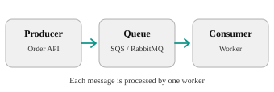
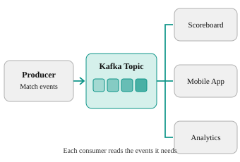
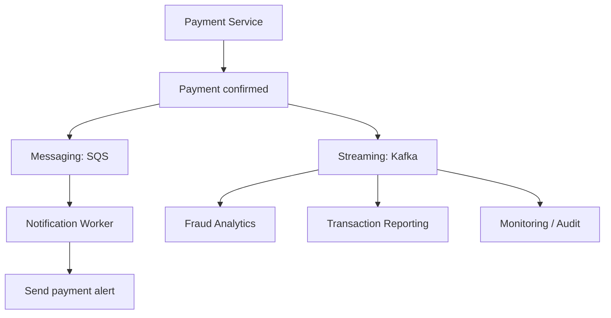

In system design, **Messaging and Streaming are two ways for applications to communicate and exchange data without always waiting for each other.**

The main difference is:

- **Messaging:** "Here is a task. Someone needs to complete it."
- **Streaming:** "Here is something that happened. Multiple systems may need to know about it, now or later."

Here, streaming means **event streaming**, such as Apache Kafka, not video streaming like Netflix.

**system design**, **streaming** refers to **the continuous, real-time transfer and processing of data as it is generated, rather than waiting to deliver or process it in large chunks or batches**

## 1. Messaging — explained in layman's terms

Messaging in system design is an asynchronous communication method where software components send data packets (messages) to each other through an intermediary broker or queue, rather than calling each other directly

Imagine you're ordering food at a restaurant.

You give your order to a waiter, who places it in the kitchen's order queue. A chef picks up the order, prepares the food, and marks it complete.

This is messaging.

**Messaging architecture**

### How messaging works

1. **Producer:** An application creates a message, for example, `Order #101 placed`.
2. **Message Broker:** SQS or RabbitMQ receives the message and puts it in a queue.
3. **Queue:** The message waits until a consumer is available.
4. **Consumer:** A worker receives the message and processes the order.
5. **Acknowledgement (ACK):** The worker confirms successful processing. The broker then removes or marks the message complete according to its design.
6. **Failure:** If processing fails, the message can be retried, and after repeated failures may be moved to a Dead Letter Queue (DLQ).

### Advantages and disadvantages

| Advantages | Disadvantages |
|---|---|
| Producer and consumer work independently | Queue backlog can grow |
| Handles sudden traffic spikes | Duplicate deliveries are possible |
| Failed tasks can be retried | Retry loops require careful handling |
| Multiple workers can process tasks in parallel | Ordering may not be guaranteed |
| Simple for background processing | Standard queues are not designed for long-term event replay |

**Common tools:** Amazon SQS, RabbitMQ, Azure Service Bus.

## 2. Streaming — explained in layman's terms

Streaming in system design is the continuous ingestion, transport, and processing of data in real time as it is generated, rather than collecting and processing it in large, delayed batches

Imagine a cricket match.

Every ball generates an event:

- Ball 1: Four runs.
- Ball 2: Single run.
- Ball 3: Wicket.

The scoreboard, statistics system, mobile application, and commentary system all need to receive these updates.

Instead of creating a separate task for each system, we publish events into a stream.

**Event streaming architecture**

### How streaming works

1. **Producer:** The cricket application generates events.
2. **Broker:** Kafka accepts the events.
3. **Topic:** Events are stored in a topic, such as `match-events`.
4. **Partition:** Kafka distributes events among partitions to handle large volumes. Ordering is maintained within a partition.
5. **Consumer:** The scoreboard, mobile application and analytics systems read events independently.
6. **Offset:** Each consumer group tracks how far it has read in each partition.
7. **Retention:** Kafka keeps events for a configured duration or size limit, even after consumption. Consumers can replay retained events.

For example, an analytics application that was down for 30 minutes can resume reading from its previous offset and catch up, provided those events are still retained.

### Advantages and disadvantages

| Advantages | Disadvantages |
|---|---|
| Processes continuous event data | More operational complexity |
| Multiple services consume the same events independently | Partitioning and ordering need planning |
| Events can be replayed | Retention requires storage |
| High throughput and horizontal scaling | Consumer lag can accumulate |
| Useful for real-time analytics | Duplicate handling and idempotency are needed |

**Common tools:** Apache Kafka, Amazon Kinesis, Apache Pulsar.

## 3. Messaging vs Streaming — interview comparison

| Feature | Messaging | Streaming |
|---|---|---|
| Main purpose | Process tasks | Distribute and process events |
| Typical tool | SQS, RabbitMQ | Kafka, Kinesis |
| Storage model | Queue of pending tasks | Retained event log |
| Consumption | Usually one worker per queue message | Multiple independent consumer groups |
| After processing | Message acknowledged/removed | Event remains until retention expires |
| Replay | Generally limited | Supported within retention |
| Ordering | Depends on queue type | Within a partition |
| Scaling | Add consumer workers | Add partitions and consumers |
| Example | Send an email | Track millions of payment events |

Important distinction: **Streaming is a form of messaging.** These are not completely separate categories. Kafka can process tasks, while some messaging brokers also support publish/subscribe and event retention.

## 4. Components involved and their responsibilities

| Component | Messaging | Streaming |
|---|---|---|
| Producer | Creates task messages | Publishes events |
| Broker | SQS / RabbitMQ | Kafka / Kinesis |
| Queue / Topic | Holds messages | Organizes event streams |
| Consumer | Executes tasks | Processes incoming events |
| ACK / Offset | Confirms completed work | Tracks reading position |
| Retry | Redeliver failed message | Retry processing or replay |
| DLQ | Holds repeatedly failed messages | Often implemented as a separate error topic |
| Storage | Pending messages | Retained event history |

## 5. Real-world example: Google Pay

Since we discussed Google Pay system design, consider a successful UPI payment.

**Using messaging and streaming together**

*Illustrative design: the payment system publishes post-confirmation tasks and events, preferably using a reliable transactional outbox or equivalent mechanism.*

**Messaging:** A task is sent to SQS to trigger the payment notification. One worker handles it, with retries if needed.

**Streaming:** A `PaymentCompleted` event is published to Kafka. Fraud analytics, reporting and monitoring services consume it independently.

The actual payment confirmation must come from the authoritative payment system. Kafka or SQS should not independently decide whether money was transferred.

## 6. What if components fail?

| Failure | What happens | Remediation |
|---|---|---|
| SQS consumer crashes | Message is not acknowledged | Redelivery after visibility timeout |
| Queue backlog increases | Processing becomes delayed | Scale workers, monitor queue age |
| Kafka consumer crashes | Consumer group stops or rebalances | Resume from committed offset |
| Kafka broker fails | Partition availability may be affected | Replication and leader failover |
| Consumer processes twice | Duplicate side effects possible | Idempotency using event/message ID |
| Consumer falls behind | Kafka consumer lag grows | Optimize processing, scale within partition limits |

## 7. Three important interview questions

**Q1. Can Kafka replace SQS?**

Yes, for some workloads. But if the requirement is simply to distribute background tasks with managed retries, SQS may be simpler. If the requirement includes replay, high throughput and multiple independent consumers, Kafka can be a better fit.

**Q2. Does Kafka automatically guarantee exactly-once processing?**

Not for arbitrary end-to-end business operations. Kafka supports exactly-once capabilities for certain Kafka workflows, but external database writes and API side effects still need idempotency or coordinated transactions.

**Q3. What if the consumer is slower than the producer?**

In messaging, the queue backlog grows. In Kafka, consumer lag grows. You can scale consumers, optimize processing, apply backpressure, or limit incoming traffic. In Kafka, parallelism within a consumer group is also constrained by the number of partitions.

---

## 8. What to say in your Apple SRE interview

> Messaging is typically used for asynchronous task processing, where a producer places a message into a queue and a consumer processes and acknowledges it. Streaming is used for continuous event processing, where events are retained in a log and multiple consumer groups can independently process and replay them. For simple background jobs, I would consider SQS or RabbitMQ; for high-throughput event processing, analytics and replay requirements, I would consider Kafka.

**One concept to remember:**

**Queue = Who will do this work?**

**Stream = What happened, and which systems need to react?**
