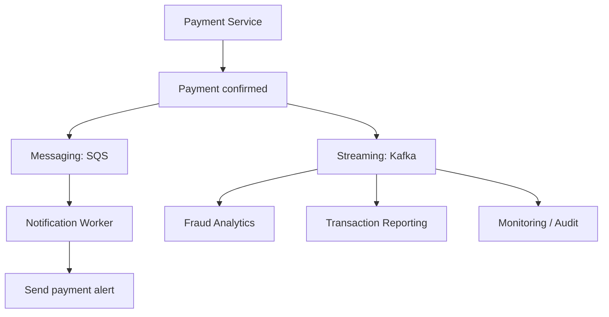

In system design, **Messaging and Streaming are two ways for applications to communicate and exchange data without always waiting for each other.**

The main difference is:

- **Messaging:** "Here is a task. Someone needs to complete it."
- **Streaming:** "Here is something that happened. Multiple systems may need to know about it, now or later."

Here, streaming means **event streaming**, such as Apache Kafka, not video streaming like Netflix.

**system design**, **streaming** refers to **the continuous, real-time transfer and processing of data as it is generated, rather than waiting to deliver or process it in large chunks or batches**

## 1. Messaging — explained in layman's terms

Messaging in system design is an asynchronous communication method where software components send data packets (messages) to each other through an intermediary broker or queue, rather than calling each other directly

Imagine you're ordering food at a restaurant.

You give your order to a waiter, who places it in the kitchen's order queue. A chef picks up the order, prepares the food, and marks it complete.

This is messaging.

**Messaging architecture**

### How messaging works

1. **Producer:** An application creates a message, for example, `Order #101 placed`.
2. **Message Broker:** SQS or RabbitMQ receives the message and puts it in a queue.
3. **Queue:** The message waits until a consumer is available.
4. **Consumer:** A worker receives the message and processes the order.
5. **Acknowledgement (ACK):** The worker confirms successful processing. The broker then removes or marks the message complete according to its design.
6. **Failure:** If processing fails, the message can be retried, and after repeated failures may be moved to a Dead Letter Queue (DLQ).

### Advantages and disadvantages

| Advantages | Disadvantages |
|---|---|
| Producer and consumer work independently | Queue backlog can grow |
| Handles sudden traffic spikes | Duplicate deliveries are possible |
| Failed tasks can be retried | Retry loops require careful handling |
| Multiple workers can process tasks in parallel | Ordering may not be guaranteed |
| Simple for background processing | Standard queues are not designed for long-term event replay |

**Common tools:** Amazon SQS, RabbitMQ, Azure Service Bus.

## 2. Streaming — explained in layman's terms

Streaming in system design is the continuous ingestion, transport, and processing of data in real time as it is generated, rather than collecting and processing it in large, delayed batches

Imagine a cricket match.

Every ball generates an event:

- Ball 1: Four runs.
- Ball 2: Single run.
- Ball 3: Wicket.

The scoreboard, statistics system, mobile application, and commentary system all need to receive these updates.

Instead of creating a separate task for each system, we publish events into a stream.

**Event streaming architecture**

### How streaming works

1. **Producer:** The cricket application generates events.
2. **Broker:** Kafka accepts the events.
3. **Topic:** Events are stored in a topic, such as `match-events`.
4. **Partition:** Kafka distributes events among partitions to handle large volumes. Ordering is maintained within a partition.
5. **Consumer:** The scoreboard, mobile application and analytics systems read events independently.
6. **Offset:** Each consumer group tracks how far it has read in each partition.
7. **Retention:** Kafka keeps events for a configured duration or size limit, even after consumption. Consumers can replay retained events.

For example, an analytics application that was down for 30 minutes can resume reading from its previous offset and catch up, provided those events are still retained.

### Advantages and disadvantages

| Advantages | Disadvantages |
|---|---|
| Processes continuous event data | More operational complexity |
| Multiple services consume the same events independently | Partitioning and ordering need planning |
| Events can be replayed | Retention requires storage |
| High throughput and horizontal scaling | Consumer lag can accumulate |
| Useful for real-time analytics | Duplicate handling and idempotency are needed |

**Common tools:** Apache Kafka, Amazon Kinesis, Apache Pulsar.

## 3. Messaging vs Streaming — interview comparison

| Feature | Messaging | Streaming |
|---|---|---|
| Main purpose | Process tasks | Distribute and process events |
| Typical tool | SQS, RabbitMQ | Kafka, Kinesis |
| Storage model | Queue of pending tasks | Retained event log |
| Consumption | Usually one worker per queue message | Multiple independent consumer groups |
| After processing | Message acknowledged/removed | Event remains until retention expires |
| Replay | Generally limited | Supported within retention |
| Ordering | Depends on queue type | Within a partition |
| Scaling | Add consumer workers | Add partitions and consumers |
| Example | Send an email | Track millions of payment events |

Important distinction: **Streaming is a form of messaging.** These are not completely separate categories. Kafka can process tasks, while some messaging brokers also support publish/subscribe and event retention.

### Fundamental differences — data lifecycle and processing

The actual fundamental difference between the two lies in how the data is treated after it is read (destruction vs. persistence) and whether the data is processed as standalone tasks or a continuous history.

Here is a direct comparison to clarify how they truly differ:

| Attribute | Messaging Systems (e.g., RabbitMQ, SQS) | Streaming Systems (e.g., Apache Kafka, Kinesis) |
|---|---|---|
| Data Lifecycle | Destructive. Once a consumer reads and acknowledges a message, it is deleted from the queue. | Persistent. Data is appended to an immutable log and stays there for a set retention period, even after being read. |
| Replayability | No. You cannot re-read or "rewind" to get past messages because they are gone. | Yes. Multiple consumers can re-read or replay historical data from any point in time. |
| Data Nature | Discrete Commands / Tasks. Each message is an independent action item (e.g., "Generate PDF Report #402"). | Continuous Facts / Events. A continuous stream of related occurrences (e.g., sensor telemetry or GPS coordinates). |
| Primary Goal | Task Delegation. Decoupling components and distributing a workload across workers. | Data Pipelines & Analytics. Tracking chronological history and analyzing data patterns over time. |

*Scope note: The comparison describes common traditional queue vs. retained-log designs, rather than every product configuration. For SQS, successful processing usually requires an explicit delete after receipt; acknowledgement by itself is not the same API operation. Some messaging systems support replay, while Kafka/Kinesis replay is limited to the configured retention window.*

## 4. Components involved and their responsibilities

| Component | Messaging | Streaming |
|---|---|---|
| Producer | Creates task messages | Publishes events |
| Broker | SQS / RabbitMQ | Kafka / Kinesis |
| Queue / Topic | Holds messages | Organizes event streams |
| Consumer | Executes tasks | Processes incoming events |
| ACK / Offset | Confirms completed work | Tracks reading position |
| Retry | Redeliver failed message | Retry processing or replay |
| DLQ | Holds repeatedly failed messages | Often implemented as a separate error topic |
| Storage | Pending messages | Retained event history |

## 5. Real-world example: Google Pay

Since we discussed Google Pay system design, consider a successful UPI payment.

**Using messaging and streaming together**

*Illustrative design: the payment system publishes post-confirmation tasks and events, preferably using a reliable transactional outbox or equivalent mechanism.*

**Messaging:** A task is sent to SQS to trigger the payment notification. One worker handles it, with retries if needed.

**Streaming:** A `PaymentCompleted` event is published to Kafka. Fraud analytics, reporting and monitoring services consume it independently.

The actual payment confirmation must come from the authoritative payment system. Kafka or SQS should not independently decide whether money was transferred.

## 6. What if components fail?

| Failure | What happens | Remediation |
|---|---|---|
| SQS consumer crashes | Message is not acknowledged | Redelivery after visibility timeout |
| Queue backlog increases | Processing becomes delayed | Scale workers, monitor queue age |
| Kafka consumer crashes | Consumer group stops or rebalances | Resume from committed offset |
| Kafka broker fails | Partition availability may be affected | Replication and leader failover |
| Consumer processes twice | Duplicate side effects possible | Idempotency using event/message ID |
| Consumer falls behind | Kafka consumer lag grows | Optimize processing, scale within partition limits |

## 7. Three important interview questions

**Q1. Can Kafka replace SQS?**

Yes, for some workloads. But if the requirement is simply to distribute background tasks with managed retries, SQS may be simpler. If the requirement includes replay, high throughput and multiple independent consumers, Kafka can be a better fit.

**Q2. Does Kafka automatically guarantee exactly-once processing?**

Not for arbitrary end-to-end business operations. Kafka supports exactly-once capabilities for certain Kafka workflows, but external database writes and API side effects still need idempotency or coordinated transactions.

**Q3. What if the consumer is slower than the producer?**

In messaging, the queue backlog grows. In Kafka, consumer lag grows. You can scale consumers, optimize processing, apply backpressure, or limit incoming traffic. In Kafka, parallelism within a consumer group is also constrained by the number of partitions.

---

## 8. What to say in your Apple SRE interview

> Messaging is typically used for asynchronous task processing, where a producer places a message into a queue and a consumer processes and acknowledges it. Streaming is used for continuous event processing, where events are retained in a log and multiple consumer groups can independently process and replay them. For simple background jobs, I would consider SQS or RabbitMQ; for high-throughput event processing, analytics and replay requirements, I would consider Kafka.

**One concept to remember:**

**Queue = Who will do this work?**

**Stream = What happened, and which systems need to react?**
---

## 9. Message Queues — Fast Interview Revision (Video Follow-up)

**Reference:** [Message Queues in System Design — YouTube](https://www.youtube.com/watch?v=1ISRd0bS714)

This section adds practical interview talking points and deeper failure scenarios without replacing any earlier messaging or streaming notes.

### 9.1 What is a message queue?

A **message queue** is an intermediary buffer between a **producer** and a **consumer** that enables asynchronous processing: the producer submits work without waiting for a worker to finish it.

\`\`\`text
Producer --> Message Queue --> Consumer / Worker
               (buffers)        (processes)
\`\`\`

**Four reasons to use it:**
1. **Asynchronous execution:** Return a response without waiting for background processing.
2. **Decoupling:** Producer and consumer can deploy, fail, and scale independently.
3. **Buffering traffic spikes:** Temporarily absorb bursts while workers catch up.
4. **Reliability:** A suitably configured durable queue holds accepted work during transient consumer failures.

**Example:** An image-upload API stores the original in S3, enqueues a thumbnail job in SQS, and returns \`202 Accepted\`. Workers resize the image later.

> **Interview memory hook:** **Queue = Who will do this work?** **Stream = What happened, and who needs to react?**

### 9.2 Exact queue processing and failure flow

\`\`\`text
Producer
   |
   v
Queue (e.g., SQS)
   |
   v
Consumer receives message
   |
   +-- Process successfully --> ACK / delete --> Done
   |
   +-- Processing fails / worker crashes
          |
          v
       Retry / redelivery after visibility timeout
          |
          +-- Retry succeeds --> ACK / delete
          |
          +-- Retry limit reached --> DLQ --> Inspect / fix / redrive
\`\`\`

**ACK only after successful processing.** In SQS specifically, a consumer **deletes** the message when it finishes; receiving the message only makes it invisible for the configured visibility timeout. RabbitMQ has broker acknowledgements.

**Poison message:** A malformed or consistently failing message can get redelivered forever unless retries are bounded. Configure a maximum receive/retry count, **DLQ**, backoff where applicable, and alert on DLQ depth. Fix the underlying issue before replaying DLQ messages.

### 9.3 Delivery guarantees: most important distinction

| Guarantee | Meaning | Trade-off / mitigation |
|---|---|---|
| **At-most-once** | Process zero or one time; failures may lose work | Lower duplicate risk, but potential loss |
| **At-least-once** | Retry until delivery/processing is acknowledged under the system's configured guarantees | May process twice; **make side effects idempotent** |
| **Exactly-once** | Each logical business action has one effect | Difficult end-to-end across DB/API boundaries; use idempotency, transactions, and reconciliation |

**Critical failure example:**

\`\`\`text
Consumer receives message M123
  --> DB transaction commits successfully
  --> Consumer crashes BEFORE ACK
  --> Queue redelivers M123
  --> New consumer sees M123 already processed
  --> Skips duplicate business side effect; then ACKs
\`\`\`

A robust implementation persists a unique **message ID / idempotency key** with the business update in one atomic database transaction. Kafka's exactly-once features do **not** automatically make external payments, DB writes, or HTTP calls exactly-once.

### 9.4 Backpressure: a queue does not eliminate overload

If the producer sends **300 messages/sec** but consumers handle only **200 messages/sec**, backlog increases at roughly **100 messages/sec**.

**Respond by:**
- Scaling out consumers if capacity and downstream dependencies permit.
- Improving processing throughput and applying batching where safe.
- Rate-limiting or throttling producers / rejecting excess new work.
- Monitoring **queue depth**, **oldest-message age**, **processing latency**, **failure rate**, and **DLQ depth**.
- Applying bounded retries with exponential backoff and jitter; otherwise retries can create a storm.

**Interview line:** *A queue absorbs temporary bursts; if incoming rate remains higher than processing rate, delay grows without bound.*

### 9.5 Ordering, partition keys, and scaling

- Ordering depends on the technology and configuration: **SQS Standard** does not guarantee strict order; **SQS FIFO** supports order within message groups; **Kafka** preserves order **within a partition**, not across all partitions.
- For payment/account events, use an \`account_id\` partition or message-group key when actions for the same account must stay ordered.
- **Hot partition risk:** A small number of extremely busy keys can cause uneven load and consumer lag.
- In Kafka, increasing partitions enables greater potential parallelism; within a **consumer group**, active partition processing is limited by the number of partitions.
- Adding workers alone may not help if partitions, FIFO message groups, database connection pools, or downstream APIs are the actual bottleneck.

### 9.6 When NOT to introduce a queue

Avoid adding a queue solely for fashion if the user needs an **immediate synchronous result**, for example retrieving the current bank account balance. A queue adds operational complexity, eventual completion, and coordination requirements.

An API may still synchronously validate a request and commit its authoritative state, then enqueue noncritical follow-up tasks asynchronously.

### 9.7 Durability and broker failures

| Failure | What can happen | What to design / monitor |
|---|---|---|
| Consumer pod crashes | Unacknowledged work returns for redelivery | Visibility timeout / ACK semantics; idempotency |
| Poison message | Repeated failures and retry storm | Retry cap, DLQ, alerting and safe redrive |
| Queue backlog grows | High end-to-end processing latency | Queue depth, message age, consumer capacity, throttle |
| Broker or AZ fails | Temporary unavailability or data risk depending on broker configuration | Managed HA or replicated durable queues; validate durability and failover guarantees |
| Duplicate delivery | Duplicate business effects if consumer is unsafe | Atomic idempotency-key check + transaction |
| Downstream DB is slow | Workers pile up and may exhaust DB connections | Bounded concurrency, timeouts, backoff, circuit breaker |

**Technology choice:** For simple background jobs and managed retry/DLQ capabilities, consider **SQS**. For broker-based task routing consider **RabbitMQ**. For high-throughput retained event history, replay and independent consumer groups, consider **Kafka**.

### 9.8 30-second system design interview answer

> I would introduce a message queue when work can be processed asynchronously, to decouple services, absorb temporary traffic spikes and make retries reliable. I would use at-least-once delivery with idempotent consumers, acknowledge only after successful processing, configure bounded retries and a DLQ, and monitor queue depth and oldest-message age. For scaling, I would add workers while checking downstream limits and ordering constraints. If producers consistently exceed consumers, I would apply backpressure rather than assuming the queue solves overload.

**Eight things to remember:** **ASYNC · BUFFER · ACK · RETRY · DLQ · SCALE · ORDER · IDEMPOTENCY**

### 9.9 Comparison against the earlier sections of this document

**Already covered earlier:** producer/broker/consumer, asynchronous messaging, ACK, retry, DLQ, SQS visibility timeout, Kafka partitions, consumer groups, offsets, replay, duplicate handling and Kafka vs SQS.

**Expanded here for interview readiness:** at-most-once vs at-least-once vs exactly-once, when not to use queues, partition-key selection and hot partitions, overload/backpressure math, poison-message controls, queue durability and operational alerts.
