# Real-Time Messaging System — Consolidated System Design Notes (Apple ASE SRE R23-D02)

> **Purpose:** Progressive, interview-ready revision of the Alice ↔ Bob real-time messaging system. This consolidates the exact concepts, corrections, scenarios, and follow-up questions practiced in the tutoring session. Read one component at a time rather than memorizing the whole system in one sitting.
>
> **Related notes:** [WhatsApp lecture notes](../rocking%20system%20design/03_whatsapp_one_to_one_messaging.md) · [Apple ASE SRE 7-day plan, Section 12.4](https://github.com/Johnybritto/Interview/blob/main/Apple_ASE_SRE_7_Day_Interview_Preparation_Plan.md)
>
> **Scope:** Proposed design for interview practice, **not** a description of Apple's internal system. Primary example uses **AWS + EKS**; Azure equivalents are included in brackets. One-to-one text messages are the base case; mention groups and multiple devices when asked.

---

## 1. What are we designing? — Start with requirements

**Functional:** Alice and Bob can open the app, establish a live connection, send messages, get **accepted/delivered/read** statuses, retrieve history, receive messages after reconnecting, and avoid duplicates.

**Non-functional questions to clarify with interviewer:** Daily and concurrent users; peak messages/sec and fan-out; p95/p99 send and online-delivery latency; availability target; ordering **within a conversation**, security/privacy; message retention; offline-sync expectation; acceptable RTO and RPO.

Example assumptions (illustrative, *not production measurements*): millions of users, many persistent connections, message acceptance within a few hundred milliseconds, online delivery around a second under healthy conditions, and three-AZ deployment.

**Key contract:** An **ACCEPTED** ACK means the message has been durably committed according to the chosen database guarantees. It does **not** mean Bob has received or read it.

### API Contracts — Point 1: API Contract Summary

For this architecture, **WebSocket events** handle real-time messaging while **REST APIs** handle conversation setup and message history/offline synchronization. These are illustrative interview contracts.

| API / Event | Protocol | Purpose |
|---|---|---|
| `POST /v1/conversations` | REST | Create a conversation |
| `GET /v1/conversations/{id}/messages` | REST | Retrieve history and offline messages |
| `message.send` | WebSocket | Alice sends a message |
| `message.delivery_ack` | WebSocket | Bob confirms his app received the message |
| `message.read` | WebSocket | Bob reports reading messages |
| `presence.heartbeat` | WebSocket | Refresh online presence / connection state |

### API Contracts — Point 2: Exact Message Flow and Events

```text
Alice --message.send--> WebSocket Gateway --> Messaging Service
                                               |
                                               v
                              DynamoDB atomic commit (message + outbox)
                                               |
                               message.accepted <--+-- ACK to Alice
                                               |
                                               v
                                Outbox Publisher --> Kafka
                                                    |
                                                    v
                                               Delivery Worker
                                                    |
                                              Redis lookup
                                                    |
                                                    v
                                            Bob's WebSocket Gateway
                                                    |
                                             message.new --> Bob
                                                    |
                                    Bob --message.delivery_ack-->
                                                    |
                                     Save receipt; notify Alice
```

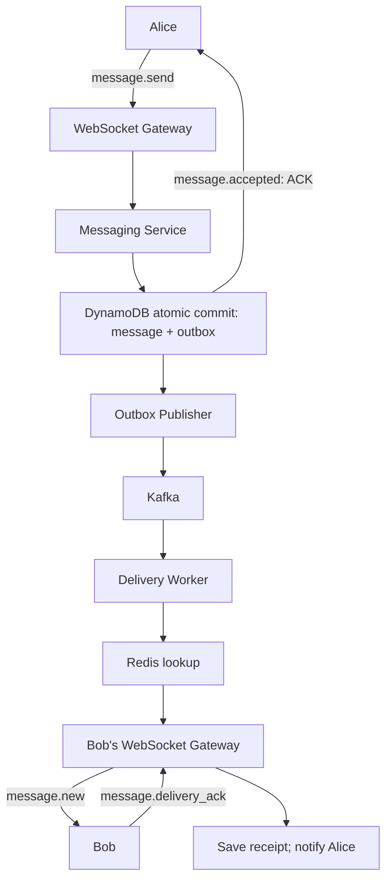

**A. Alice sends a message — WebSocket `message.send`**

```json
{
  "type": "message.send",
  "clientMessageId": "uuid-123",
  "conversationId": "conv-100",
  "payload": {
    "type": "text",
    "text": "Hello Bob"
  }
}
```

Messaging Service validates Alice's identity and conversation membership, checks `clientMessageId` for an existing send, then atomically stores the message, authoritative sequence, idempotency record and outbox event.

**Response to Alice only after durable DB commit — `message.accepted`:**

```json
{
  "type": "message.accepted",
  "clientMessageId": "uuid-123",
  "messageId": "msg-105",
  "conversationId": "conv-100",
  "sequence": 105,
  "status": "ACCEPTED",
  "serverTimestamp": "2026-10-24T10:00:00Z"
}
```

**B. Bob receives the message — server-to-client `message.new`**

```json
{
  "type": "message.new",
  "conversationId": "conv-100",
  "messageId": "msg-105",
  "sequence": 105,
  "senderId": "alice",
  "payload": {
    "type": "text",
    "text": "Hello Bob"
  }
}
```

**Bob acknowledges receipt — `message.delivery_ack`:**

```json
{
  "type": "message.delivery_ack",
  "messageId": "msg-105",
  "conversationId": "conv-100",
  "deviceId": "bob-iphone"
}
```

The backend validates the ACK, updates durable delivery state and notifies Alice. A gateway socket write alone is **not** a device delivery ACK.

**C. Bob reads the message — WebSocket `message.read`**

```json
{
  "type": "message.read",
  "conversationId": "conv-100",
  "lastReadSequence": 105,
  "deviceId": "bob-iphone"
}
```

**Alice receives the resulting receipt update:**

```json
{
  "type": "message.receipt_updated",
  "conversationId": "conv-100",
  "lastReadSequence": 105,
  "status": "READ"
}
```

Read positions are validated against Bob's authenticated identity, conversation membership and permitted message range. **ACCEPTED ≠ PUBLISHED ≠ DELIVERED ≠ READ.**

### Database Fields — Five Core Tables

For the **DynamoDB + Kafka + Redis** messaging design, these are **five logical durable tables** with the interview-important fields only.

**1. Conversations — who is chatting?**

| Field | Why it exists |
|---|---|
| `conversationId` (PK) | Unique conversation identifier |
| `participantIds` | Alice/Bob membership for chat authorization |
| `lastSequence` | Coordinate per-conversation message ordering |
| `createdAt` | Conversation creation time |
| `updatedAt` | Last activity time |

**2. Messages — what was sent?**

| Field | Why it exists |
|---|---|
| `conversationId` (PK) | Query messages for one chat |
| `sequence` (SK) | Read messages in conversation order |
| `messageId` | Stable ID for deduplication and receipts |
| `senderId` | Identify message author |
| `payload` | Store message content (ciphertext where E2EE applies) |
| `createdAt` | Persist server creation time |

**3. Idempotency — was it already sent?**

| Field | Why it exists |
|---|---|
| `senderId` (PK) | Scope a client's message ID to the sender |
| `clientMessageId` (SK) | Identify repeated send attempts |
| `messageId` | Return original saved message on retry |
| `payloadHash` | Reject reuse of a key with changed content |
| `createdAt` | Audit and retention |

Use the unique `(senderId, clientMessageId)` combination with atomic/conditional checking.

**4. Outbox — did the event reach Kafka?**

| Field | Why it exists |
|---|---|
| `eventId` (PK) | Unique publication event |
| `messageId` | Reference the saved message |
| `conversationId` | Partition delivery events by chat |
| `status` | `PENDING` / `PUBLISHED` lifecycle |
| `createdAt` | Measure stuck event age |
| `publishedAt` | Know when Kafka acknowledged the publication |

Outbox records must be written **in the same atomic transaction** as the message; publisher completion does not imply delivery to Bob.

**5. DeviceSync / Receipts — what has each device received/read?**

| Field | Why it exists |
|---|---|
| `userId` | Recipient/user identity |
| `deviceId` | Distinguish Bob's phone from laptop |
| `conversationId` | Scope progress to the conversation |
| `lastDeliveredSeq` | Highest contiguous sequence delivered to this device |
| `lastReadSeq` | Highest sequence reported read |
| `lastSyncedSeq` | Resume after disconnection |

Use a unique composite identity for **user + device + conversation** (possibly encoded across DynamoDB PK/SK), so syncing one device doesn't accidentally advance another device.

**Database flow to remember:**

```text
Alice message.send
   --> Conversations (membership + ordered sequence)
   --> Idempotency (duplicate check)
   --> Messages (durable message)
   --> Outbox (pending Kafka event)
            [atomic transaction before ACCEPTED ACK]
   --> Kafka --> Delivery Worker --> Redis gateway lookup
   --> Bob device --> DeviceSync / Receipts (delivery/read progress)
```

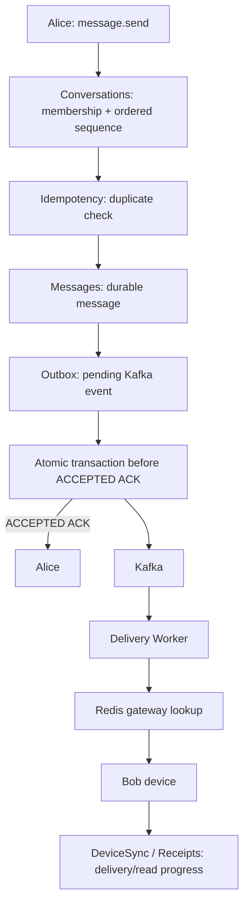

**Memory shortcut:** **Conversations = who; Messages = what; Idempotency = already?; Outbox = published?; DeviceSync = delivered/read where?**

Redis is **not** one of these durable tables. It maintains temporary `userId/deviceId → gatewayId/connectionId` mappings with TTL.

---

## 2. Component selection — what, why, where?

| # | Component | AWS / EKS implementation | Azure equivalent | Why do we need it? |
|---|---|---|---|---|
| 1 | DNS/global routing | Route 53 + regional health/routing | Azure DNS + Traffic Manager / Front Door | Resolve stable hostname and choose a healthy region |
| 2 | Load balancer | NLB forwarding TCP/WSS (or ALB for HTTP-aware routing) | Azure Load Balancer / Application Gateway | Distribute initial connections to healthy gateways |
| 3 | WebSocket gateway | Custom Go/Java/Node app in EKS Deployment | Custom AKS pod or Azure Web PubSub | Maintain live bidirectional connections |
| 4 | Messaging service | Stateless EKS application Deployment | AKS application Deployment | Validate authorization, idempotency, sequence and writes |
| 5 | Message database | DynamoDB (design choice, not mandatory) | Cosmos DB / transactional store | Durable conversation history, idempotency and outbox |
| 6 | Outbox publisher | Custom EKS worker or Debezium/Kafka Connect | Worker/CDC publisher | Reliably get committed events into a broker |
| 7 | Broker | Kafka on Amazon MSK | Event Hubs using Kafka protocol, or other suitable ordered broker | Buffer and asynchronously distribute message-created events |
| 8 | Delivery worker | EKS Kafka consumer pods | AKS consumer pods | Find destination, route to gateway, retry/deduplicate |
| 9 | Presence store | ElastiCache for Redis | Azure Managed Redis / equivalent | Map user/device to active gateway/connection with TTL |
| 10 | Recipient gateway | Same WebSocket gateway service as #3 | Same WebSocket service | Push to Bob over existing socket; accept recipient ACK |

**Memory line:** DNS finds the service; load balancer chooses a gateway; gateway keeps the connection; Messaging Service validates; database remembers; outbox guarantees retriable publication; Kafka buffers events; worker delivers; Redis locates Bob; Bob ACKs receipt.

### 2.1 DNS, NLB, ALB and API Gateway (steps 1–2)

- Alice opens an app configured with a hostname such as **messaging.example.com**. The **client/OS resolver** resolves DNS; it is not the backend API calling DNS for each message.
- Global routing may direct clients to a healthy region. NLB forwards the initial TCP connection to a gateway pod. TLS terminates at the appropriate configured endpoint (load balancer or gateway).
- **NLB** is L4/TCP and appropriate for our model. **ALB** is L7, also supports WebSocket upgrades and is useful for HTTP routing. Never claim NLB is **always** faster merely because it is L4.
- **API Gateway WebSocket APIs** are a managed AWS alternative to custom connection-gateway pods; **Azure Web PubSub** is a managed Azure real-time option. They are not hardware components.
- After the connection is established, Alice's messages use **the same WebSocket**; no fresh DNS lookup or new connection is needed for each message.

**Memory line:** NLB/ALB **routes** a connection; WebSocket Gateway **manages** the established application session.

### 2.2 WebSocket Gateway pod (step 3)

- A WebSocket gateway is **application software running in a pod** in our EKS/AKS design; alternatively a cloud provider can manage it.
- Alice establishes a secure WebSocket (**WSS**) connection after the HTTP upgrade/connection setup. The gateway checks auth, tracks the live connection, exchanges heartbeats, and forwards incoming message events to the Messaging Service.
- **HTTPS REST versus WebSocket:** Ordinary REST is a client-initiated request/response interaction. WebSocket provides a **persistent, full-duplex** connection: the server may push a message to Alice/Bob without a new REST request. HTTPS can also return responses—bidirectional data alone is not the distinction.
- Gateway pods may be replicated across AZs. Existing TCP sockets cannot move intact when a pod dies; client reconnects via the load balancer, reauthenticates, and resumes missing message history.
- The gateway is *not* the authoritative persistent message store.

Mini example:

~~~text
Alice → DNS → NLB → WebSocket Gateway Pod 1
                       |
               persistent WSS socket
                       |
                 Messaging Service
~~~

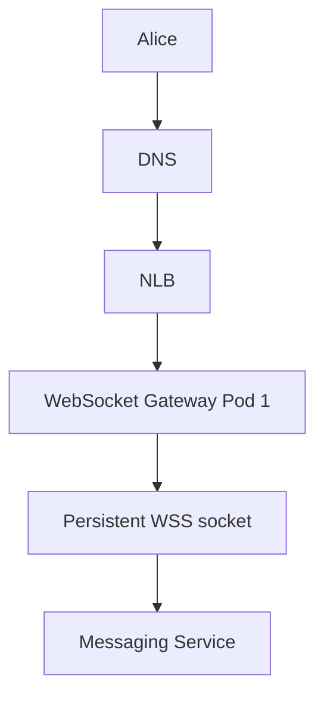

**Memory line:** Gateway pod fails → reconnect + authenticate + synchronize; no accepted message is lost merely because the socket died.

### 2.3 Messaging Service pod (step 4)

Receives a message over the established gateway connection, then:
1. verifies Alice's authenticated identity and that she is a member of Bob's conversation;
2. checks payload/rate limits and validates the request;
3. checks sender-scoped **clientMessageId** for idempotency/retries;
4. allocates a per-conversation sequence **safely/atomically**;
5. commits message + idempotency result + delivery outbox event to database;
6. returns **ACCEPTED** to Alice only after a successful durable commit.

Example event:

~~~json
{
  "conversationId": "conv-100",
  "senderId": "alice",
  "recipientId": "bob",
  "clientMessageId": "alice-uuid-123",
  "payload": "Hello Bob"
}
~~~

**Memory line:** Messaging Service decides **whether** this message is valid and whether it is **new**; the database confirms it is **durable**.

### 2.4 Database selection, structure, atomicity, partitioning and replication (step 5)

**Why choose DynamoDB here?**
- Managed key-value/document database with predictable **conversationId** access, low-latency key queries and automatic physical partitioning.
- Built-in multi-AZ durability/availability within an AWS region.
- Supports conditional writes and transactional writes **within a region**, useful for message + idempotency + outbox consistency.
- It is a *reasonable option*, not the only valid database. PostgreSQL/Aurora can provide strong SQL transactions; Cassandra/ScyllaDB can scale writes but require different coordination for strict sequence and cross-record atomic behavior.

**One logical Messages table, NOT a table per conversation:**

| PK: conversationId | SK: sequence | senderId | payload |
|---|---:|---|---|
| conv-100 | 101 | Alice | Hello Bob |
| conv-100 | 102 | Bob | Hi Alice |
| conv-200 | 101 | Alice | Hello Charlie |
| conv-200 | 102 | Charlie | Hi Alice |
| conv-300 | 101 | David | Hello Bob |

- **Partition key = conversationId**: efficient lookup of the full conversation, regardless of sender.
- **Sort key = sequence**: retrieve messages in conversation order.
- **clientMessageId**: idempotency key; separately persisted with an atomic uniqueness/conditional-write rule, scoped to sender/client identity.
- **Conversation metadata/membership**: separate data model for users, access, and membership (do not depend on messages alone).
- **Outbox records**: durable delivery events linked to accepted messages.
- **Device receipt/cursor data**: separate state for last delivered/read/synchronized sequence.

**Why not senderId as PK?** Alice's and Bob's messages would be separated and retrieving the combined timeline would be less efficient. **Why not clientMessageId as PK?** It detects retries but does not organize conversation history.

**What does atomically mean?** All changes in one database transaction commit together, or none do:

~~~text
BEGIN ATOMIC TRANSACTION
  ├─ Save Message (conversation 100, seq 105)
  ├─ Save idempotency result (alice, uuid-123)
  ├─ Update/validate conversation sequence ownership
  └─ Save Outbox event (event-105)
COMMIT → ACCEPTED ACK to Alice
~~~

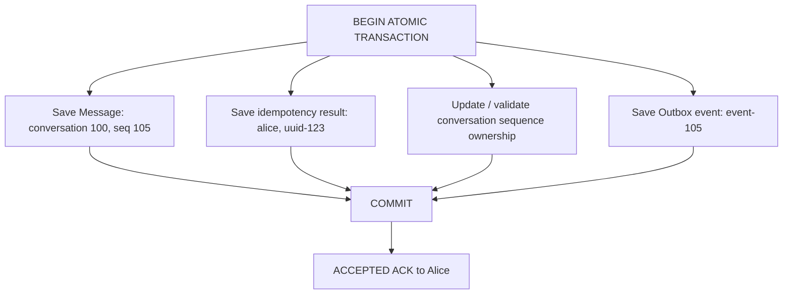

If the outbox write fails **before commit**, the transaction does not commit; do **not** acknowledge success.

**Technical sequencing nuance:** The authoritative sequence must be allocated under a conditional-write/transaction or fenced conversation ownership. DynamoDB does not magically provide a gap-free increment from multiple concurrent Messaging Service pods. An implementation can use optimistic concurrency (read current version/sequence, conditionally transactionally update it and insert message, retry on conflict) or a fenced conversation sequencer. Sequence gaps might be permitted under some designs; define requirements.

**Sharding vs replication:**

~~~text
ONE logical Messages table
      |
      | PARTITIONING / SHARDING (scale)
      +-- physical partition A: many conversation keys
      +-- physical partition B: other keys
      +-- physical partition C: other keys

Each physical partition's data is replicated
across AZs by the managed database (availability/durability).
~~~

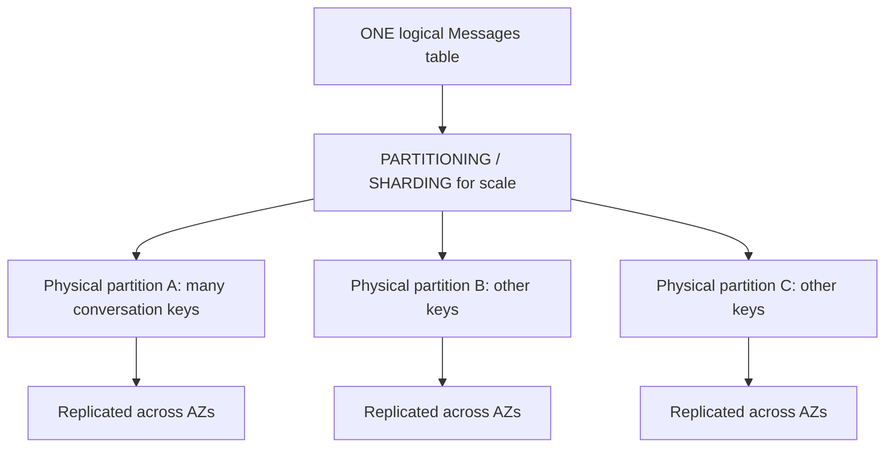

- DynamoDB decides physical partition distribution; **conversationId does not create one physical partition per chat**. A huge/hot conversation can still stress one partition-key access pattern.
- **Sharding/partitioning = spread data and workload**. **Replication = store copies for availability and durability**.
- **Multi-AZ** replication comes with regional DynamoDB; **multi-region** replication is separately configured (e.g., Global Tables).
- Standard DynamoDB Global Tables replicate across regions asynchronously and allow multi-region writes, so they are **not automatically a single-primary/synchronous-zero-RPO mechanism**. Preserve a logical **single writer per conversation** if strict order is required and define replication conflicts/failover policy carefully.

**Memory line:** DynamoDB table = all conversations; conversationId = group; sequence = order; clientMessageId = dedup; sharding = scale; replication = resilience.

### 2.5 Transactional Outbox + Outbox Publisher (step 6)

**What is an outbox?** A durable database record describing an event that *still needs to be published*. It is not Kafka.

**What is the publisher?** Application logic: an independent **Outbox Publisher Deployment** (pods), a background worker in Messaging Service, or CDC tooling such as Debezium + Kafka Connect. It uses the **Kafka producer client** to publish the event.

**Why not write DB and Kafka directly?** Dual-write failure: database message commit succeeds but Messaging Service crashes **before** Kafka publication. Bob's real-time delivery event is missing. The outbox is committed in the same transaction as the message, and another publisher can retry.

~~~text
Messaging Service
   |
   └─ Database transaction:
       Messages: msg-105 COMMITTED
       Outbox: event-105 PENDING
                   |
                   v
          Outbox Publisher Pod
                   |
                Kafka producer client
                   |
                   v
              Kafka Broker
                   |
            Broker publish ACK
                   |
                   v
          Outbox marked PUBLISHED
~~~

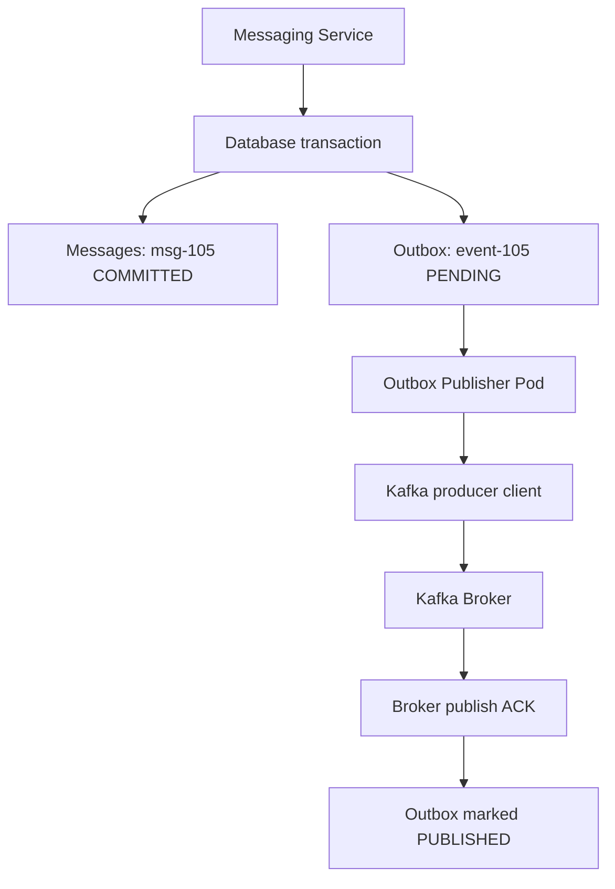

- **PENDING → PUBLISHED** means Kafka acknowledged receipt (using the configured producer/broker durability settings); **NOT** that Bob received the message.
- If publisher crashes **before publishing**, a restarted/other publisher reprocesses the durable pending event.
- If publisher crashes **after Kafka ACK but before marking PUBLISHED**, it may publish **again**; consumer must deduplicate on stable event/message ID.
- Multiple publisher pods coordinate using database claims/leases/locking or a CDC approach; retries remain possible.
- If Kafka is down, outbox records build up; measure **oldest pending age and backlog size**, throttle new sends only if limits require it.

**Memory line:** Atomic DB write prevents **missing events**; publisher retries prevent **stuck events**; consumer dedup prevents **duplicate effects**.

### 2.6 Kafka / message broker (step 7)

- Kafka is an **asynchronous durable event log/broker**, not a WebSocket gateway and not the conversation-history source of truth.
- Separates persistence from delivery, buffers bursts, lets workers scale, and permits replay after transient failures.
- **Kafka does not automatically send an event to a WebSocket client.** Delivery Worker pods **poll/consume** from Kafka.
- Use **conversationId as partition key** for related ordering. Kafka preserves order **within a partition**; application delivery still needs sequence checks.
- **Kafka offset:** a numbered position **within a Kafka partition**. After required processing succeeds, consumer commits its progress. If worker crashes **before committing**, another worker in the consumer group can replay. Processing may happen twice; deduplicate.
- Example: after successfully processing offset 102, commit the **next position, 103**. Kafka offset is **not** the conversation sequence number (e.g., message sequence 105).
- Be precise about the processing contract: an offset should not be committed if the message would otherwise be irretrievably lost; a durable handoff or idempotent retry/reconciliation mechanism is required. Waiting on slow recipients may require a separate durable delivery state rather than holding a whole partition indefinitely.

**Memory line:** Kafka = *buffer + distribute + replay events*; offset = *consumer's progress bookmark*.

### 2.7 Delivery Worker pod (step 8)

- A consumer application running as an EKS/AKS Deployment.
- Reads message-created events; checks Bob's active device(s) through Redis; routes to the owning WebSocket gateway.
- Handles transient failures with bounded retries/backoff, idempotent event processing and stable message IDs.
- Why can't Kafka do this directly? Kafka **does not know Bob's user-to-gateway connection mapping or perform custom application delivery logic**.
- If delivery worker dies after polling but before offset commit, consumer-group rebalance/restart allows replay. If Bob already received the event, Bob's app deduplicates.

**Memory line:** Kafka gives the worker **what** happened; Redis helps the worker find **where** Bob is connected.

### 2.8 Redis / presence store (step 9)

Presence example:

~~~text
userId = Bob
deviceId = iphone
connectionId = conn-456
gatewayPod = websocket-gateway-2
region = us-east-1
TTL = 60 seconds (illustrative)
~~~

- Redis is fast and supports temporary key expiry/TTL.
- Bob's gateway registers and refreshes this record while connected.
- A crash can leave a stale presence entry until expiry; handle failed routing by retry/sync.
- DynamoDB *could* store presence, but constant heartbeats are temporary, frequent writes; use Redis/hot presence for this pattern. Durable **last seen** can be persisted less frequently, if product/privacy requirements permit.
- Redis failure **does not delete message history**; gateways rebuild routing entries and devices resync if needed.

**Memory line:** Redis knows **where Bob is now**. DynamoDB knows **what messages exist**.

### 2.9 Recipient WebSocket gateway and acknowledgements (step 10)

~~~text
Delivery Worker → Redis lookup → Bob's Gateway Pod 2
                               → existing WebSocket → Bob's app
                                                    → DELIVERY_ACK
                               → persist receipt/status → notify Alice
~~~

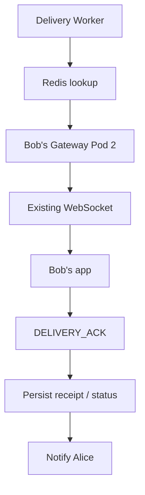

An **ACK from the gateway's socket write is not proof Bob's application received the message**. Bob's application sends a delivery acknowledgment after accepting it. Read receipts are a separate later event.

| State | What it actually means |
|---|---|
| Sending | Alice tried to transmit |
| ACCEPTED / SENT | Server durably committed the message |
| PUBLISHED (internal outbox state) | Kafka acknowledged the event |
| DELIVERED | Bob's device/application acknowledged receipt |
| READ | Bob reported reading the message |

For multi-device, specify whether "delivered" means **any** authorized device or **each** device; track synchronization positions accordingly.

**Memory line:** **Accepted ≠ Published ≠ Delivered ≠ Read.**

---

## 3. Ordering, retries, offline recovery — what makes the design reliable?

### Ordering within a conversation

~~~text
Alice sends:    seq 101 → seq 102 → seq 103
Bob receives:   seq 101 → seq 103 → seq 102
Bob displays:   seq 101 → seq 102 → seq 103
~~~

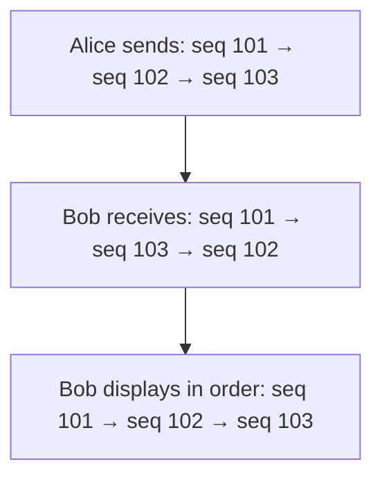

The **authoritative conversation sequence** is assigned by the coordinated server/database state, *not* by Alice's timestamp, Bob's timestamp, or the order packets arrive. If Bob expects seq 102 but sees 103, buffer 103 and request seq 102 from history; deduplicate before displaying. Ordering is per conversation, not global.

If Alice and Bob send simultaneously, the authoritative transaction/owner determines which commit gets the earlier sequence. Multiple Messaging Service pods must not allocate conflicting sequence values.

### Lost ACK and idempotency

~~~text
Alice sends clientMessageId = ABC123
       ↓
DB commits msg 105; ACK is lost
       ↓
Alice retries SAME clientMessageId = ABC123
       ↓
Messaging Service finds existing committed result
       ↓
Returns original msg 105, not a second stored message
~~~

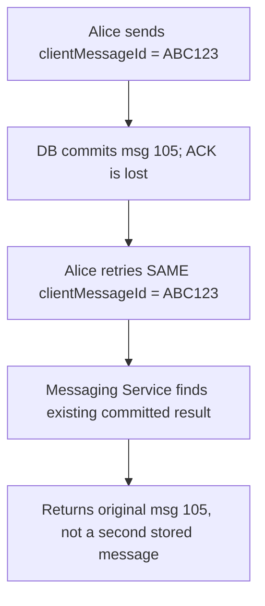

The idempotency uniqueness check must be **atomic** so simultaneous retries cannot both insert. Reusing an idempotency key with a different payload should be rejected.

### Offline user and multi-device catch-up

~~~text
Bob offline → No live Redis entry
                 ↓
Message stays in durable DB
                 ↓
Optional APNs/FCM push notification (not source of truth)
                 ↓
Bob reconnects/authenticates
                 ↓
Bob reports last contiguous sequence = 100
                 ↓
History fetch seq 101, 102, 103...
                 ↓
Client deduplicates, displays, updates cursor
~~~

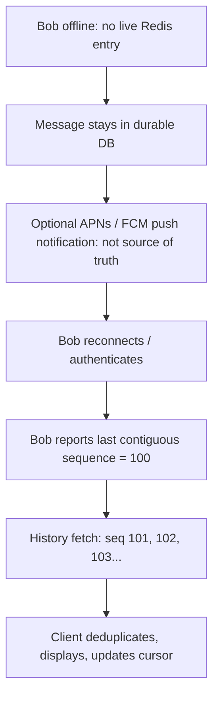

A newly connected client should reconcile the race between history retrieval and incoming live messages (subscribe/fence a watermark, catch up, merge by sequence). Two devices may hold different sync cursors.

### DLQ and poisoning

A permanently malformed/undeliverable *processing event* can be isolated for investigation/replay. Do not silently skip a required conversation message while falsely claiming a contiguous delivery sequence. Queue/stream retention and reconciliation policies must be defined.

---

## 4. Capacity, scaling, security and SRE operations

### Capacity/scaling decisions

Estimate separately: concurrent WebSocket connections, new connection rate, incoming messages/sec, outgoing deliveries (group fan-out), durable storage/day, DB hot keys, broker lag and recovery-region capacity.

- WebSocket gateway: active connections, memory, FDs, network, CPU, reconnects. Scaling out accommodates *new* connections; it doesn't migrate existing sockets.
- Messaging Service: ingress, DB latency, transaction contention; don't scale blindly when DB is bottleneck.
- Kafka/Workers: topic partitions, oldest event age, consumer lag, safe replay capacity.
- DB: hot conversations, throttling, partition distribution, conditional-write conflicts, replica lag.
- **10x load:** use capacity headroom, quotas/rate limiting, bounded retries, back-pressure and load shedding for low-value features (typing indicators) before risking message durability.
- Kubernetes: multi-AZ replica topology, readiness and graceful WebSocket draining, PDB, HPA + node autoscaler; remember replicas can remain **Pending** when there is no node capacity.

### Security minimum

TLS/WSS; authenticate connection; validate membership on every send/read; protect tokens/secrets; rate-limit; encrypt at rest using KMS/Key Vault; restrict logs; set retention and deletion policy; discuss E2EE if required (server then transports ciphertext, with device-key management consequences).

### Observability / customer SLIs

| SLI / signal | What it tells the SRE |
|---|---|
| Valid sends durably accepted / valid sends attempted | Core sending availability |
| p95/p99 durable acceptance latency | Is saving messages slow? |
| Online message commit → Bob device ACK latency | Is real-time delivery slow? |
| Connection success/reconnect/disconnect rate | Are gateways/region unhealthy? |
| Oldest outbox PENDING event age | Is publishing stuck? |
| Kafka consumer lag / oldest unprocessed event | Are workers falling behind? |
| DB p99, throttling, leader/replication health | Storage bottleneck or data risk |
| Presence lookup failure / stale registrations | Routing accuracy |
| Missing sequence, duplicate application, integrity audit | Message correctness |
| Cross-region replication lag / standby capacity | Recovery/RPO exposure |

Propose a concrete SLO only after defining eligible traffic and percentile/measurement boundaries. Page on customer-impacting error-budget burn, increasing end-to-end lag, acknowledged-message integrity risk, or dangerous backlog/data safety conditions—not every isolated pod restart. Canary compares user-facing correctness and latency, not only readiness probes.

### Multi-region design and data-loss tradeoff

~~~text
US-EAST-1 (3 AZ, active)
  WebSocket / Messaging / Outbox / Kafka / DB writer
                 |
                 | Cross-region replication
                 v
US-WEST-2 (3 AZ, warm standby)
  Ready gateway/services/broker + replicated DB state
~~~

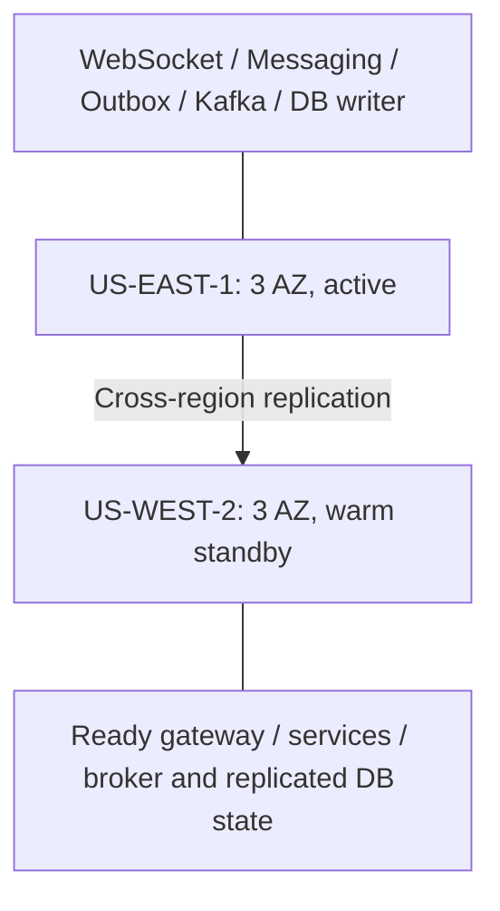

- Warm standby is **not automatically full spare capacity**. Verify quotas, image pull readiness, DB/broker capability and scale-up time.
- Failover: establish impact and replica watermark → **fence old writer** → promote/assign exclusive ownership in West → route new client connections → clients reconnect/authenticate/sync → replay and verify.
- Example: East acknowledged through **105**, West holds only **103**. Asynchronous replication can lose 104–105 after permanent East loss.
- **RPO:** maximum acceptable data loss (e.g., 30 seconds of commits). **RTO:** maximum acceptable time to restore service (e.g., 10 minutes).
- **Near-zero RPO** is not automatically **zero RPO**. Zero-loss acknowledged writes under a defined regional-failure model require appropriate cross-region synchronous/quorum durability *before ACK*, with latency/availability tradeoffs.
- If East merely appears down due to partition, promoting West without exclusive ownership/fencing could cause **split brain**. Don't allow two authoritative writers to allocate the same conversation sequence.
- Global DNS reroutes **new** connections but WebSockets do not migrate; clients reconnect. DNS TTL/cache may delay redirection. Recovered East first rejoins safely as non-writer; no automatic unsafe failback.

**Memory line:** RTO = **how long to recover**. RPO = **how much data can be lost**. Fencing = **only one legitimate writer**.

---

# 5. FINAL MENTAL MODEL — Exact steps 1 to 10

> **Revise this section aloud at the end.** Treat the 10 steps as the one repeatable whiteboard story.

~~~text
ALICE SENDS
 1. Alice opens app → DNS resolves messaging.example.com
         |
 2. DNS/global routing → NLB → healthy region + gateway
         |
 3. WebSocket Gateway Pod 1:
    authenticated persistent WSS connection to Alice
         |
    [Alice sends over EXISTING socket]
         |
 4. Messaging Service Pod:
    authorization + validate payload + check clientMessageId
         |
 5. Database ATOMIC COMMIT:
    message + idempotency + sequence state + outbox event
         |
    └── ACCEPTED ACK → Alice (stored, NOT Bob-delivered)

BOB RECEIVES
 6. Outbox Publisher Pod reads PENDING event
         |
 7. Kafka Producer → Kafka Broker (publish ACK)
    Outbox event marked PUBLISHED
         |
 8. Delivery Worker Pod CONSUMES Kafka event
         |
 9. Delivery Worker queries Redis:
    Bob/device → Gateway Pod 2 (or Bob is offline)
         |
10. Gateway Pod 2 pushes over Bob's existing WebSocket
    Bob app sends DELIVERY_ACK → update receipt → notify Alice
~~~

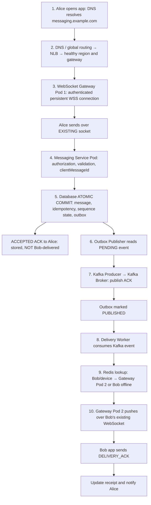

~~~text
Alice
  |
DNS → NLB
  |
WebSocket Gateway Pod 1
  |
Messaging Service Pod
  |
Database (Atomic Transaction)
  |-- Messages
  |-- Idempotency / Sequence
  |-- Outbox
  |
  +--> ACCEPTED ACK to Alice
  |
Outbox Publisher Pod
  |
Kafka Producer → Kafka
  |
Delivery Worker (Consumer)
  |
Redis Lookup
  |
WebSocket Gateway Pod 2
  |
Bob's Mobile
  |
DELIVERY_ACK
  |
Update DB → Notify Alice
~~~

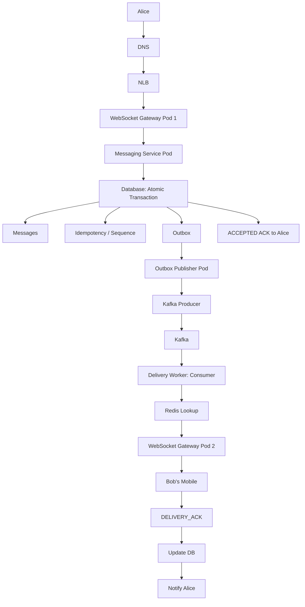

~~~text
Kafka
  |
  v
Delivery Worker Pod
  |
  | 1. Look up Bob in Redis
  v
Redis
  |
  | 2. Bob is connected to
  |    WebSocket Gateway Pod 2
  v
Delivery Worker Pod
  |
  | 3. Forward message to Pod 2
  v
WebSocket Gateway Pod 2
  |
  | 4. Send over existing WebSocket
  v
Bob's Mobile App
  |
  | 5. Bob sends DELIVERY_ACK
  v
WebSocket Gateway Pod 2
  |
  v
Messaging Service
  |
  v
Database (Update delivery status)
~~~

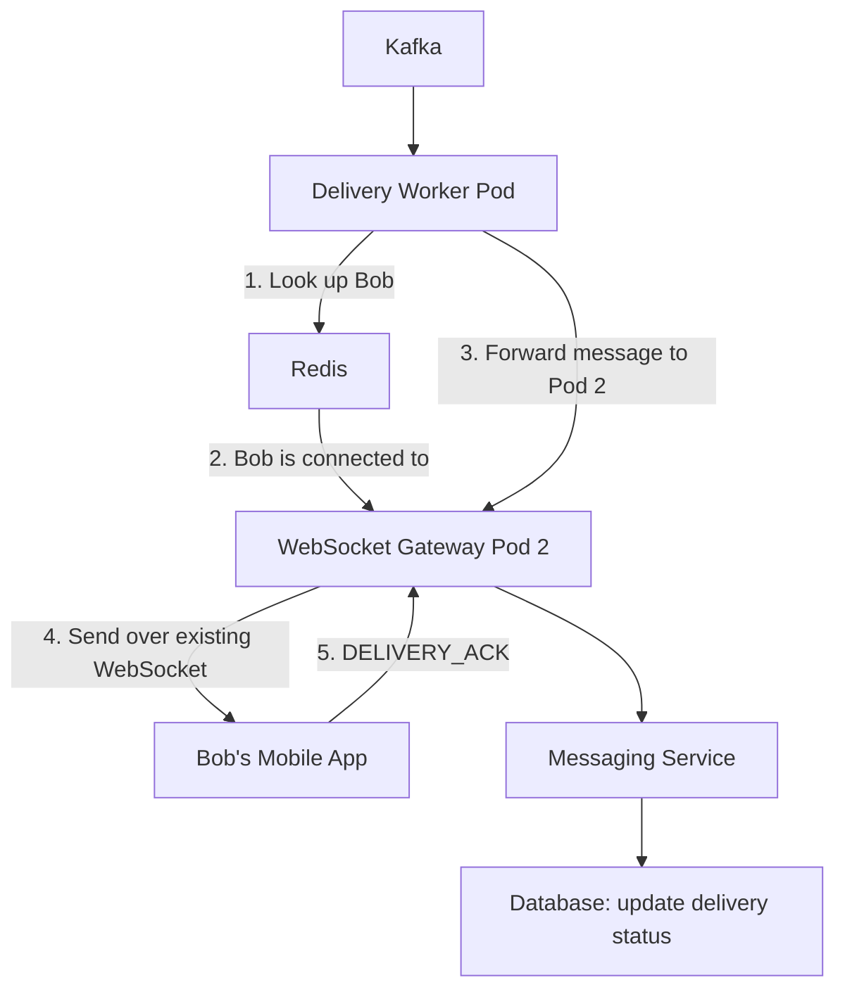


**Interview mini-script:** "I use a persistent WebSocket for Alice, a Messaging Service for auth/validation/idempotency, and a transactional database write for message plus outbox. Alice is acknowledged after durability. An outbox publisher reliably feeds Kafka, Delivery Workers look up Bob's gateway using Redis, and Bob receives the message over his WebSocket. Separate recipient ACK and read receipt close the loop."

---

# 6. FAILURE SCENARIOS — what changes in the above flow?

Use this pattern every time: **user impact → evidence → safe mitigation → verify → prevent**.

| Scenario | What happens | Recovery / key decision |
|---|---|---|
| Gateway Pod 1 crashes | Alice's socket drops | Client reconnects via NLB to another gateway, reauthenticates and fetches missed sequences |
| Bob offline / no Redis entry | No live destination | Keep durable DB history, optional push hint; Bob reconnects and syncs by last contiguous sequence |
| Alice's ACCEPTED ACK lost | Alice retries uncertain send | Same clientMessageId → atomic idempotency check → original message/ACK, no duplicate |
| DB commit fails halfway | All-or-nothing transaction | Roll back message + outbox; no successful ACCEPTED ACK |
| Messaging Service crashes after DB commit | Message already durable | Outbox publisher still sees event; client retry returns original ID |
| Outbox Publisher crashes before Kafka ACK | Event remains PENDING | Another publisher retries from DB |
| Publisher crashes after Kafka ACK before marking PUBLISHED | Kafka may receive duplicate event | Republish safely; idempotent consumer/client handles duplicate |
| Kafka down | Bob's live delivery delayed, outbox grows | Monitor age/depth; retry when healthy; protect bounded backlog via rate limits/back-pressure |
| Delivery Worker crashes before offset commit | Kafka replays after consumer reassignment | Another worker processes; client/message dedup covers repeated delivery |
| Redis unavailable / stale | Worker cannot locate Bob correctly | Keep message history; retry lookup/rebuild presence; offline sync fallback |
| Messages arrive 101, 103, 102 | Potential out-of-order display | Sequence gap detection; buffer 103, obtain 102, display 101,102,103 |
| DB p99 spikes / retry storm | Message acceptance slows; errors rise | Check DB throttle/pools/recent changes; bound retries/concurrency, rate-limit; verify accepted messages |
| 10x traffic | Gateways/DB/worker bottlenecks | Measure tier-specific saturation, reserved headroom, scale safely, shed low-value work |
| Single AZ fails | Some sockets lost; pods/replicas unavailable | Surviving AZ capacity + reconnect, durable DB quorum, measure customer SLO |
| East region fails; West replica behind | West may lack acknowledged messages | Evaluate RPO and replica watermark; do not promise zero loss with async replication |
| East-West split brain | Both regions might accept writes | Fence old writer and use exclusive ownership epoch/quorum before promotion |
| Region failover complete | Clients need new connections | Same API hostname → healthy region; reconnect/auth/sync; validate delivery, capacity and ordering |
| Bad deployment | Gateway errors or incorrect messages | Stop canary/pipeline rollback; verify correctness and persistent data impact |

**Kafka outage deeper flow (one scenario rehearsed):**

~~~text
DB has accepted message + outbox event PENDING
             |
         Kafka unavailable
             |
   Outbox Publisher cannot complete publication
             |
   Alice still has ACCEPTED (durable DB commit)
   Bob's real-time delivery may be delayed
             |
   Monitor oldest outbox age + backlog + DB capacity
             |
   Rate-limit only when unsafe backlog/capacity threshold
             |
   Kafka returns → publisher retries → consumer → Bob
~~~

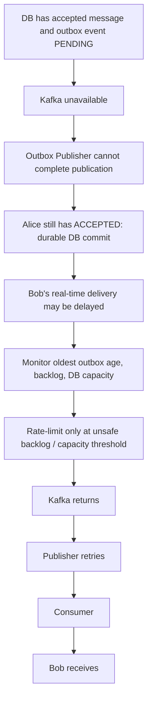

**Regional outage deeper flow (second scenario rehearsed):**

~~~text
East Region DOWN → identify last safe West replication watermark
       → fence/retire East ownership before write promotion
       → activate West services/DB writer after consistency check
       → global routing sends new connections to West
       → Alice and Bob re-establish WebSocket sessions
       → replay/reconcile messages, verify sequence and receipts
~~~

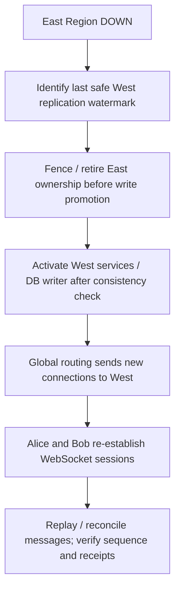

---

# 7. FOLLOW-UP INTERVIEW Q&A — questions we practiced

Short answers deliberately; explain only if probed. Questions in this section were discussed during the interactive practice, not verified verbatim Apple panel questions.

**Q1. What is a WebSocket Gateway? Is it hardware?**  
A: Software running in an EKS/AKS pod in this design, or a managed cloud WebSocket service. It maintains client connections; not a special hardware box.

**Q2. HTTPS also returns a response—why WebSocket?**  
A: REST responses follow requests. WebSocket is persistent, full-duplex, and allows the server to push messages without a new client request.

**Q3. Why choose NLB rather than ALB?**  
A: NLB is suitable for L4 TCP forwarding. ALB also supports WebSocket and offers L7 routing; NLB is not inherently always faster. API Gateway/Web PubSub is another architecture option.

**Q4. Does Alice hit DNS for every message?**  
A: No. DNS/connection setup happens initially or on reconnect; messages flow over the established WebSocket.

**Q5. Gateway pod crashes; what happens?**  
A: Alice reconnects to another healthy pod, reauthenticates and synchronizes from her last confirmed cursor.

**Q6. How does the backend know Bob is connected to gateway Pod 2?**  
A: The gateway registers user/device/connection/pod/region in Redis with TTL. User ID in the JSON alone doesn't identify the owning pod.

**Q7. Bob is offline. Does Kafka hold his message until he returns?**  
A: Durable database history is the source of truth. On reconnect Bob fetches missing messages using his stored cursor; push notification can be a hint, not guaranteed transport.

**Q8. What happens if the sender ACK is lost?**  
A: Alice retries the same clientMessageId; an atomic idempotency record maps it to the original committed message and returns the original ACK.

**Q9. What is atomicity?**  
A: All database writes in one transaction commit together or none commits. Message + idempotency + outbox cannot partially commit within that transaction.

**Q10. Why need outbox rather than direct DB write plus Kafka publish?**  
A: Direct dual writes can fail between the DB commit and Kafka publication. Atomic outbox records allow a separate publisher to retry safely.

**Q11. Is Outbox Publisher a Kafka service or a Kubernetes pod?**  
A: It is publisher logic: often a dedicated pod/Deployment, sometimes an in-service background worker, or CDC via Debezium/Kafka Connect. Kafka producer is the client library it uses.

**Q12. What if the Outbox Publisher pod fails?**  
A: PENDING events remain in the DB. Another pod can claim/retry them. Duplicates remain possible, so consumers are idempotent.

**Q13. When is Outbox event 105 marked completed?**  
A: After Kafka acknowledges the publication, the publisher marks it PUBLISHED. That does not mean Bob received the message.

**Q14. What if Kafka is unavailable after DB commit?**  
A: Event stays in outbox; live delivery is delayed. Monitor lag/backlog and protect capacity. Publisher retries when Kafka recovers; history remains readable.

**Q15. Why Kafka if Redis and DynamoDB exist?**  
A: DynamoDB is durable message history, Redis is live connection routing, Kafka decouples, buffers and replays asynchronous delivery events.

**Q16. Why a Delivery Worker? Why can't Kafka send to Bob?**  
A: Kafka does not know Bob's active gateway or implement the business delivery protocol. Worker consumes event, finds Bob in Redis and routes to correct gateway.

**Q17. A worker consumes an event and crashes before delivery. Lost?**  
A: Not if processing progress wasn't committed and Kafka retains the event. Another group consumer replays; idempotency avoids duplicate visible messages.

**Q18. What is a consumer offset? How deeply must I know it?**  
A: Offset is a position in one Kafka partition; consumer commit records progress. Crash before commit enables replay. Know this; detailed Kafka internals are optional for this round.

**Q19. How does Bob see 101, 102, 103 if arrival is 101, 103, 102?**  
A: Authoritative per-conversation sequence + client gap detection/buffering/history fetch. Kafka ordering helps within a partition but is not the only safeguard.

**Q20. What is an authoritative conversation sequence?**  
A: The server/database's official ordered sequence, allocated by a coordinated transactional/owned sequencer, not client timestamps or arrival order.

**Q21. Alice and Bob send simultaneously—who decides which is 101?**  
A: The authoritative conversation ownership/atomic sequence allocator serializes them and determines commit order.

**Q22. Is there a new database table for Alice↔Bob and Alice↔Charlie?**  
A: No, one logical Messages table stores millions of conversations; conversationId PK and sequence SK group and order records.

**Q23. Why conversationId as partition key, not senderId?**  
A: To fetch the complete conversation between all members efficiently. senderId splits one chat across separate keys. clientMessageId is for idempotency, a different concern.

**Q24. Why Redis rather than DynamoDB for presence?**  
A: Connection state is short-lived and frequently refreshed. Redis offers fast in-memory lookups with TTL; DynamoDB retains durable history.

**Q25. Is DynamoDB partitioning the same as sharding and replicating copies?**  
A: Physical partitioning/sharding distributes workload for scale; replicas across AZs provide durability and availability. Logical PK != a physical table/shard per conversation.

**Q26. Why DynamoDB? Could we use SQL?**  
A: DynamoDB supports managed key-based scalable reads/writes and conditional/transactional operations. SQL/Aurora is also valid; justify the data access pattern and consistency requirements.

**Q27. Kafka consumer offset versus conversation sequence?**  
A: Kafka offset tracks position in a broker partition. Conversation sequence defines users' logical chat ordering. They are different numbers.

**Q28. If US-East fails and US-West has only seq 103 while East ACKed 105?**  
A: With asynchronous replication, acknowledged 104–105 can be lost if East never returns. Stronger pre-ACK cross-region quorum/synchronous durability is needed for zero RPO within the defined failure model.

**Q29. Near-zero RPO versus zero RPO?**  
A: Near-zero allows a small loss window; zero RPO requires no loss of acknowledged data under the agreed failure model and costs more coordination/latency.

**Q30. Why warm standby in a second region?**  
A: Lower cost than full active capacity while retaining a tested recovery environment. Verify standby scales fast enough for the RTO.

**Q31. How do Alice and Bob connect to US-West when US-East dies?**  
A: Same API hostname, global DNS/traffic routing switches to healthy West. Existing sockets die; clients reconnect and synchronize. DNS caching may delay cutover.

**Q32. What is RTO? What is RPO?**  
A: RTO = maximum acceptable recovery duration (example target: 10 minutes). RPO = maximum acceptable data-loss window (example: 30 seconds). Targets are business decisions; observed recovery time may differ.

**Q33. What should I do if Kafka goes down and outbox backlog rises?**  
A: Do not block Alice immediately if durable outbox capacity is safe. Measure backlog age/depth and DB pressure, enforce quotas/back-pressure if limits are near, replay safely after recovery.

**Q34. Why fence primary before standby promotion?**  
A: To stop two regions writing the same conversation with conflicting sequence numbers after a network partition (split brain).

**Q35. Users complain delivery takes 15–20 seconds; what do you check first?**  
A: Confirm customer impact and scope, then trace timestamps stage by stage: client send → gateway → DB commit → outbox age → Kafka lag → worker processing → presence/gateway → Bob ACK. Correlate with deployment, errors and capacity; mitigate the slow tier, then verify the end-to-end SLO.

**Q36. What matters in a bad rollout of gateway pods?**  
A: Graceful connection draining, readiness, spare pods across AZs, reconnect/resync success, and canary checks for duplicate/missing messages—not only Running/healthy pods.

**Q37. What should you say if asked for the entire design in 60 seconds?**  
A: "DNS and NLB route Alice to a WebSocket gateway. A Messaging Service validates her request and atomically persists the message, sequence, idempotency record and outbox event in DynamoDB, then returns ACCEPTED. A publisher sends the outbox event to Kafka. A Delivery Worker consumes it, finds Bob's active gateway in Redis, delivers over WebSocket, and records his delivery ACK. Retries, deduplication, cursor sync and region recovery protect correctness when components fail."

---

## Final five memory anchors

1. **Connection:** DNS → NLB → WebSocket Gateway; reuse the live socket.
2. **Durability:** Messaging Service → atomic DB + outbox → ACCEPTED to Alice.
3. **Delivery:** Outbox Publisher → Kafka → Delivery Worker → Redis → Bob's gateway.
4. **Correctness:** clientMessageId prevents duplicates; conversation sequence preserves order; Bob's ACK confirms delivery; offline users sync from DB.
5. **SRE:** measure customer impact and lag, apply safe back-pressure, preserve replication/ownership guarantees, test RTO/RPO and recovery.

**Study method:** First explain steps **1–5** without notes; then **6–10**; then choose **one failure scenario** and say impact → evidence → mitigation → verification. Avoid learning deeper Kafka internals before these are fluent.
