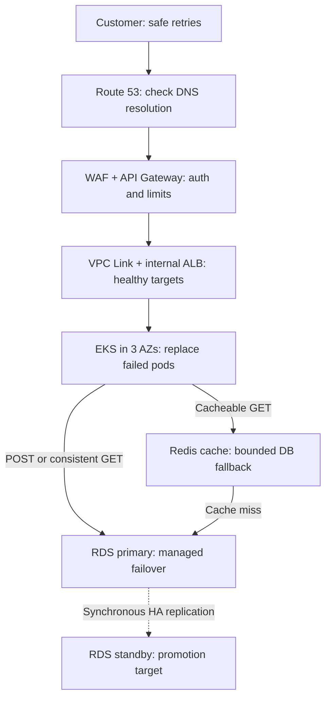
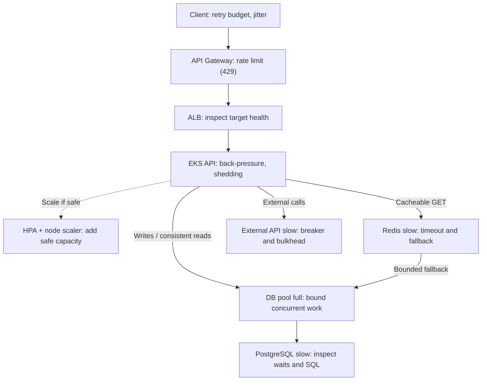
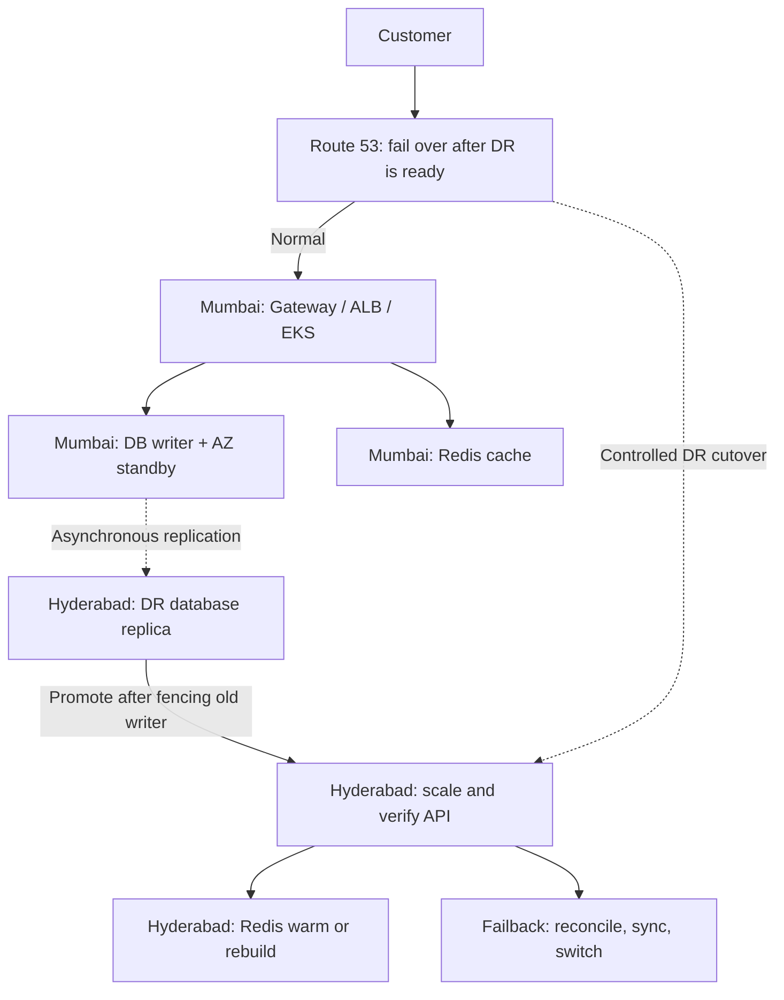

# Apple ASE SRE — Order API Quick Revision (R23-D03 / D04 / D05)

> **Purpose:** Compact interview revision for the **same Order API** across high availability, overload, and regional disaster recovery. Read each **diagram → concept table → failure table → follow-up Q&A → memory line**. These are **design choices and example numbers**, not claims about Apple's systems.
>
> **Baseline:** Client → DNS → AWS WAF/API Gateway → internal ALB → EKS Order API (3 AZs) → Redis (optional cache) / RDS PostgreSQL (source of truth). Example forecast: **3,762 peak RPS**, **24 pods = 8 per AZ**, and **300 planned RPS/pod**. All capacity depends on load testing.

Diagram compatibility: The three diagrams below deliberately use **short, single-line Mermaid nodes** (no HTML line breaks) to avoid GitHub's clipped text. Failure actions are also listed in tables for easy reading.

---

## R23-D03 — Highly Available Customer-Facing API

**Goal:** A pod, node, AZ, cache, or DB instance failure should not bring down the whole service.

### Diagram 1 — Component flow and failure response

*AWS detail:* With ALB **IP targets**, the ALB routes directly to pod IPs; Kubernetes Ingress/Service configuration is not an extra proxy hop. A standard RDS Multi-AZ **standby is not a read replica**.

### Concepts — Simple explanation

| Concept | Simple explanation |
|---|---|
| High availability | Multiple healthy instances across failure domains |
| HPA vs node autoscaler | HPA requests pods; autoscaler provides nodes when capacity is missing |
| Redis cache | Speeds up eligible reads; PostgreSQL remains authoritative |
| PostgreSQL Multi-AZ | Primary + synchronous standby for automatic instance/AZ failover |
| Idempotency | Same POST key must not create a second order after a timeout |
| SLO | Measure successful customer requests and p95/p99 latency, not just Running pods |

### Failures — What we do

| Failed component | What we do |
|---|---|
| DNS / gateway / WAF | Check DNS, TLS, auth, 403/429/5xx, rate limits and policy logs |
| ALB | Inspect healthy targets, ports, health-check path and security groups |
| EKS pod / node | Route to Ready targets; recreate pods; check node headroom |
| One AZ | Use surviving AZs; verify application **and DB/cache** capacity |
| Redis | Short timeout + circuit breaker; **bounded** DB fallback |
| PostgreSQL primary | Managed standby promotion; reconnect; verify committed orders |
| Bad deployment | Stop rollout / pipeline rollback; validate user-journey metrics |

### Interview follow-up Q&A — D03

| Interviewer asks | Short answer |
|---|---|
| Pods are Running; why are all ALB targets unhealthy? | Check readiness, target-group health reasons, port/path and network rules. |
| HPA adds pods but they stay Pending? | Check scheduler events, requests, AZ spread, quotas and node autoscaler. |
| One AZ fails: is the API still available? | Only if surviving pods **and dependencies** have adequate capacity. |
| Why use PostgreSQL instead of Redis for writes? | SQL transaction and durability guarantee; Redis is an optional cache. |
| Primary DB fails during an order POST? | Fail over, reconnect and resolve uncertain commits using the **same idempotency key**. |
| Redis and PostgreSQL disagree? | PostgreSQL is authoritative; bypass/invalidate stale cached data. |

**Remember:** **DNS → Gateway → ALB → EKS → Redis/DB → HA failover**.

---

## R23-D04 — API Overload and Dependency Failure

**Goal:** A 10× traffic spike or slow dependency must not trigger a cascading outage.

### Diagram 2 — Overload path and protection

**Example:** 10× forecast peak = **37,620 RPS**. At 300 RPS/pod, 24 pods can plan for only **7,200 RPS**. HPA cannot instantly create enough *safe end-to-end* capacity.

### Concepts — Simple explanation

| Concept | Simple explanation |
|---|---|
| Rate limit | Control requests per client/API; excess typically **429** |
| Back-pressure | Limit admitted work when dependencies cannot keep up |
| Load shedding | Reject excess work quickly, often **503**, to preserve critical calls |
| Timeout | Bound how long a request waits |
| Backoff + jitter | Delay and randomize safe retry attempts; avoid retry storms |
| Retry budget | Cap extra attempts; retry at one deliberate layer where possible |
| Circuit breaker | Stop repeatedly calling a failing dependency; reopen cautiously |
| Bulkhead | Isolate concurrency so one slow dependency doesn't exhaust all workers |

### Failures — What we do

| Failed component / symptom | What we do |
|---|---|
| Gateway: 10× traffic | Throttle/rate limit; protect critical operations |
| ALB: 502/503/504 | Check health, targets, connections, backend latency |
| EKS: high CPU / many requests | HPA if useful; cap in-flight work, shed load |
| EKS: new pods Pending | Check scheduling, requests, quotas; provision nodes |
| Redis: slow / down | Short timeout, breaker, **controlled** DB fallback |
| DB pool: exhausted | Check pool waits; cap concurrency; **don't blindly grow pools** |
| PostgreSQL: high CPU/slow queries | Find locks/slow SQL/I-O; reduce expensive workload |
| External API: slow | Deadline, circuit breaker, bulkhead, safe fallback only |
| Retry storm | Reduce retries; deadline + jitter + budget + idempotency |

### Interview follow-up Q&A — D04

| Interviewer asks | Short answer |
|---|---|
| What happens to HPA during a retry storm? | CPU may stay low while requests wait; CPU-based HPA may **not scale**. If CPU rises, more pods may overload DB further. |
| Why does a 5-second query hurt with unchanged RPS? | In-flight work rises (roughly RPS × latency); pools and workers fill. |
| Can retries turn 1 request into 27 DB calls? | Yes, **if** 3 independent layers each try up to 3 times; avoid layered retries. |
| What's backoff vs jitter? | Backoff spaces retries; jitter randomizes their timing. |
| Pool has 20 connections/pod; increase to 100? | Not blindly: first inspect pool waits, DB saturation and total pod × pool connections. |
| Why use a circuit breaker vs a timeout? | Timeout bounds one wait; breaker temporarily stops repeatedly failing calls. |
| Why not queue every request at 10× traffic? | Unbounded queues inflate latency and timeouts; cap work and shed excess. |
| Redis fails during the peak—what now? | Short timeout + circuit breaker; **limit** PostgreSQL fallback and protect DB. |
| Should POST be retried after timeout? | Only safely, retaining the same durable idempotency key and honoring deadlines. |

**Remember:** **Rate limit → Back-pressure → Timeouts → Breaker → Shed load → Verify recovery**.

---

## R23-D05 — Multi-Region Recovery

**Goal:** Restore the same Order API after the **entire primary region** fails.

**Design choice:** **Active-passive / warm standby**. Mumbai serves traffic; Hyderabad is provisioned for recovery. PostgreSQL cross-region replication is **asynchronous** (unlike synchronous standby replication *within* Mumbai).

### Diagram 3 — Region failure, recovery and failback

### Concepts — Simple explanation

| Concept | Simple explanation |
|---|---|
| Active-passive | One serving region, one recovery region; simpler writes |
| Active-active | Both serve traffic; harder write consistency/conflict control |
| Async replication | Copies changes to DR; may lag and lose recent acknowledged writes |
| RTO | Time allowed to restore service; **e.g. 15 min target** |
| RPO | Acceptable data loss window; **e.g. 1 min target** |
| Recovery capacity | DR must sustain forecast **3,762 RPS**, including dependencies |
| Failback | Safely return to Mumbai after data reconciliation and validation |

*RTO/RPO values are hypothetical business targets, **not AWS guarantees**; prove them with DR exercises.*

### Failures — What we do

| Failed component | What we do |
|---|---|
| Mumbai pod / one AZ | Stay in-region; use healthy instances and HA DB |
| Entire Mumbai region | Declare DR; prevent competing writers / split-brain |
| Primary regional PostgreSQL | Assess replication lag; promote Hyderabad replica; reconcile uncertain POSTs |
| Hyderabad pods/nodes inadequate | Scale and verify EKS, quotas, Redis and DB capacity |
| DR cache empty | Gradually warm Redis; throttle DB fallback |
| Regional routing | Shift Route 53 **after** DR write path and app are ready; consider DNS caching |
| Mumbai recovers | Reconcile → establish reverse replication → validate → controlled failback |

### Interview follow-up Q&A — D05

| Interviewer asks | Short answer |
|---|---|
| Why active-passive, not active-active? | Simpler write consistency and fewer cross-region conflicts; lower running cost. |
| What's RTO vs RPO? | RTO = acceptable recovery time; RPO = acceptable data-loss window. |
| Does DB replication guarantee zero loss? | No; async cross-region replication can lag. Reconcile missing/uncertain orders. |
| Route 53 switches automatically—are we done? | No. First fence old writer, promote DR DB and verify regional service capacity. |
| Can warm standby handle 3,762 RPS immediately? | Not necessarily; test quotas, node scale-up, cache and DB before cutover. |
| What about clients using old DNS records? | DNS caching delays cutover; old region must not accept conflicting writes. |
| When should we fail back to Mumbai? | After data reconciliation, reverse replication, validation and planned traffic shift. |

**Remember:** **Detect → Prevent dual writers → Promote DB → Scale → Verify → Switch DNS → Failback**.

---

## Final 30-second revision

| Design | Core question | One-line answer |
|---|---|---|
| **D03 — HA** | What if a component or AZ dies? | Use replicas, health-aware routing, HA dependencies and enough survivor capacity. |
| **D04 — Overload** | What if traffic or dependency latency explodes? | Restrict incoming and concurrent work, bound retries, shed excess, and protect the DB. |
| **D05 — DR** | What if the whole region dies? | Promote the DR DB safely, validate capacity/correctness, then switch routing and fail back later. |

**Universal SRE sequence:** **Customer impact → Evidence → Safe mitigation → Recovery checks → Prevention**.

**AWS ↔ Azure mental mapping:** Route 53 ↔ Azure DNS/Traffic Manager; API Gateway ↔ API Management; ALB ↔ Application Gateway; EKS ↔ AKS; ElastiCache ↔ Azure Managed Redis; RDS PostgreSQL ↔ Azure Database for PostgreSQL. These are role equivalents, **not identical network flows**.
