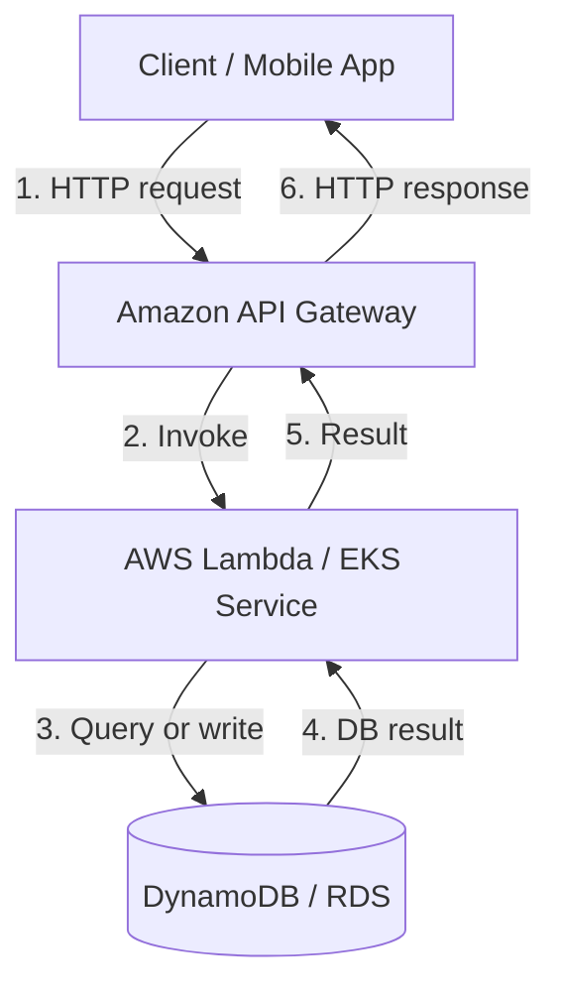
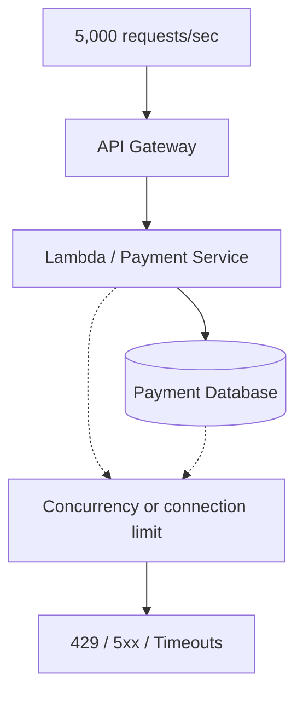
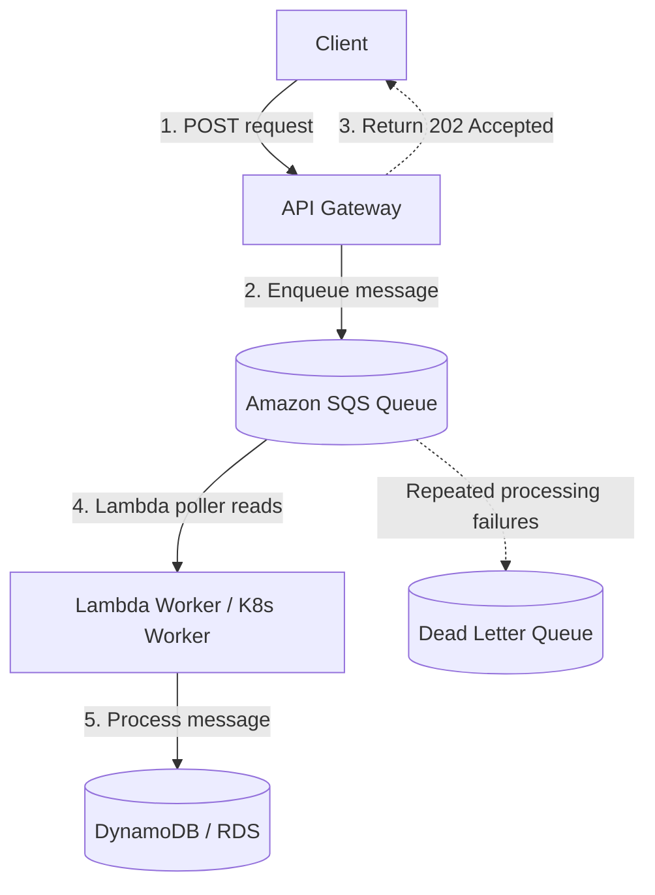
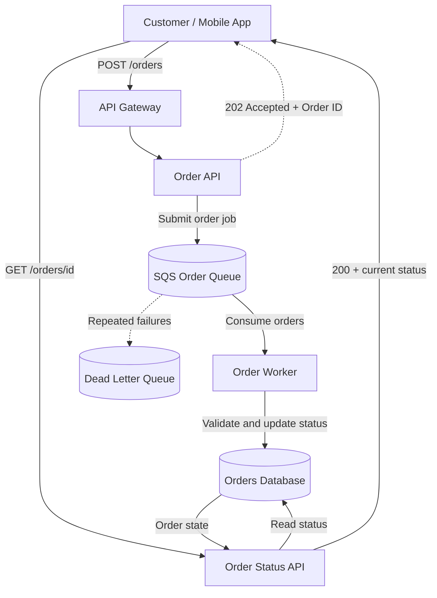
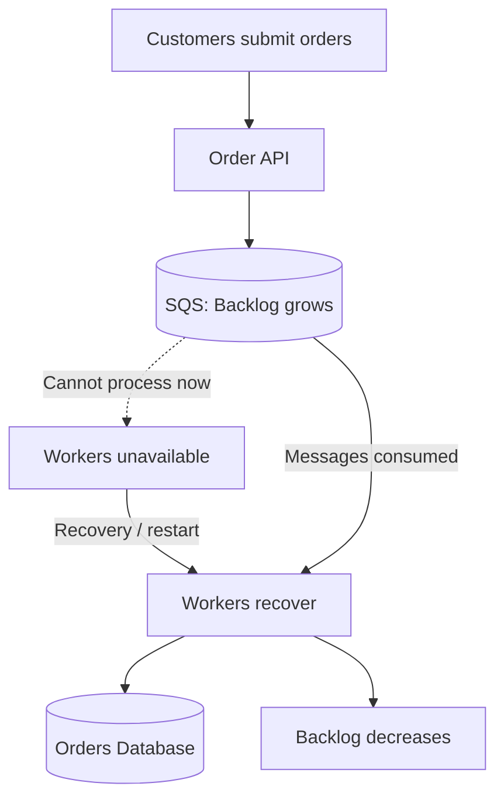

# Synchronous vs Asynchronous (Event-Driven) Architecture

> **System design fundamentals — interview revision notes**  
> Topics: request flow, independent scaling, failure modes, retries, SQS, DLQ, idempotency, real-world ordering system, AWS/Azure mapping, SRE monitoring, and interview Q&A.

## 1. Understanding the concepts

In a microservices architecture, services communicate with each other to process user requests. There are two common communication approaches:

- **Synchronous:** The caller invokes a service and waits for the result before continuing.
- **Asynchronous:** The caller submits work (typically via a message/queue), and processing can happen later without the caller waiting for the final result.
- **Event-driven:** Components react to business or system events (such as `OrderCreated`). It frequently uses asynchronous messaging but is **not exactly synonymous** with asynchronous communication.

**Easy analogy:** In a synchronous restaurant reservation call, you wait while the restaurant confirms a table. For an asynchronous food order, you receive an order ID immediately and check progress later.

---

## 2. Synchronous architecture

**Remember this line from the lecture:**

> the caller will invoke this API and wait for the response during the same invocation.

Consider a customer-facing application on AWS. The same principle applies to Kubernetes/OpenShift, EC2, or Azure services.

### Diagram 1 — Synchronous request flow



**Explanation of each hop**

1. Client calls `POST /payments`.
2. API Gateway validates/routes the request.
3. Lambda (or a Kubernetes service) executes the business logic.
4. The application queries/writes DynamoDB or RDS.
5. Database returns a result to the application.
6. Application returns its response through API Gateway to the client.

The caller waits. An important dependency failure can directly cause an error or timeout.

### Failure points and recovery

| Component | Possible failure | Impact and recovery |
|---|---|---|
| Client → API Gateway | DNS, TLS, network timeout | Request cannot be completed; retry carefully with an idempotency key |
| API Gateway | Throttling or integration failure | 429/5xx; enforce admission control, investigate configured limits |
| Lambda / K8s pod | Concurrency exhausted, timeout, crash | Throttle/scale safely, inspect logs and metrics, avoid retry storms |
| Database | Connection exhaustion, high latency, unavailable | Database failover, connection pooling, query optimization, load mitigation |
| Response path | Response lost *after* DB commit | User sees timeout although work may have succeeded; look up status before retry |

### Diagram — Sale traffic and synchronous bottleneck



**Real-world scenario:** A sale normally receives **500 requests/sec**, but suddenly receives **5,000 requests/sec**. The API may accept more traffic while the application or database hits a capacity limit. Requests slow down, get throttled, or time out.

**Architect response:** rate limiting, autoscaling, database capacity planning, connection pooling, timeouts, circuit breakers, safe retries, and — where immediate completion is unnecessary — move heavy operations to asynchronous processing.

> **Correction to the original lecture:** Synchronous components do **not** have to scale by the **same factor** or at precisely the same time. Each stage must have enough capacity for the demand it receives. Any bottleneck on the critical path can affect end-to-end success and latency.

### Synchronous architecture — advantages

1. **Immediate outcome:** The caller knows the operation's result within the same request, assuming the response arrives.
2. **Straightforward request/response model:** Easier to understand for small, quick workflows.
3. **Simple interactive UX:** Well suited for login, queries, authorization checks, and status retrieval.
4. **Direct error reporting:** Error codes and validation failures can be returned immediately.
5. **Often simpler data flow:** No queue, consumer lifecycle, DLQ, or asynchronous status model is required for basic operations.

### Synchronous architecture — disadvantages

1. **Tight runtime dependency:** Slow or failed downstream services affect the current request.
2. **Latency accumulates:** Serial network calls can make the entire transaction slow.
3. **Cascading failures and retry storms:** Uncontrolled retries amplify backend pressure.
4. **Scaling bottlenecks:** An API can scale while its database or another dependency remains constrained.
5. **Timeout and partial-success ambiguity:** A write may commit even when the client times out.
6. **Potentially expensive overprovisioning:** Meeting high peak synchronous concurrency may require extra reserved capacity.

---

## 3. Asynchronous / event-driven architecture

**Remember this line from the lecture:**

Event-Driven Architecture (EDA) is a system design paradigm where decoupled components communicate asynchronously by producing, detecting, and reacting to events.

> We decouple the components.

Rather than requiring the backend to finish during the original HTTP call, place a durable queue between the producer and consumer. The queue **buffers messages** while consumers process them at their available rate.

### Diagram 2 — Asynchronous architecture with SQS



**Explanation of each hop**

1. Client sends `POST` to the API.
2. API Gateway submits the work to SQS. This can be a **direct SQS service integration** configured with appropriate permissions; alternatively, an API service can enqueue it.
3. Only **after SQS accepts the message**, the API can respond `202 Accepted`: accepted for processing, **not completed**.
4. For Lambda, an **event source mapping polls SQS** and invokes Lambda. For Kubernetes, a custom worker polls SQS.
5. The worker applies business logic and writes to the database.
6. With the Lambda SQS event source mapping, successfully processed messages are deleted; unsuccessful ones can become visible for retry after their visibility timeout.
7. If an SQS redrive policy is configured, repeatedly failing messages may be moved to a **dead-letter queue (DLQ)** for investigation and eventual redrive.

**Precise point:** SQS does not push messages directly to Lambda; Lambda's event source mapping polls the queue.

### Where failures happen

| Failure | What happens | Recovery / controls |
|---|---|---|
| API Gateway down | New client requests fail | API recovery, rate limits, safe client retry |
| Enqueue to SQS fails | Message was not confirmed as accepted | Return error; client retries with idempotency key |
| Lambda/worker capacity exhausted | Messages accumulate in queue | Scale workers within database limits; monitor queue age |
| Lambda/worker crashes | In-flight message may become visible again | Visibility timeout, retries, idempotent processing |
| Database down | Processing cannot complete; backlog grows | Restore/fail over DB; restart/retry processing |
| Poison message | Same message fails repeatedly | DLQ after configured receive threshold; inspect and redrive |
| Queue retention expires | Old unprocessed message may be lost | Set retention, alert on oldest message age, plan recovery |
| Duplicate delivery | Business operation may be repeated | Idempotency key and deduplication at the business/database layer |

### Core concepts

**Buffering:** SQS stores accepted messages so consumer outages and temporary bursts do not immediately lose all submitted work.

**Independent scaling:** The API and workers can scale independently. Lambda SQS event-source maximum concurrency can limit consumer load; Kubernetes consumers can use **KEDA/HPA** with queue signals and backend-capacity guardrails.

**Retry:** Failed processing may be retried after a visibility timeout. Retry/redrive policy and retention must be planned; retries are not an unlimited reliability guarantee.

**DLQ:** Quarantines messages that repeatedly fail; operators inspect the cause and redrive messages **after the underlying issue is resolved**.

**Idempotency:** SQS standard queues provide **at-least-once delivery**, so duplicates are possible. Workers should make repeated delivery of the same business request safe. FIFO queues provide specific ordering/deduplication controls, but do not remove the need for end-to-end idempotency.

### Asynchronous / event-driven architecture — advantages

1. **Decouples producers and consumers:** A consumer outage need not immediately break submission while the queue is healthy.
2. **Absorbs traffic bursts:** Incoming demand and processing throughput can be different temporarily.
3. **Independent scaling and throttling:** Grow consumers based on workload while protecting databases/downstream systems.
4. **Built-in recovery primitives:** Visibility timeout, queue retries, DLQ, and redrive policies support resilient processing.
5. **Improves responsiveness for slow tasks:** The API returns acceptance quickly instead of holding open a long connection.
6. **Flexible processing:** Events can trigger downstream workflows, multiple subscribers, or audit pipelines when the appropriate messaging model is chosen.

### Asynchronous / event-driven architecture — disadvantages

1. **Eventual completion/consistency:** The final result is not available immediately and status can lag.
2. **More moving parts:** Queues, workers, retry settings, DLQs, status stores, and monitoring require operations.
3. **Duplicate and out-of-order handling:** Design idempotency and, if required, partition/message-group ordering.
4. **Harder end-to-end debugging:** One logical transaction can span many services and retries; use correlation IDs and distributed traces.
5. **Poison messages and backlog growth:** Permanent failures or slow consumers may delay processing and exhaust retention.
6. **Extra cost:** Queues, storage, consumers, retries, and observability are not always cheaper than direct calls.

---

## 4. Real-world scenario — E-commerce flash sale (hybrid design)

An ordering application combines the strengths of both models:

- **Submit/fulfil orders asynchronously:** Queue requests and process inventory/payment/workflow in the background.
- **Retrieve order status synchronously:** Customer calls a GET endpoint and gets the current known status promptly.

### Diagram 3 — Hybrid order processing



> This is a **simplified teaching diagram**. In a production application, make sure the initial order status is durable and readable even before the worker runs. If an API must write an order record and publish an event reliably, use a **transactional outbox** (or another well-defined atomic handoff), rather than trusting two independent writes to succeed together.

### Full workflow

**A. Asynchronous order submission**

1. Customer calls `POST /orders`.
2. Order API validates the request, assigns an order ID, and associates an idempotency key.
3. Processing work is safely accepted for later execution.
4. Client receives `202 Accepted`, for example:

```json
{
  "orderId": "ORD-1001",
  "status": "ACCEPTED"
}
```

This does **not** guarantee that inventory is reserved, payment succeeded, or the order is finally confirmed.

**B. Background processing**

Worker consumes the queued order and performs inventory validation, payment coordination, and order-state updates. Payment authorization/capture must be idempotent so that a message retry cannot double-charge the customer. Some business steps may need a saga/compensating action when a distributed transaction cannot be committed atomically.

**C. Synchronous status retrieval**

Customer calls `GET /orders/ORD-1001` and receives the current persisted state:

```json
{
  "orderId": "ORD-1001",
  "status": "CONFIRMED"
}
```

The GET path can use suitable caching with a clear staleness policy.

### Diagram 4 — What happens when the workers are down?



**Failure example:** **10,000** users submit orders, and order workers go down for a few minutes.

- Requests already **successfully queued** remain pending subject to retention.
- New requests can still be accepted **if the API and SQS remain healthy and within limits**.
- Once workers recover, they resume consuming queued orders.
- Backlog decreases **only if consumer processing rate exceeds the new incoming work rate**.
- Existing users normally do not need to resubmit already accepted orders, but confirmation is delayed.

**Protections in production:** idempotency keys, sensible SQS visibility timeout, retry policy, DLQ alarm and redrive, partial-batch failure handling for Lambda batches, queue-age alerts, and transactional outbox when publishing an event must be coupled to a database change.

---

## 5. Synchronous vs asynchronous — comparison

| Area | Synchronous | Asynchronous |
|---|---|---|
| Caller behavior | Waits for processing result | Typically gets an acknowledgement before final processing |
| Runtime coupling | Caller needs downstream service to respond | Consumer can be temporarily unavailable while work is buffered |
| Scaling | Slowest critical-path component can limit success | Producers and consumers scale more independently |
| Latency | Immediate result, but may be slow | Fast acceptance, delayed final outcome |
| Failure handling | Timeouts and client/service retries | Queue-based retries, DLQ, retention limits |
| Complexity | Usually simpler for quick requests | Requires queue, workers, status model and observability |
| Cost | Can require overprovisioning for peaks | Extra messaging/worker costs; **not automatically cheaper** |
| Example | Login, balance/status GET | Order fulfilment, emails, file/video processing |

## 6. Important corrections to the lecture

1. **Synchronous components need capacity, not identical scale factors.** API Gateway, Lambda and DynamoDB do not all scale by the same numerical factor just because traffic increased.
2. **Event-driven is not identical to asynchronous.** Event-driven names the trigger model; asynchronous names how execution and waiting are decoupled.
3. **202 means acceptance, not successful completion.** The status endpoint must represent accepted/pending/rejected/confirmed accurately.
4. **Queues do not eliminate failures.** They buffer work but cannot prevent retention expiry, upstream enqueue failures, poison messages, or overwhelming sustained load.
5. **At-least-once delivery means duplicates are possible.** Use durable idempotency on consumers and external side effects.
6. **Asynchronous is not intrinsically cheaper.** Evaluate total system/operational cost and latency requirements.

---

## 7. Monitoring and troubleshooting (SRE perspective)

| Component | Key metric | What it indicates |
|---|---|---|
| API Gateway | 4xx / 5xx / request latency | Customer-facing submission failures and latency |
| SQS | `ApproximateAgeOfOldestMessage` | Delay/backlog; whether work is falling behind |
| SQS | `ApproximateNumberOfMessagesVisible` | Number of available pending messages |
| Lambda / K8s consumers | Errors, throttles, concurrent workers, CPU | Worker health, limits and throughput |
| Database | Errors, connections, query latency | Downstream processing bottlenecks |
| DLQ | Message count | Repeated failures requiring inspection |

**Important SRE distinction:** A brief, expected queue-depth spike during a flash sale may be normal. **Steadily increasing oldest-message age** is a much stronger signal of unhealthy throughput or repeated failure.

### Fast troubleshooting mental model

```text
Client errors?     -> Check API 4xx/5xx, auth, throttling, enqueue errors
Accepted but slow? -> Check SQS oldest-message age and visible backlog
Workers not moving?-> Check consumer concurrency, errors, visibility, CPU
Worker errors?     -> Check DB and other downstream dependencies
Only some fail?    -> Check poison messages, DLQ, schema, idempotency
Recovered?         -> Verify successful processing, queue age trending down
```

---

## 8. AWS and Azure equivalents

| Purpose | AWS | Azure |
|---|---|---|
| API entry | API Gateway | API Management |
| Serverless | Lambda | Azure Functions |
| Work queue | Amazon SQS | Azure Service Bus Queue |
| Event routing | EventBridge / SNS | Azure Event Grid |
| Kubernetes | EKS | AKS |
| NoSQL database | DynamoDB | Cosmos DB |
| Observability | CloudWatch / X-Ray | Azure Monitor / Application Insights |

---

## 9. Interview follow-up questions and answers

### Q1. What if SQS has 100,000 messages and Lambda processes only 1,000/minute?

**Answer:** The backlog persists and may grow if new work arrives faster than it is processed. Inspect `ApproximateAgeOfOldestMessage`, worker errors and concurrency, then increase processing capacity **only within downstream database constraints**.

### Q2. What if Lambda writes to DynamoDB but crashes before the SQS message is acknowledged/deleted?

**Answer:** The message may be delivered again. Without idempotency, the same operation may be applied twice. Track a unique business operation ID, write atomically where feasible, and make external side effects retry-safe.

### Q3. Why not make every API asynchronous?

**Answer:** Users sometimes need the current result immediately: authentication, balance/status reads, or authorization decisions. Queuing such calls would add complexity and delayed outcomes.

### Q4. If the database goes down, does SQS immediately put all messages in the DLQ?

**Answer:** No. They are retried when visible again after the visibility timeout; with a configured redrive policy, repeatedly failing messages may move to the DLQ after the relevant receive threshold.

### Q5. Can Kafka replace SQS?

**Answer:** For certain workflows, yes, but semantics differ. Kafka retains partitioned event logs and exposes consumer offsets and replay; SQS is a managed work queue with visibility timeouts and message deletion. Choose based on ordering, replay, fan-out and operational requirements.

### Q6. Does SQS guarantee exactly-once processing?

**Answer:** No end-to-end exactly-once business execution guarantee. In particular, standard SQS is at-least-once. FIFO provides ordering/deduplication features within defined conditions; consumers and downstream systems still require idempotency.

### Q7. What happens if workers recover but the database is still down?

**Answer:** Retried processing continues to fail, increasing delay and possibly creating a retry storm. Control concurrency/backoff, alarm on queue age, and recover DB before allowing full-speed replay.

### Q8. How would you handle 5x incoming orders but only 2x database capacity?

**Answer:** Let the queue absorb a **temporary** burst, cap consumer concurrency to protect the database, estimate drain time and retention, monitor queue age, and add capacity or admission control if the higher rate is sustained.

---

## 10. 90-second interview answer

> In synchronous architecture, the caller invokes an API and waits for the response during the same invocation. For example, API Gateway calls a Lambda function that queries DynamoDB. Dependency latency, service concurrency limits, or database failures can directly impact the client's request.
>
> With asynchronous architecture, **we decouple the components** using a queue such as Amazon SQS. The API acknowledges the request after successful enqueueing, while Lambda or Kubernetes workers process it independently.
>
> The queue absorbs temporary traffic spikes and allows controlled consumer throughput. We handle failures using visibility timeouts, retries, DLQs, monitoring, and idempotent consumers.
>
> In production I prefer a hybrid approach. E-commerce order fulfilment can be asynchronous, while order status retrieval remains synchronous. The final design depends on latency, business consistency, recovery needs, and operational complexity.

### Final takeaway

**Synchronous:** use when the client **needs the result now**.  
**Asynchronous:** use when work **can complete later** and independent scaling or buffering is valuable.  
**Event-driven:** use when components should **react to events**, commonly through asynchronous messaging.
