# Caching in System Design — Complete Chat Notes, Redis HA and Interview Q&A

> **System Design Notes | Interview-ready consolidated guide**  
> Focus: caching fundamentals, cache-aside vs read-through, write strategies, failure mitigation, Redis high availability, consistency, performance, durable writes, monitoring, and real-world troubleshooting.  
> **Mental model:** Caching improves read performance; HA reduces downtime; durability protects accepted data. These solve different problems.

---

## 1. What is caching?

Caching stores frequently used data in a faster layer to avoid repeated, expensive requests to the original source (often a relational or NoSQL database).

**Example:** An e-commerce API receives 10,000 product reads/second. If cache hit rate is 90%, approximately 9,000 reads/second are served from Redis and 1,000 reach the database (simplified: assumes one cache lookup per read, one DB read per miss, and no additional background reads).

### Diagram 1 — Cache-aside API with Redis

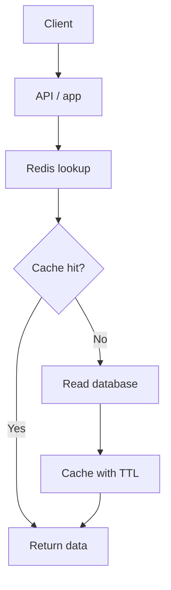

**Flow:** Client calls the API -> app checks Redis -> if hit, returns from cache -> if miss, app queries DB -> saves result with a TTL -> responds.

**Typical cache layers:**

| Layer | Examples | What it helps |
|---|---|---|
| Browser | HTTP/browser cache | Repeat image/CSS/JS requests |
| CDN / edge | CloudFront, Azure Front Door | Reduce origin requests and global latency |
| Local process | In-memory LRU | Sub-millisecond access per pod (not shared across pods) |
| Distributed cache | Redis / Memcached | Reusable data across application pods |
| DB internal | Buffer pool, plan cache | Reduce DB disk I/O / planning overhead |

---

## 2. Main caching strategies

There are **five common application caching patterns** worth learning. The choice depends on read/write patterns, consistency expectations, and failure requirements.

### 2.1 Cache-aside (Lazy Loading)

**How it works:** Application checks Redis first. On a **cache miss**, the **application itself** queries the database and populates Redis with the result.

**Example:** Product catalog, user profile, order status.

**Advantage:** Simple and loads only the values that users request.  
**Disadvantage:** First request after expiration is slower; stale entries and stampedes are possible.  
**Mitigation:** TTL, invalidation after DB commit, cache warming and single-flight loading.

### Diagram 2A — Cache-aside (app fetches the data)

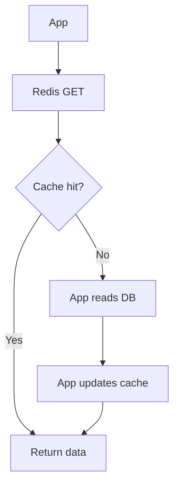

### 2.2 Read-through

**How it works:** Application requests data from a **cache abstraction or integrated loader**. If the value is missing, **the cache layer** retrieves it from the database and populates the cache.

**Example:** A caching middleware/library providing automatic data loading.

**Advantage:** Centralizes cache loading instead of repeating miss-handling logic in multiple services.  
**Disadvantage:** Requires an integrated loader and still has cold-miss latency.  
**Mitigation:** Replicated cache, bounded timeouts, controlled DB fallback and preloading hot keys.

### Diagram 2B — Read-through (cache layer fetches the data)

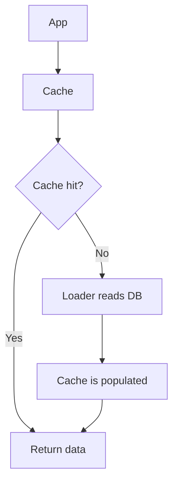

### Q1. Why do read-through and cache-aside look so similar?

**You're correct. Both are lazy-loading approaches.** The key difference is **who handles a cache miss**:

| Question | Cache-aside | Read-through |
|---|---|---|
| Who fetches data on a miss? | Application | Cache layer / integrated loader |
| Does application handle miss logic? | Yes | Usually no, it's abstracted |
| Cache populated on first read? | Yes | Yes |
| Is plain Redis sufficient? | Yes, with app logic | Not automatically; requires a loader/cache abstraction |
| Common in EKS/AKS apps? | Very common | Useful with suitable cache library/middleware |

**Interview answer:** Cache-aside keeps loading logic in the application, whereas read-through moves it into the caching abstraction.

### Q2. How do the write caching strategies differ?

**Write-through:** The cache layer persists the write to the DB before acknowledging success.  
**Write-behind:** The cache/buffer acknowledges before a later asynchronous DB flush, so durability matters.  
**Write-around:** The application writes directly to the DB, bypasses cache population, and invalidates existing stale entries.

The three diagrams and their individual advantages/disadvantages are below.

### 2.3 Write-through

**How it works:** Write through the cache layer, and **persist to the database synchronously before acknowledging success**.

**Example:** A system where the cache should reflect the latest successfully written record.

**Advantage:** Good control over read-after-write freshness.  
**Disadvantage:** Slower writes and possible partial failure between cache and DB.  
**Mitigation:** Durable database commit, retries or cache invalidation if cache update fails, idempotency and version handling.

### Diagram 3A — Write-through

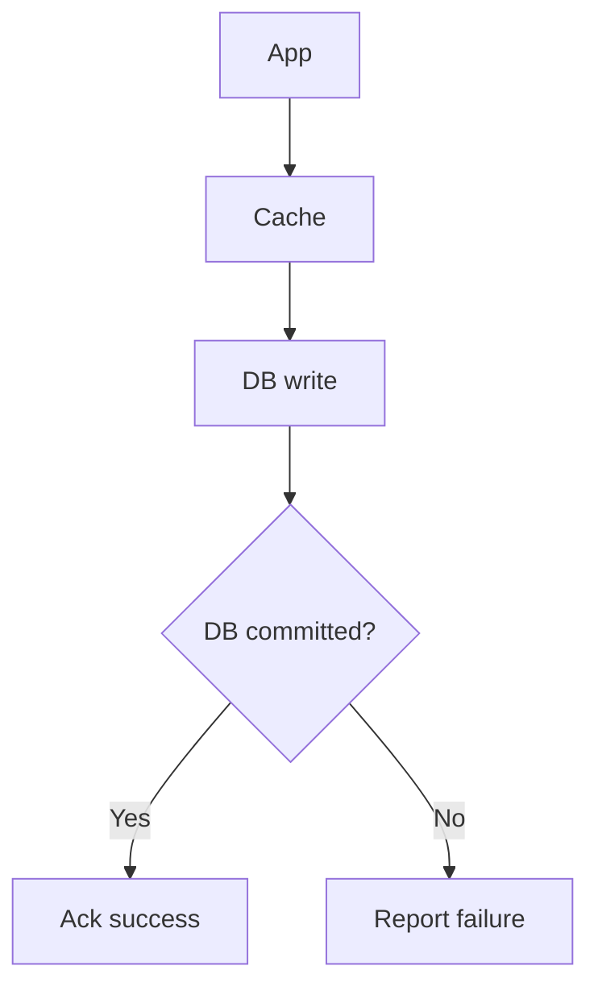

### 2.4 Write-behind (Write-back)

**How it works:** Write to the cache/buffer and acknowledge early; persist the change to DB **later**, asynchronously.

**Example:** Delay-tolerant counters or telemetry, not a default for payment transactions.

**Advantage:** Fast writes and possible batching.  
**Disadvantage:** The cache can fail before unflushed changes reach DB, losing acknowledged data.  
**Mitigation:** Durable queue/WAL, replication with suitable acknowledgements, controlled retries, DLQ (where supported), recovery/replay and idempotency.

### Diagram 3B — Write-behind

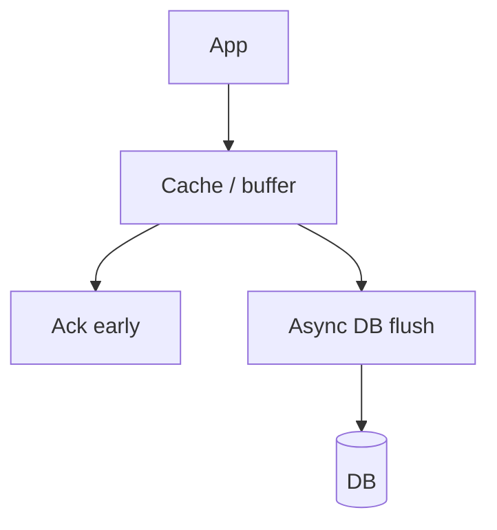

### 2.5 Write-around

**How it works:** Write directly to DB, **bypassing cache population**. Future reads may populate the cache.

**Example:** Write-heavy data that is rarely read again.

**Advantage:** Avoids filling the cache with rarely used writes.  
**Disadvantage:** First subsequent read misses, and old cached values can become stale.  
**Mitigation:** Invalidate after successful DB commit, use TTL, and preload only genuinely hot keys.

### Diagram 3C — Write-around

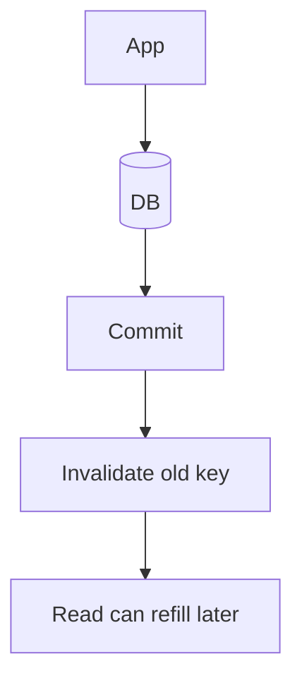

---

## 3. Which strategy should an architect select?

| Strategy | Advantage | Disadvantage | **How to mitigate the disadvantage** | Typical use |
|---|---|---|---|---|
| **Cache-aside** | Simple; loads only requested data | First-read latency; stale entries | TTL, invalidation on DB writes/commit, cache warming, single-flight | Product catalog, user profiles |
| **Read-through** | Centralized read-loading logic | Loader dependency, miss latency | Replicated cache, bounded timeouts, fallback to DB, preload hot keys | Shared read caching |
| **Write-through** | Cache and DB coordinated during writes | Higher write latency, partial-write risk | DB-first durable commit, retry or invalidate cache, idempotency | Frequently read/updated records |
| **Write-behind** | Low write latency, possible batching | Data loss before DB persistence | Durable queue/WAL, replication, retries, DLQ, recovery/replay | Delay-tolerant telemetry/counters |
| **Write-around** | Avoids caching rarely read writes | Later read misses; old keys stale | Invalidate on DB commit, TTL, optional warm hot keys | Write-heavy, low-read data |

**Architect recommendation from our discussion:** For a typical EKS/AKS customer-facing API with RDS/Azure SQL, start with **cache-aside + Redis HA + TTL + invalidation + rate-limited DB fallback**. The database remains the source of truth; correctness-critical financial operations should not rely on arbitrarily stale cache values.

---

## 4. Interview Q&A — Cache consistency and performance

### Q3. What is invalidation on DB writes?

When a record changes in the DB, remove or update the corresponding cached key so the next read does not keep serving stale data.

**Example:**

- Redis has `product:1001 = ₹50,000`.
- DB has `product:1001 = ₹50,000`.
- Admin updates price to ₹48,000.
- After DB change commits, delete `product:1001` from Redis.
- Next GET misses -> reads ₹48,000 from DB -> repopulates Redis.

**Failure risk:** Cache invalidation can fail even after the DB succeeds. TTL limits how long old data can remain under ordinary expiry semantics; reliable event delivery / retries may also be needed.

### Q4. What does "invalidate on DB commit" add?

It specifies *when* to invalidate: after the DB transaction **successfully commits**, rather than when an update was merely attempted.

### Diagram 4 — Commit then invalidate

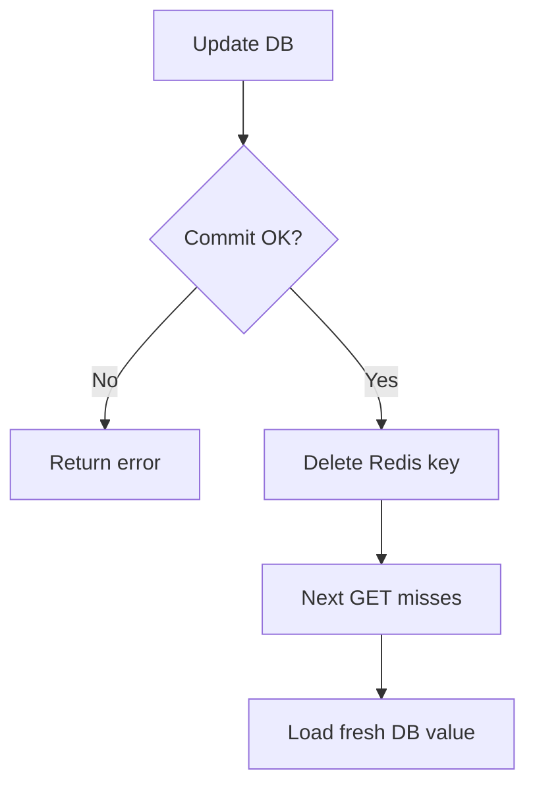

**Why not invalidate on a failed transaction?** The DB may have rolled back, creating a needless miss.

**Architect's nuance:** "Commit then delete key" by itself is not atomic across DB and Redis. Invalidation can be lost; a concurrent read can repopulate an old value in a race. For important consistency use versioned values/keys, CDC or a transactional outbox, idempotent invalidation handlers, and well-defined TTL/consistency expectations.

### Q5. What is cache warming?

Intentionally populate useful cache entries **before** normal user requests (for example, after Redis restart or before a flash sale), instead of making the first users cause all the DB reads.

**Example:** A restarted Redis has an empty cache. Load popular catalog entries from the DB, then gradually ramp up production traffic. This reduces cold-start DB pressure.

### Q6. What is single-flight loading?

When many concurrent requests miss **the same key**, coordinate them so only one performs the DB fetch and the others share the result.

### Diagram 5 — Cache stampede prevention

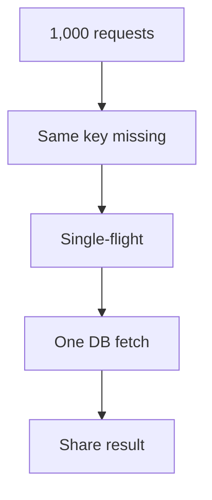

**Without it:** 1,000 users might trigger 1,000 reads. **With it:** ideally one read *per coordination scope/key*.

**Caveat:** A mutex in one pod coalesces only that pod's requests. In multi-pod EKS/AKS, use cross-pod coordination or accept some duplicate loads. Other mitigations: TTL jitter, stale-while-revalidate, and refresh-ahead.

---

## 5. Interview Q&A — HA and graceful degradation

### Q7. What is a replicated cache?

A primary Redis node replicates changes to one or more replicas, often placed across different AZs. If the primary fails, one suitable replica can be promoted, **provided automatic failover is configured**.

**Benefit:** reduces the single-node failure risk.

**Limitation:** Redis replication is usually asynchronous; recently acknowledged cache writes might not exist on the promoted replica. In a conventional cache-aside design, this is normally acceptable because the DB is authoritative and missing data can be rebuilt.

### Q8. What are bounded timeouts?

Put an upper limit on each Redis connection/read attempt (and on all retries together) so an unhealthy cache cannot stall the entire API request.

**Illustrative, not recommended universal defaults:**

```text
Redis connect timeout = 100 ms
Redis read timeout    = 50 ms
Retries               = limited by total request deadline
If unavailable        = circuit-break and controlled fallback
```

Choose actual values based on network latency, SLO and overall request deadline. Long timeouts can exhaust app worker threads/connections.

### Q9. What is fallback to DB?

When Redis is down, the application queries the database directly **within a controlled fallback budget**. Useful for availability, dangerous if unconstrained.

Example: 10,000 RPS, 90% hit rate -> normally about 1,000 DB reads/sec. If Redis completely fails and *all* requests fall back, DB load may surge to 10,000 reads/sec and cause cascading failure.

**Mitigation:** short timeouts, circuit breaker, fallback concurrency cap, token bucket/rate limit, DB connection-pool limits, serve acceptable stale data when allowed, and 429/503 load shedding if DB cannot keep up.

### Q10. What are "preload hot keys"?

Proactively cache the most frequently requested keys before peak load.

**Example:** Out of one million products, 500 generate most traffic. Load `product:1001` through `product:1500` from the DB ahead of the sale.

**Difference:** Cache warming is the broad practice; preloading hot keys is a targeted warming technique.

---

## 6. Redis HA on EKS / AKS — Architecture and failover

For AWS, a common production approach is **Amazon ElastiCache for Redis/Valkey** with Multi-AZ replicas and automatic failover. In Azure, choose an HA-managed Redis option with appropriate zone redundancy.

### Diagram 6 — Managed Redis across three AZs

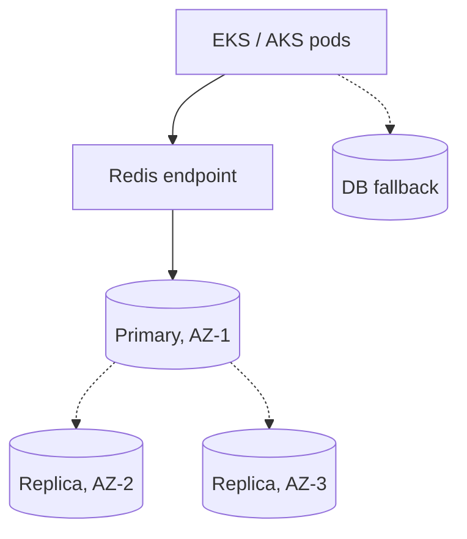

**Deployment checklist:**

1. Provision a Redis replication group / managed HA deployment.
2. Place primary and replicas in separate AZs; enable automatic failover.
3. Use supported primary/reader endpoints or failover-aware clients, **not a fixed node IP**.
4. Set sensible connection/read timeouts and bounded retry/reconnect policies.
5. Configure monitoring: availability, replication lag, memory, evictions, connections, errors and cache hit ratio.
6. Plan cold-cache warming and protect RDS during failover.
7. If using Redis Cluster for sharding, also plan replicas and failover **per shard**. Sharding alone is not HA.

### Diagram 7 — Redis primary fails

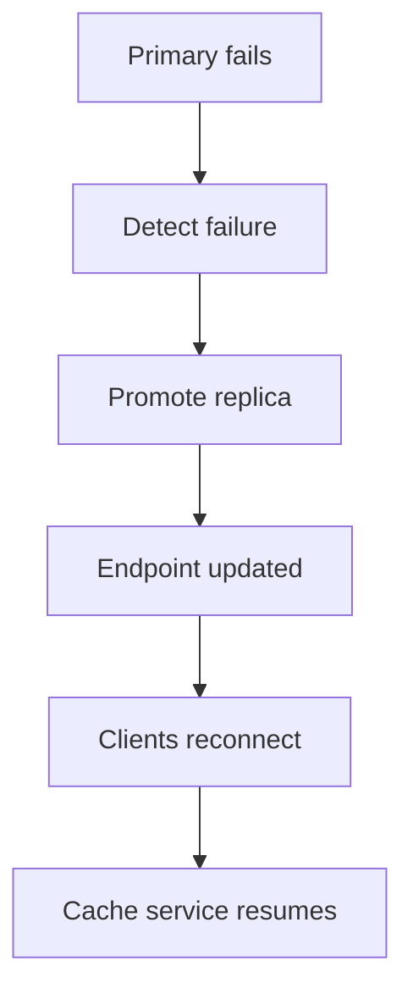

**Failure impact:** Some cache operations and client connections fail during detection/promotion. Failover is not zero downtime or automatically zero data loss. Applications require reconnect/retry behavior.

### Diagram 8 — Wider Redis outage and cascading DB failure

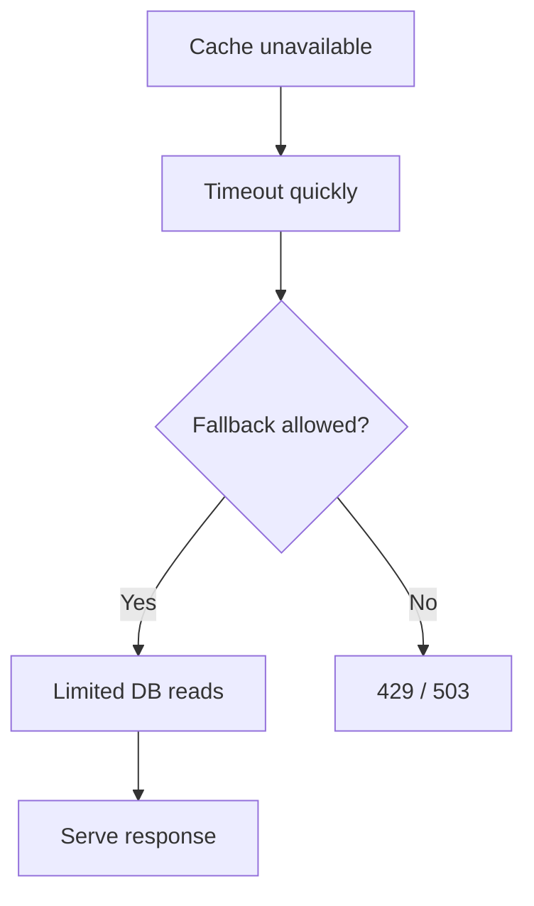

| Redis failure | Expected behavior | SRE/architect response |
|---|---|---|
| Replica fails | Primary still serves | Replace and resync replica; confirm redundancy |
| Primary fails | Replica promoted if available | Managed failover, reconnect clients, verify service |
| One AZ lost | Remaining nodes may serve after failover | Multi-AZ distribution and spare capacity |
| All Redis nodes unreachable | Cache traffic fails | Circuit breaker, capped DB fallback, graceful degradation |
| Redis memory pressure | Evictions or rejected writes, depending on policy | Correct maxmemory/eviction policy, TTL, scaling |
| Network issue | Timeouts/connection errors | Check DNS, SG/NSG, routes, network policies, endpoints |
| Entire region lost | Regional cache unavailable | Fail over app and DB by DR plan; rebuild/warm cache |

### Q11. What about Redis Sentinel?

For **self-managed** non-clustered Redis on VMs/Kubernetes, Sentinel can monitor nodes, discover the current primary and coordinate failover. A common robust design uses at least **three independently placed Sentinel instances** with quorum/majority configuration.

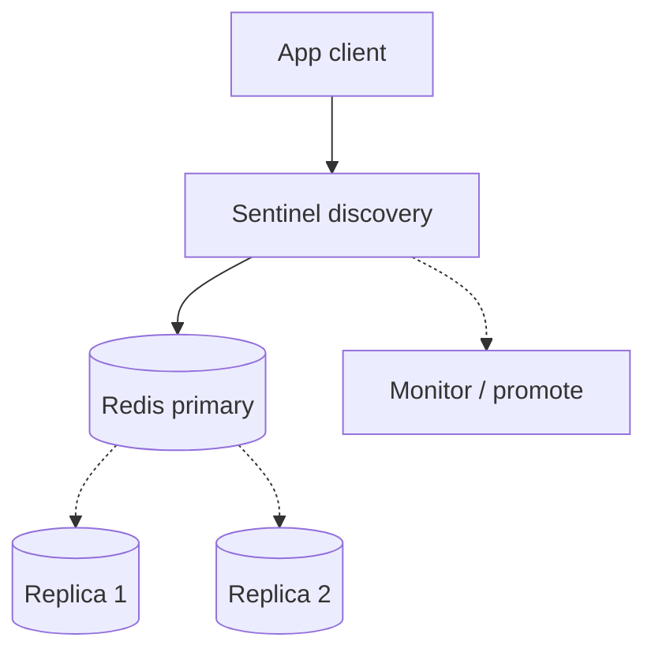

**Important:** Redis Sentinel and Redis Cluster are different: Sentinel is a failover/discovery system typically for non-sharded Redis; Redis Cluster shards data and also supports replication/failover per shard. Managed AWS/Azure cache options generally reduce the need to run Sentinel yourself.

---

## 7. Interview Q&A — Durability for write-behind

### Q12. What is a durable queue / WAL?

A **durable queue** stores accepted work persistently for later workers. A **write-ahead log (WAL)** records pending changes before applying them to the final storage state, enabling crash recovery in systems designed around it.

**Why:** If you acknowledge a cache write but lose the only cached copy before a DB flush, you may lose accepted data. A durable handoff **before acknowledgement** reduces this risk.

### Diagram 9 — Durable asynchronous write pipeline

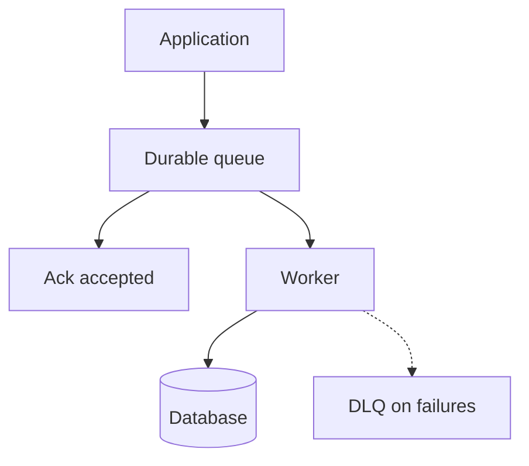

**Important distinction:** This is a *durable asynchronous write pipeline*. Classic write-behind caching acknowledges a cache write before DB persistence. Redis alone is **not automatically equivalent** to a durable queue/WAL with end-to-end guaranteed acceptance; Redis AOF/replication/ack policy and failure model matter.

### Q13. What does replication mean for write-behind?

Keep copies of pending changes/log entries on multiple nodes so a single node crash does not necessarily erase the only copy.

**Warning:** Asynchronous replication can still lose recent entries. Durability depends on write acknowledgement policy, persistence and the failure scenario—not only the existence of replicas.

### Q14. What are retries and DLQ?

- **Retry:** Temporarily failed DB writes get another attempt after backoff (preferably with jitter).
- **DLQ:** When using a queue with a redrive policy, a repeatedly failing message can be isolated for inspection.
- **Idempotency:** A retry/replay must not double-charge, duplicate orders, or accidentally double-apply a counter update.

**Illustrative flow:** write fails -> retry 1 -> retry 2 -> retry 3 -> DLQ, if configured with that threshold. A DLQ is **not a feature of every WAL or cache**.

### Q15. What is recovery/replay?

After a failed database/worker recovers, consume previously durable pending changes and persist them.

**Scenario:** DB down -> queue accepts updates -> worker pauses/retries safely -> DB recovers -> worker replays backlog -> successful records are acknowledged/deleted -> processing catches up.

**Operational controls:** keep message retention longer than expected outage/recovery, rate-limit replay to protect DB, monitor oldest message age, use idempotency and reconcile final state.

---

## 8. Cache expiry and eviction

**TTL (time to live)** expires cached entries after an interval; **eviction** removes keys due to capacity policy (or another memory management rule).

Example Redis command:

```redis
SET product:1001 "iPhone" EX 300
```

This sets a 5-minute expiry.

| Policy / technique | Purpose |
|---|---|
| TTL | Bound age of ordinary cached data |
| LRU | Evict least recently used keys (policy/implementation dependent) |
| LFU | Evict least frequently used keys |
| TTL jitter | Spread expirations so many hot keys do not expire simultaneously |
| Negative caching | Cache short-lived “not found” results carefully |
| Stale-while-revalidate | Allow acceptable stale data during asynchronous refresh |
| Refresh-ahead | Proactively update keys expected to be requested soon |

**Never treat a TTL as a substitute for a correctness/authorization policy.**

---

## 9. Monitoring and troubleshooting

| Component | Metric / signal | Interpretation |
|---|---|---|
| Application | p95/p99 API latency; 5xx | Customer impact |
| Redis | Cache hit/miss ratio | Whether reads are being served from cache |
| Redis | Latency, connection errors/timeouts | Network or server health |
| Redis | Evictions, used memory | Capacity / eviction-policy issues |
| Redis replication | Replica lag, role/failover events | HA health and risk |
| Database | Queries/sec, connections, CPU, latency | Fallback pressure or DB bottleneck |
| Worker / queue | Retry count, queue depth, oldest age, DLQ count | Write-behind backlog, persistent failures |

### Diagram 10 — Ten-minute Redis outage investigation

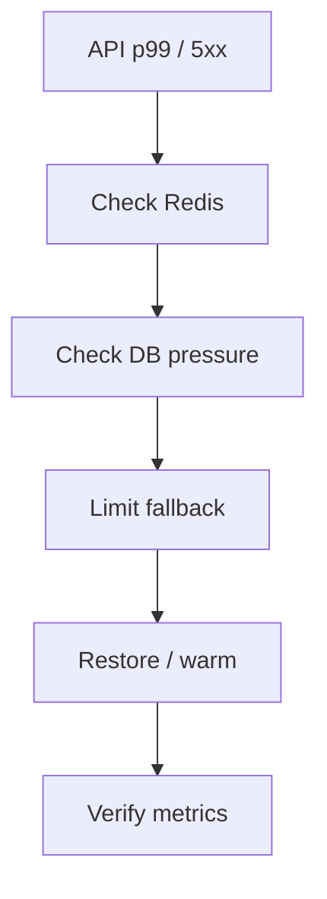

**Incident response:** identify customer impact -> check Redis node/endpoint events and cache client errors -> confirm DB safety -> allow managed failover or restore cache -> reconnect -> gradual warming -> validate hit ratio, p99, errors and DB load.

---

## 10. Fast revision — Terms and problems solved

| Term | In one line |
|---|---|
| Invalidation on DB writes | Remove/update stale cached data after DB changes |
| Invalidate on DB commit | Do so only after successful transaction commit |
| Cache warming | Pre-fill cache before normal demand |
| Single-flight loading | Coalesce concurrent misses for the same key |
| Replicated cache | Maintain copies to survive cache-node failure |
| Bounded timeouts | Stop waiting for slow Redis quickly |
| Fallback to DB | Query authoritative DB when cache unavailable, within limits |
| Preload hot keys | Warm only the most frequently used cache keys |
| Durable queue / WAL | Record accepted pending changes before final persistence |
| Replication | Reduce single-node loss risk; not equal to zero-data-loss |
| Retries | Reattempt transiently failed work safely |
| DLQ | Isolate repeated failures in queue-backed processing |
| Recovery/replay | Reprocess durable pending work after outage |

---

## 11. Interview follow-ups

**Q. Why should I use cache-aside over read-through?**  
Cache-aside is straightforward when the application owns the DB query and cache-population code. Read-through is useful with a shared loader abstraction. Both need invalidation/TTL and cache-failure policies.

**Q. Redis primary fails: is there zero downtime?**  
No. Replicas/managed failover reduce downtime, but clients may see transient errors and need reconnect logic.

**Q. Can my DB survive 100% cache misses?**  
Do not assume so. Design a bounded fallback and load-shedding policy. Warm hot keys and prevent stampedes.

**Q. Is Redis replication a backup?**  
No. Replication provides availability of copies but can replicate bad data/deletes; durability/backups/DR need independent consideration.

**Q. Are WAL and DLQ interchangeable?**  
No. WAL is a write-recovery mechanism; DLQ isolates failed processing messages in queue-based workflows.

**Q. What happens if DB commit succeeds but cache invalidation fails?**  
Cache can be stale. Alert/retry invalidation using CDC/outbox where required, use TTL and race-aware/versioned strategies for stricter consistency.

**Q. Should payments use write-behind?**  
Not by default. Payment correctness normally needs durable, strongly controlled transaction semantics. If asynchronous processing is used, persist commands durably, apply idempotency and expose states clearly.

---

### Original caching Q&A — Complete set from the first explanation

**Q. When should we not cache data?**

When strong freshness or consistency is required and stale values would cause incorrect business decisions—for example, certain financial balances, payment authorization decisions, or rapidly changing inventory checks. Caching may still be used around these systems with carefully defined correctness rules.

**Q. How do you update Redis when the database changes?**

Use invalidation after a DB update, update the cache with the new value, or use a write-through design. For concurrent updates, consider versioned values and race conditions.

**Q. Is Redis a primary database?**

Redis can be a primary database in systems designed around its durability and data model, but in a typical Redis-plus-RDS cache-aside design, RDS remains the source of truth and Redis is treated as disposable cached data.

**Q. What happens if a cached value is stale?**

Users may see outdated information. Use appropriate TTL, invalidation and consistency controls. Critical writes should not rely solely on potentially stale cache values.

**Q. Can caching be implemented across multiple AWS regions?**

Yes. Each region can have its own cache close to application workloads. Plan invalidation, cache warming, regional failover and acceptable data staleness; ordinary Redis caches do not automatically become a strongly consistent global cache.

---

## 12. 90-second architect / SRE interview answer

> Caching stores frequently accessed data in a faster layer such as Redis, reducing database traffic and API latency. For a typical EKS or AKS API I would start with cache-aside: check Redis first, and on a miss read the authoritative database and populate cache with TTL. Read-through works similarly, except a cache abstraction loads the missing value rather than the application doing it explicitly.
>
> For consistency, I would invalidate stale keys after successful DB commits, and consider versioning, CDC or an outbox if reliable invalidation is essential. For performance, I would warm hot keys and use single-flight loading to avoid stampedes.
>
> For HA, I would select managed Redis with replicas across AZs and automatic failover, then configure client timeouts, reconnection, circuit breakers and a rate-limited database fallback. A Redis failure must not turn into a database failure.
>
> If the workload needs write-behind behavior, I would distinguish a disposable cache from acknowledged business writes and ensure an appropriate durable log or queue, retry handling, DLQ where applicable and idempotent replay.

**Remember:** **Consistency** = invalidation/TTL/versioning. **Performance & availability** = warming/single-flight/replicas/timeouts/fallback. **Durability & recovery** = queue/WAL/replication/retries/DLQ/replay.
