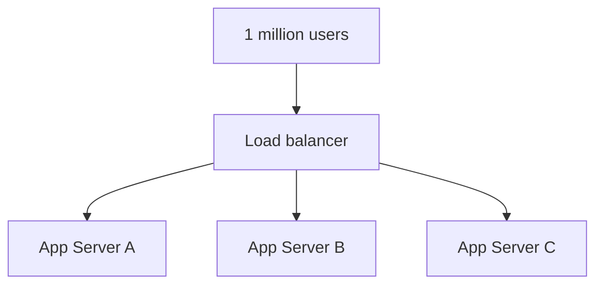
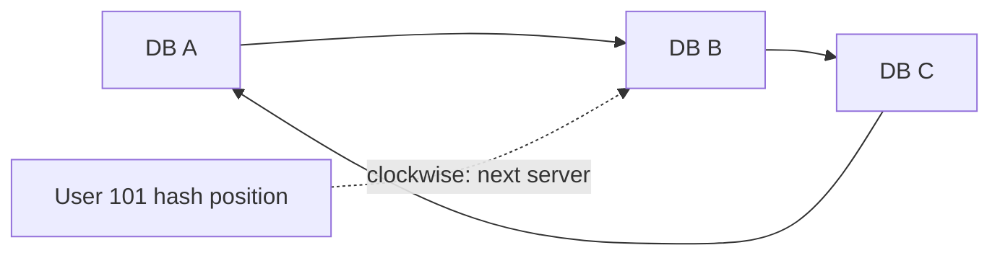
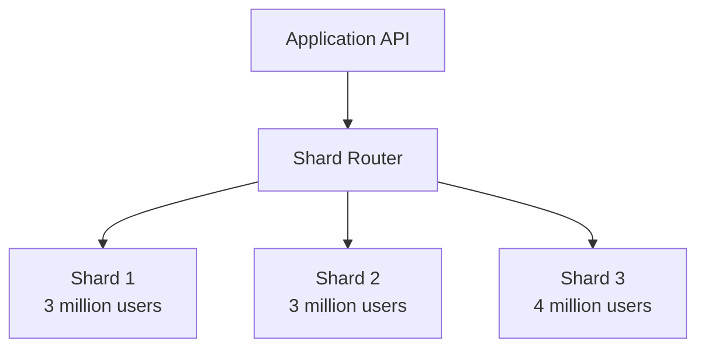
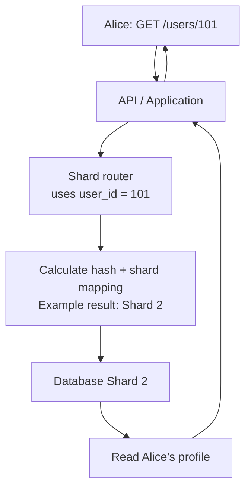
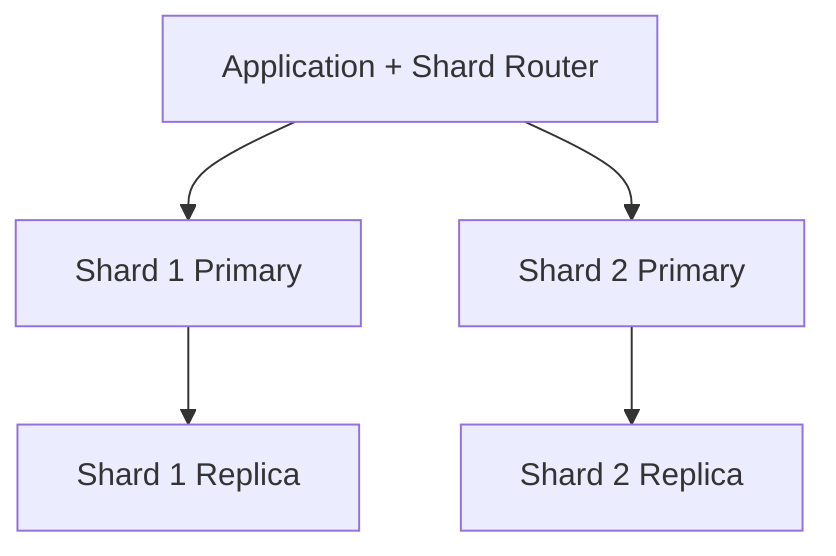

# Distributed Computing, Hashing, Consistent Hashing & Database Sharding

> **System design / SRE interview — consolidated quick-revision notes**  
> Simple explanations → backend flow → advantages/disadvantages → failure scenarios → follow-up Q&A.

## 1. What is distributed computing?

**In layman's terms:** One computer does not do all the work. Multiple computers work together to run an application.

**Example:** An application serves **1 million users**. Instead of a single server, work can be shared across three servers:

- Server A: 300,000 users
- Server B: 300,000 users
- Server C: 400,000 users

The numbers illustrate distribution, not a guarantee that each server owns particular users. Requests can be routed dynamically by a load balancer.



**Why use it?** Scalability (share the work), high availability (other nodes may continue when one fails), and better use of resources.

**Trade-off:** Coordination, network failures, data consistency and debugging become harder when many machines are involved.

> **Remember:** Distributed computing describes the overall approach. Sharding is one technique for distributing **data**, while load balancing distributes **requests**.

## 2. What is hashing?

**In layman's terms:** A hash function converts an input, such as a user ID, into a deterministic number/value. For the same input and same function, you get the same hash result.

**Example — choosing a data destination:**

```text
User ID: 101
    |
  hash(101) = 78921        <-- illustrative hash result
    |
  78921 % 3 = 0            <-- modulo gives the remainder
    |
  Select Shard 0
```

In this simple scheme, the hash selects **where a record belongs**. It is not the same as encrypting the user's data. A database still stores and retrieves the original record using its key.

**Key terms:**

- **Hash function:** Maps input to a hash value.
- **Modulo (`%`):** Remainder after division; often used to convert a hash to a server/shard index.
- **Shard key:** A data field such as `user_id` or `tenant_id` used to choose where a record is stored.

## 3. Challenges with traditional modulo hashing

Suppose data is mapped using `hash(user_id) % 3` to shards 0, 1 and 2.

**What happens when a fourth shard is added?**

```text
Before: hash(user_id) % 3    --> Shards 0, 1, 2
After:  hash(user_id) % 4    --> Shards 0, 1, 2, 3

Same user ID can now point to a different shard.
Existing records must be found and moved or routing must be adapted.
```

| Challenge | Simple explanation | Typical mitigation |
|---|---|---|
| **Major remapping on scale-out** | Adding/removing a server changes many users' destinations | Consistent hashing, logical buckets or routing directory |
| **Costly data movement** | Moving millions of records uses network, storage and database resources | Gradual rebalancing, dual-read/write or cutover plan |
| **Uneven distribution** | Some servers end up with more records or traffic | Good shard key, virtual nodes, monitoring |
| **Hot keys / hotspots** | One famous account or tenant may overload its shard | Cache, isolate/split hot tenant, targeted capacity |
| **Failure handling** | A failed server makes assigned data unavailable unless another copy exists | Replication, health checks and failover |

**Important distinction:** Hash collisions (different keys producing the same hash value) can occur. They do **not** mean the database should treat two different user IDs as the same record. Retain the original IDs to distinguish records.

## 4. What is consistent hashing?

**In layman's terms:** It is a way of assigning data to servers so that **adding or removing a server changes only a relatively small portion of assignments**, instead of remapping most of the dataset.

**Mental model: a circular ring**

1. Apply a hash to each **server**, placing it at a position on the ring.
2. Apply a hash to each **user/key**, placing it on the same ring.
3. Move **clockwise** from the key to the first server; that server owns the key.
4. Adding a server only takes over part of the next server's range. Removing a server passes its range to the next server.



The diagram is a simplified *logical* ring; actual server/key positions depend on their hash values.

**Comparison**

| Traditional `hash(key) % N` | Consistent hashing |
|---|---|
| Simple to implement | More routing logic |
| Changing N changes many mappings | Adding/removing nodes generally moves fewer keys |
| May cause costly bulk reshuffling | Makes redistribution less disruptive |
| Still needs HA and good key choice | Still needs HA and good key choice |

**Virtual nodes:** Represent each physical server by several positions on the ring. This helps distribute records/load more evenly and smooths rebalancing. Consistent hashing reduces data *remapping*; it does **not** automatically replicate data, eliminate hotspots or guarantee zero downtime.

## 5. What is database sharding?

**In layman's terms:** Split one very large database into smaller, independent pieces (**shards**), each holding a *different portion* of the records.

**Example: 10 million users**



Ways to choose a shard:

- **Range-based:** Users A–G in shard 1, H–P in shard 2, Q–Z in shard 3; easy to understand, but can become uneven.
- **Hash-based:** `hash(user_id) % 3` (or a stable bucket/ring mapping); aims to spread keys.
- **Directory-based:** Lookup a map from `user_id` or `tenant_id` to its assigned shard; flexible but adds a mapping dependency.

A shard is **not** a copy of every other shard. Copies of a shard are called **replicas**.

## 6. How sharding works in the backend

**Example: Alice requests her profile and her `user_id` is 101.**



**Step by step:**

1. Alice sends a request to the API.
2. Application obtains the **shard key** (`user_id = 101`).
3. The router applies the configured algorithm or consults the routing directory.
4. The router connects to the selected shard.
5. That shard reads/writes Alice's record.
6. The API returns the result.

The router may live in **application code**, a **database middleware/proxy**, or a database platform with built-in sharding. The earlier numeric hash example mapped to *Shard 0* using a particular illustrative value; this workflow's *Shard 2* is a **separate example**, not the result of that same calculation.

**Practical considerations:**

- Picking a good **shard key** matters: even distribution and frequent queries should guide the choice.
- A query about many users may need **scatter-gather** across multiple shards.
- A transaction touching records on different shards needs more complex coordination.
- Adding a shard requires a **controlled migration and routing update**, not just starting another server.

## 7. Advantages and disadvantages of sharding

### Advantages

| Advantage | Simple explanation |
|---|---|
| **Scalability** | Add database capacity across more machines as data grows. |
| **Potentially faster queries** | Well-routed queries operate on a smaller data subset. |
| **Load distribution** | Different shards can serve different requests in parallel. |
| **More storage capacity** | Not limited to one database server's disk. |
| **Fault isolation** | A problem in one shard may not stop unrelated shards. |

### Disadvantages

| Disadvantage | Simple explanation | What can help |
|---|---|---|
| **Routing complexity** | App must know which shard holds the data | Centralized, tested shard-routing logic |
| **Cross-shard joins** | Joining data from different shards is slower/harder | Co-locate related records; avoid unnecessary joins |
| **Rebalancing** | Moving data while adding shards can be costly | Consistent hashing/buckets and staged migration |
| **Uneven traffic** | One shard may receive more writes/reads | Monitor hotspots; split or isolate hot tenants |
| **Complex transactions** | Operations touching multiple shards are difficult to keep atomic | Design transactions within a shard when possible; orchestration where needed |
| **Backup/recovery complexity** | Coordinating safe restore points across shards is harder | Backup policies, per-shard replicas and tested recovery procedures |

## 8. Sharding vs replication (important interview distinction)

| Sharding | Replication |
|---|---|
| **Splits different data** across servers | **Copies the same data** to other servers |
| Primarily increases **capacity / horizontal scale** | Primarily supports **availability / redundancy** (and sometimes read scaling) |
| Shard 1 and Shard 2 have different subsets | Shard 1 primary and Shard 1 replica contain the same shard's data |

**Production HA pattern:** Have a primary and one or more replicas **for each shard**, often placed in different availability zones.



Replication by itself does not guarantee zero data loss: synchronous vs asynchronous replication, failure mode, failover, and consistency requirements matter.

## 9. Failure and scaling scenarios — follow-up Q&A

**Q1. What happens when Shard 2 fails?**  
**A:** Users assigned to Shard 2 can be affected, but unrelated shards may continue. Fail over to a healthy replica *of Shard 2* if available, update routing, and verify consistency. **Sharding alone is not HA.**

**Q2. What if Shard 3 is overloaded?**  
**A:** Check shard-level CPU, storage I/O, connections, slow queries and traffic by key/tenant. Optimize queries and indexes; use caching or read replicas where appropriate; split/rebalance hot data or give the shard more capacity.

**Q3. Why not store all users in one huge table?**  
**A:** One well-indexed database is simpler and may be sufficient for a long time. Shard only when storage, write throughput or other scale limits justify the added complexity.

**Q4. What exactly breaks when `hash(user_id) % 3` becomes `% 4`?**  
**A:** Many existing user IDs map to different shard numbers, while their records may still be on the old shards. Without migration/routing coordination, reads can miss data and writes can land in the wrong place.

**Q5. How does consistent hashing reduce the migration problem?**  
**A:** In a ring, a new node takes over a limited part of the key space, so only keys in that range need new ownership. Virtual nodes improve balance; a migration plan is still required.

**Q6. Is consistent hashing mandatory for database sharding?**  
**A:** No. You can use range sharding, fixed logical buckets, a routing directory, or native database sharding, depending on access patterns and operational needs.

**Q7. Does hashing alone store the data?**  
**A:** No. Hashing computes a destination. The application/database actually performs the read or write on that destination.

**Q8. What is a hotspot?**  
**A:** One shard gets disproportionately high traffic, such as a very active tenant, even if the number of users is evenly distributed. Good key distribution does not guarantee even workload.

**Q9. How do cross-shard joins work?**  
**A:** A coordinator queries multiple shards and combines results, often with extra network calls and higher latency. Designing data around a shared shard key helps reduce them.

**Q10. Is sharding the same as replication?**  
**A:** No. Sharding **partitions**, replication **duplicates**. Use both when scale and availability are required.

**Q11. Who determines which shard gets a user's request?**  
**A:** The routing logic in the app, middleware, or database. It uses the chosen shard key and maintained shard mapping.

**Q12. When should we introduce sharding?**  
**A:** After checking indexing, query design, capacity, caching and read replicas. Shard when a single primary's capacity/write throughput or dataset size is the bottleneck and the trade-offs are justified.

**Q13. If the application uses multiple servers, is the database automatically sharded?**  
**A:** No. You can have many application servers that all connect to **one** database. Distributed application servers and sharded databases are separate architecture choices.

## 10. Interview-ready answers

### 20-second combined answer

> Distributed computing uses multiple machines working together. Hashing can map a user ID to a data destination. Simple modulo hashing remaps many keys when the number of servers changes, while consistent hashing reduces that movement. Database sharding splits different records across database servers to scale storage and throughput, while replication keeps copies for high availability.

### 30-second sharding trade-off answer

> Sharding improves database scalability, storage capacity, parallelism and sometimes fault isolation. But it adds complexity in shard routing, cross-shard joins and transactions, hotspots, data migration, and backup/recovery. I'd first optimize the database, queries and indexes, then consider caching or read replicas. If sharding is needed, I'd select a good shard key, plan rebalancing, and replicate each shard across failure domains.

### One-line mental model

**Distributed computing = multiple computers; Hashing = calculate placement; Consistent hashing = stable placement when nodes change; Sharding = split data; Replication = copy data for redundancy.**
