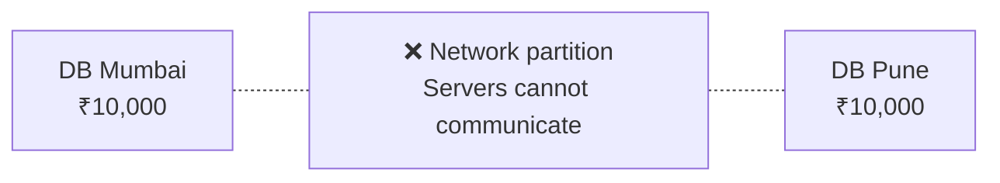
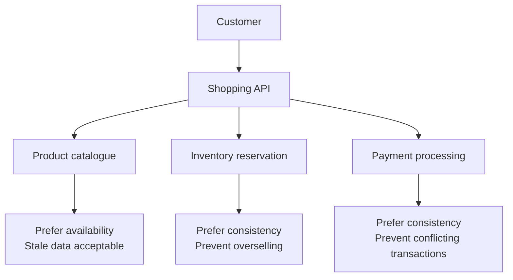

# CAP Theorem — System Design Interview Notes

## 1. What is CAP Theorem?

**In layman's terms:** CAP theorem explains the trade-off a distributed system faces when its servers cannot communicate with one another.

Imagine you have a banking application with two database servers, one in Mumbai and another in Pune.

Both servers normally communicate to keep the account balance updated. Suddenly, the network connection between them breaks.

What should the application do?

- **Option A:** Stop certain transactions until it can guarantee the correct balance.
- **Option B:** Continue accepting transactions, even though the two servers may temporarily disagree on the balance.

This is the fundamental trade-off behind CAP theorem.

## 2. Understanding C, A and P

| Property | Simple explanation | Example |
|---|---|---|
| **C – Consistency** | Every read sees the latest successfully committed value (or an error). | After a balance update, you don't read the old balance. |
| **A – Availability** | Every request to a functioning node receives a successful response, even if the data may be stale. | Application continues answering requests. |
| **P – Partition Tolerance** | System can handle broken communication between groups of servers. | Mumbai and Pune servers lose network connectivity. |

**Important:** CAP does not literally mean you always choose any two of three. It says **when a network partition happens, a distributed system must sacrifice either strong consistency or availability for some operations.**

## 3. How CAP works in a real scenario

Suppose two database servers hold a bank account balance of ₹10,000.



Now Alice withdraws ₹2,000 through the Mumbai server.

### Option 1: CP (Consistency + Partition Tolerance)

The system prioritizes correct data.

```text
Alice withdraws ₹2,000
         |
     DB Mumbai
         |
 Cannot communicate with DB Pune
         |
 Cannot safely confirm the transaction
         |
 Reject / timeout the transaction
```

In a quorum-based database, the majority side may still process transactions. Only nodes unable to obtain the required agreement must refuse them.

**Result:** Protects consistency, but some requests become unavailable.

### Option 2: AP (Availability + Partition Tolerance)

The system prioritizes responding.

```text
Alice withdraws ₹2,000
         |
     DB Mumbai
         |
 Network connection broken
         |
 Mumbai continues handling requests
         |
 Pune may still show ₹10,000
         |
 Synchronize / reconcile later
```

**Result:** Requests can continue, but users may temporarily see outdated or conflicting data. Reconciliation is required.

For an actual banking ledger, blindly accepting conflicting withdrawals would be unsafe. AP is better suited to operations that can tolerate temporary disagreement.

## 4. Real-world use cases

| Application / feature | Typical preference | Why? |
|---|---|---|
| Banking transactions | **CP** | Avoid conflicting account balance updates. |
| Inventory reservation | **CP** | Avoid overselling limited stock. |
| Social media likes | **AP** | Temporary differences in counts are acceptable. |
| Product reviews or feeds | **AP** | A delay in displaying new content is tolerable. |
| Authentication or permissions | Often **CP** | Avoid accepting outdated authorization changes. |
| Online user presence | Often **AP** | Temporary inaccurate online/offline status may be acceptable. |

These are design preferences for specific operations, not fixed classifications of entire applications. One application can combine CP and AP behaviors.

## 5. Advantages and disadvantages

| Model | Advantages | Disadvantages |
|---|---|---|
| **CP** | Strong consistency, prevents conflicting updates, simplifies reasoning about correctness | Some requests may fail or block during network partitions |
| **AP** | Better responsiveness during network partitions, higher operational continuity | Stale reads, conflicting updates, complex reconciliation |
| **CA** | Can offer consistency and availability when communication is healthy | Cannot guarantee both during a network partition; not a realistic partition-tolerant choice for a distributed system |

## 6. Interview follow-up Q&A

**Q1. Why can't we achieve all three properties simultaneously?**

When two servers cannot communicate, they cannot both guarantee the latest correct data and independently accept every request. One guarantee must be relaxed during the partition.

**Q2. What happens if there is no network partition?**

A distributed system can provide both consistency and availability during normal operation. CAP's fundamental trade-off appears when a network partition occurs.

**Q3. What is eventual consistency?**

Two databases may temporarily show different values, but they eventually converge if updates stop and synchronization succeeds.

Example: You like a social media post. One user sees 100 likes while another sees 101. Later, both see 101.

**Q4. What happens if a CP database loses connectivity?**

Nodes without sufficient coordination or quorum must reject or delay operations that require strong consistency. A healthy majority may continue serving requests.

**Q5. What happens if an AP database loses connectivity?**

Both reachable partitions may continue accepting operations. Once connectivity returns, the application must handle synchronization and potential conflicts.

**Q6. Is CAP consistency the same as ACID consistency?**

No.

- CAP consistency concerns whether operations behave like a single up-to-date copy of data (linearizability).
- ACID consistency concerns preserving database constraints and invariants across transactions.

**Q7. How can we handle conflicting updates in an AP design?**

Depending on the data, use version numbers, conflict-resolution policies, mergeable data structures (CRDTs), or application-specific reconciliation. Simply choosing the latest timestamp is not always safe.

**Q8. Can Kubernetes or an application load balancer solve CAP problems?**

No. Kubernetes and load balancers help with availability and routing, but they cannot remove the consistency-versus-availability trade-off caused by a network partition.

## 7. How would an architect apply CAP?

Suppose the interviewer asks you to design a highly available shopping application.

You can divide the application into components and make different decisions.



The CP/AP labels describe the intended guarantees of these operations during partitions. The complete systems may use different architectures.

For the catalogue, we can serve temporarily stale cached data. For inventory and payment, we would generally rather reject or delay an operation than commit an incorrect update. We also need timeouts, controlled retries, idempotency and recovery handling.

## 8. Interview-ready answer (30 seconds)

"CAP theorem states that in a distributed system, when a network partition occurs, we must choose between consistency and availability. If data correctness is critical, like banking or inventory reservations, I prioritize consistency and allow certain requests to fail temporarily. If continued operation matters more and stale data is acceptable, like social media likes or feeds, I prioritize availability and reconcile data later. In practice, I make this decision at the feature or operation level rather than for the entire application."

**One line to remember:**

**CP = Correct data, even if some requests fail.**

**AP = Keep responding, even if data is temporarily outdated.**
