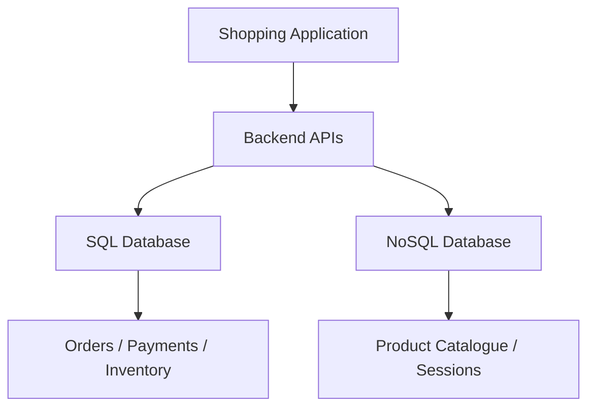
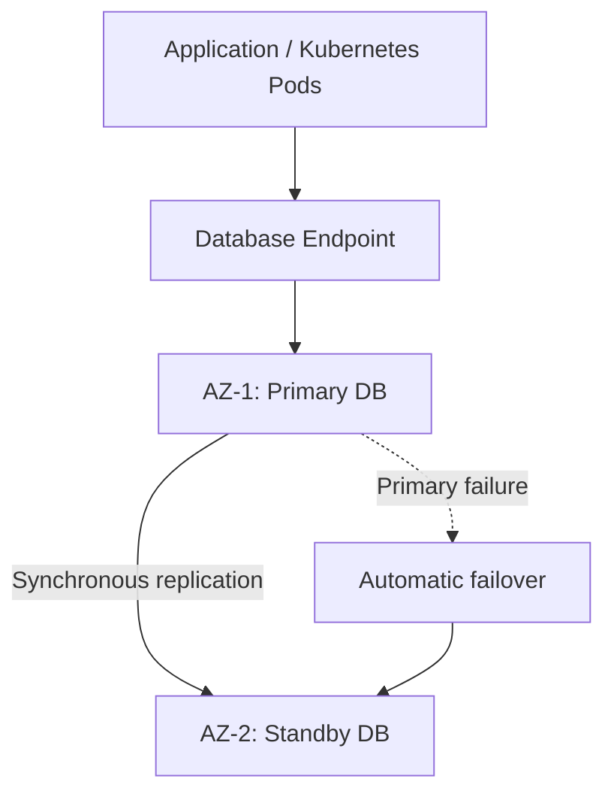
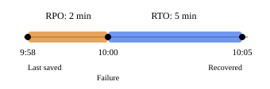
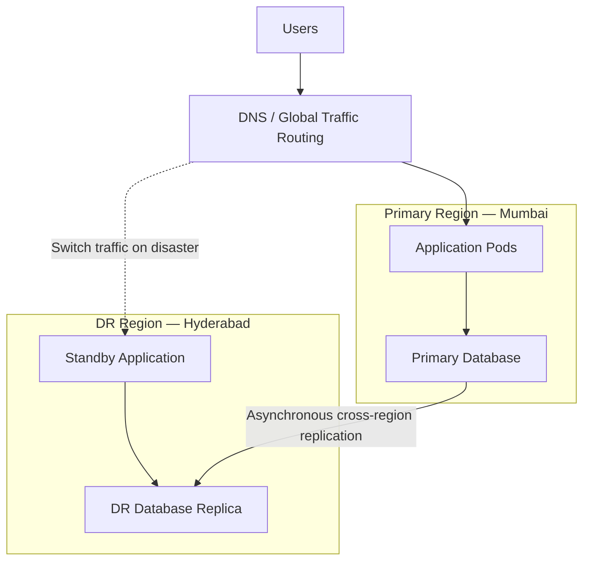
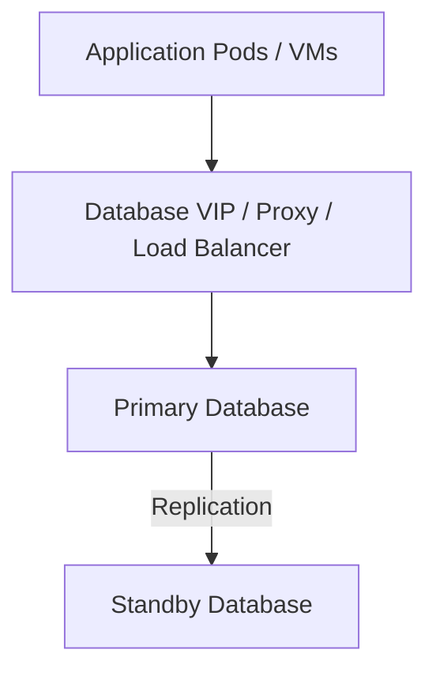
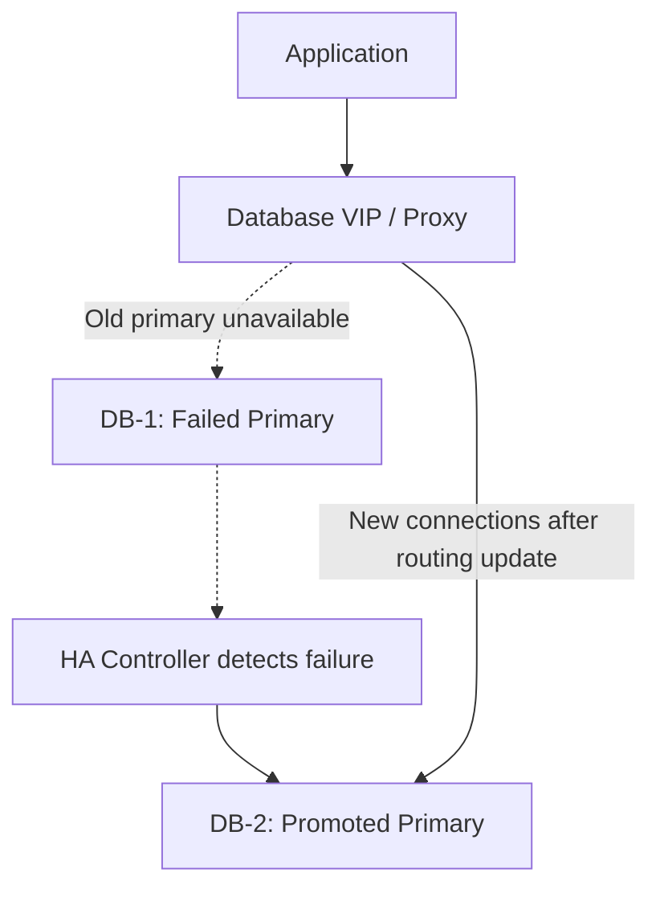
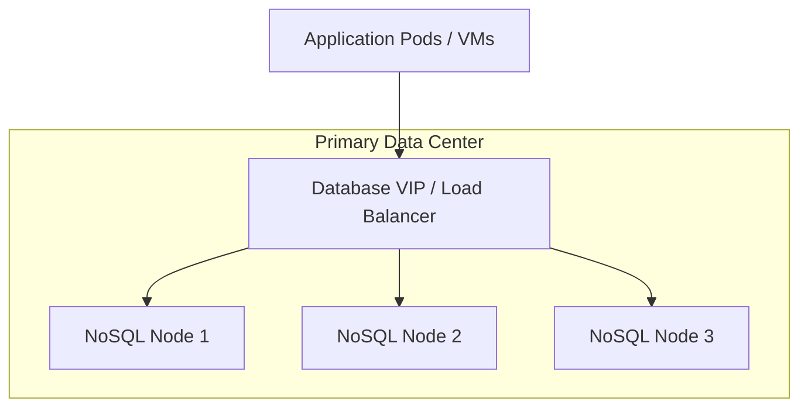
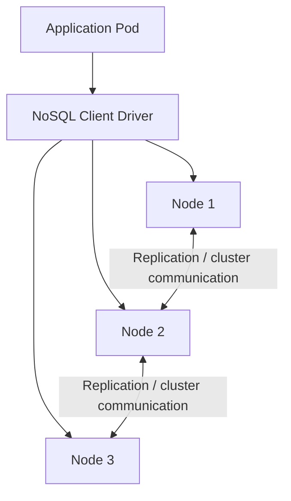
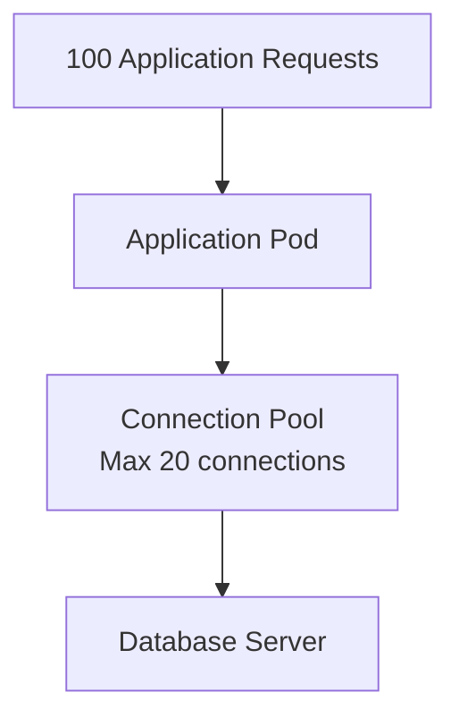
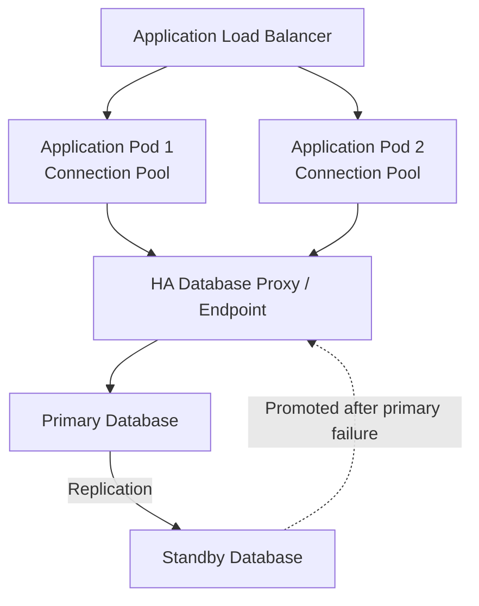

# SQL and NoSQL

## 1. What is SQL?

**SQL stands for Structured Query Language.** It is the language used to work with relational databases, which typically store data in tables containing rows and columns.

Imagine you are developing an Amazon-like shopping application.

You have a customer table:

| User ID | Name | City |
|---|---|---|
| 101 | Alice | Pune |
| 102 | Bob | Mumbai |
| 103 | John | Chennai |

And another table for orders:

| Order ID | User ID | Amount |
|---|---|---|
| 5001 | 101 | ₹2,000 |
| 5002 | 102 | ₹5,000 |
| 5003 | 101 | ₹1,500 |

Both tables are connected using `User ID`.

**SQL allows you to connect these tables and retrieve information.**

For example, find all orders placed by Alice:

```sql
SELECT u.name, o.order_id, o.amount
FROM users u
JOIN orders o ON u.user_id = o.user_id
WHERE u.user_id = 101;
```

Popular SQL databases include PostgreSQL, MySQL, Microsoft SQL Server and Oracle.

## 2. What is NoSQL?

**NoSQL generally means non-relational database technology.** It is often described as "Not Only SQL."

In layman's terms, instead of requiring information to be arranged in related tables, many NoSQL databases store data as documents, key-value pairs, graphs or wide columns.

For example, Alice's profile might be stored as a JSON-like document:

```json
{
  "user_id": 101,
  "name": "Alice",
  "city": "Pune",
  "orders": [
    {"id": 5001, "amount": 2000},
    {"id": 5003, "amount": 1500}
  ]
}
```

You can keep related information inside one document rather than always joining separate tables.

Popular NoSQL databases include MongoDB, DynamoDB, Cassandra and Azure Cosmos DB.

**Important:** NoSQL does not mean there are no schemas, no transactions or no consistency. These features depend on the database product.

## 3. SQL vs NoSQL — Key differences

| Feature | SQL | NoSQL |
|---|---|---|
| Data format | Relational tables | Documents, key-value, graphs, wide columns |
| Schema | Usually predefined | Often more flexible |
| Relationships | Excellent joins and foreign keys | Often uses embedded data or application-level relationships |
| Transactions | Strong multi-record ACID support is standard | Varies by product; some support ACID transactions |
| Scalability | Vertical and horizontal options | Often designed for horizontal distribution |
| Best suited for | Structured, related transactional data | Flexible models and specific high-scale access patterns |
| Examples | PostgreSQL, MySQL | DynamoDB, MongoDB |

## 4. When should you use SQL or NoSQL?

| Application requirement | Preferred option | Reason |
|---|---|---|
| Bank transfers | SQL | Strong transactional guarantees |
| Payments and order processing | SQL | Data consistency and relationships |
| Employee or payroll management | SQL | Structured, related records |
| Shopping product catalogue | NoSQL or SQL | NoSQL works well with varying product attributes |
| User preferences and profiles | NoSQL or SQL | Flexible JSON documents can be convenient |
| Online gaming session state | NoSQL | Fast key-value lookups |
| IoT device events | Often NoSQL | High-volume writes and partition-oriented access |
| Financial reporting with complex joins | SQL | Rich relational queries |

A shopping application can use both.



This is called **polyglot persistence** — choosing different database technologies for different requirements.

## 5. Advantages and disadvantages

### SQL

| Advantages | Disadvantages |
|---|---|
| Strong transaction support | Horizontal write scaling can require complex sharding |
| Excellent complex queries and joins | Schema migrations require planning |
| Mature tooling and database ecosystem | Large joins can become expensive |
| Referential integrity and constraints | Scaling a single primary has limits |

### NoSQL

| Advantages | Disadvantages |
|---|---|
| Flexible data models | Data consistency and transactions vary by product |
| Often supports horizontal scaling well | Complex joins may be unsupported or inefficient |
| Efficient for targeted key-based access | Data duplication can complicate updates |
| Good for large distributed workloads | Partition-key design and hotspots can be difficult |

**Interview point:** Don't select NoSQL simply because an application has millions of users. Start with the access patterns, consistency requirements, relationships and expected scale.

## 6. SQL and NoSQL products available in AWS and Azure

The cloud providers offer managed databases, meaning much of the infrastructure maintenance, backups, patching and failover handling is managed by AWS or Azure.

### AWS databases

| Product | Type | Typical use |
|---|---|---|
| Amazon RDS | SQL | MySQL, PostgreSQL, SQL Server, Oracle |
| Amazon Aurora | SQL | High-performance transactional applications |
| Amazon DynamoDB | NoSQL | User profiles, shopping carts, large-scale key-value access |
| Amazon DocumentDB | NoSQL | JSON-like document storage |

### Azure databases

| Product | Type | Typical use |
|---|---|---|
| Azure SQL Database | SQL | Enterprise applications and transactional workloads |
| Azure SQL Managed Instance | SQL | SQL Server migrations and enterprise workloads |
| Azure Database for PostgreSQL | SQL | Cloud-native applications using PostgreSQL |
| Azure Cosmos DB | NoSQL | Globally distributed document and key-based workloads |

## 7. How is High Availability achieved?

Imagine your SQL database is running on one server.

If that server fails, your application cannot access the database.

To avoid that, architects deploy a **primary database and a standby or replica database** across separate Availability Zones.

**Example: SQL Database HA across two Availability Zones**



**What happens in the backend?**

1. The application connects to the primary database through its database endpoint.
2. The primary replicates committed data to a standby, using synchronous replication in this example.
3. A health check detects when the primary becomes unavailable.
4. The database service promotes the standby to primary.
5. The endpoint routes new connections to the new primary.
6. The application reconnects and retries eligible failed transactions.

For example, this is how **RDS Multi-AZ DB instance deployments** operate. The HA standby does not normally serve read traffic; read replicas are a separate concept.

## 8. What are RPO and RTO?

These two concepts are very important in an SRE or Cloud Architect interview.

### RPO

**Data loss**

How much recent data can we afford to lose?

### RTO

**Downtime**

How quickly must the service recover?

**Example:**

- Database fails at 10:00 AM.
- Latest recoverable data is from 9:58 AM.
- Database becomes operational at 10:05 AM.



Here, the actual recovery lost 2 minutes of data and took 5 minutes to restore service. The business would normally define its RPO and RTO objectives in advance.

## 9. RPO and RTO of AWS databases

These figures refer to the specified HA configuration and failure scenario, not every possible failure.

| AWS database | How HA is achieved | RPO — AZ failure | Typical failover time |
|---|---|---|---|
| Amazon RDS Multi-AZ DB instance | Synchronous standby in another AZ | 0 for acknowledged committed writes under normal HA operation | 60–120 seconds |
| Amazon Aurora with replicas | Distributed storage across 3 AZs; replica promoted | 0 for committed data in supported AZ failure scenarios | Often under 30 seconds; typically under 60 |
| Amazon DynamoDB | Built-in replication across 3 AZs | No expected committed-data loss from a single-AZ failure | Service-managed; no fixed recovery time published |
| Amazon DocumentDB with replica | Replicated storage across AZs; replica promoted | No expected committed-data loss from a single-AZ failure | Usually under 30 seconds |

For RDS, Aurora and DocumentDB, **the application still needs reconnection and retry logic**. Database failover time and end-to-end application RTO are not always identical.

## 10. RPO and RTO of Azure databases

| Azure database | How HA is achieved | RPO — AZ failure | Typical failover time |
|---|---|---|---|
| Azure SQL Database | Built-in HA and zone redundancy | 0 committed data loss with zone redundancy | Automatic; timing depends on tier and workload |
| Azure SQL Managed Instance | Zone-redundant HA replicas | 0 | Typically under 30 seconds |
| Azure PostgreSQL Flexible Server | Synchronous standby in another AZ | 0 | Typically 60–120 seconds |
| Azure Cosmos DB | Zone-redundant replicas and automatic routing | No expected data loss from a single-zone failure | Usually brief interruptions of a few seconds |

These are same-region HA behaviors. **A complete region failure is a different scenario.**

## 11. What happens when an entire AWS or Azure Region fails?

Suppose we have deployed a production application in AWS Mumbai and a DR environment in AWS Hyderabad.

We want to protect against the loss of the entire Mumbai Region.



In this example:

- Data is replicated asynchronously to another region.
- If Mumbai fails, the DR database is promoted to handle writes.
- Traffic is redirected to Hyderabad.
- The application reconnects, verifies database readiness and resumes operation.

**The RPO now depends on replication lag.** The RTO depends on detection, database promotion, routing, application recovery and verification.

### Cross-region DR reference figures

| Product / DR configuration | RPO | RTO / recovery |
|---|---|---|
| AWS Aurora Global Database | Typically seconds | Generally minutes |
| AWS DynamoDB Global Tables — eventual consistency (MREC) | Usually replication delay of a few seconds | Can be measured in seconds with prepared routing/failover |
| AWS DynamoDB Global Tables — strong consistency (MRSC) | 0 | Application recovery depends on routing and architecture |
| Azure SQL Managed Instance — customer-managed failover group | Potential data loss, based on replication lag | Database failover typically under 60 seconds |
| Azure PostgreSQL — cross-region read replica | Typically 30 seconds to 5 minutes of lag | Minutes for promotion, plus application recovery |
| Azure Cosmos DB — per-partition automatic failover | 0 with global strong consistency; otherwise potentially nonzero | Under 3 minutes at P99 for supported configurations |

For a traditional Azure Cosmos DB account-level regional failover, recovery may take **15–30 minutes or more**. The newer per-partition automatic failover capability has a different recovery profile and specific configuration prerequisites.

All figures above are documented typical or expected behaviors, not universal contractual guarantees.

## 12. How would an architect choose?

| Requirement | Architecture recommendation |
|---|---|
| Financial transactions with strict data integrity | SQL, with synchronous HA replication |
| Large-scale key-value workload | DynamoDB or Cosmos DB |
| Application requires complex joins | SQL |
| Products have varying attributes | Document NoSQL or SQL with JSON support |
| Need zone-failure resilience | Multi-AZ / zone-redundant database |
| Need region-failure resilience | Cross-region database replication and tested failover |
| RPO = 0 | Synchronous commit protection or a supported strong-consistency multi-region design |
| RTO of a few minutes | Pre-provisioned DR, automated routing, tested promotion and application recovery |

Don't confuse **database availability** with application availability. A DB might recover in 30 seconds, while the application takes another two minutes because connection pools, DNS, retries or upstream dependencies haven't recovered.

## 13. Important interview follow-up Q&A

**Q1. Is NoSQL always faster than SQL?**

No. Performance depends on indexing, queries, access patterns and the database architecture. A well-designed SQL database can outperform NoSQL for many workloads.

**Q2. Can SQL databases scale horizontally?**

Yes. Through sharding, distributed SQL systems and read replicas. However, distributed transactions and cross-shard joins can add complexity.

**Q3. Does adding a read replica provide high availability?**

Not automatically. A read replica can help scale reads, but it only provides HA if the architecture supports promotion, failover and client reconnection.

**Q4. Is a backup enough for HA?**

No. Backups help recover data, but restoring them can take much longer than failing over to a ready standby.

**Q5. What happens if the primary database fails during a write?**

The client may not know whether the transaction committed. After failover, the application should check transaction status or safely retry using idempotency mechanisms, especially for payments.

**Q6. If the entire region fails, will RPO remain zero?**

Not necessarily. Same-region synchronous HA does not guarantee cross-region zero data loss. Asynchronous cross-region replicas may lag behind.

**Q7. If my database RTO is 30 seconds, can I promise my application RTO is 30 seconds?**

No. You must account for detecting the incident, promoting the replica, changing routing, reconnecting the application, and verifying service recovery.

**Q8. If synchronous replication ensures RPO zero, why not always use it across regions?**

Synchronous commits require acknowledgment from another location. Long distances increase latency, and network partitions can interrupt writes. Architects balance latency, availability and data-loss requirements.

## 14. Interview-ready answer

> "SQL databases store structured, relational data and are well suited to complex queries and ACID transactions. NoSQL databases support different data models and can be effective for flexible schemas and horizontally distributed workloads.
>
> In AWS, I would consider RDS or Aurora for SQL, and DynamoDB or DocumentDB for NoSQL. In Azure, I'd consider Azure SQL Database or PostgreSQL for SQL, and Cosmos DB for NoSQL.
>
> For high availability, I would use Multi-AZ or zone-redundant configurations with automatic failover. For regional disaster recovery, I'd configure cross-region replication and a tested recovery strategy. RPO defines acceptable data loss, while RTO defines acceptable recovery time. Both must be measured from the application's perspective."

**Five things to remember for system design:**

1. **SQL** — tables, relationships and transactions.
2. **NoSQL** — flexible data models and workload-specific scaling.
3. **HA** — keep running through infrastructure or zone failures.
4. **RPO** — how much data could be lost.
5. **RTO** — how quickly the application must be operational again.

---

## Basic Database Terms

Here are the important **SQL and NoSQL database terms**, explained in simple language for interviews.

### 1. Basic Database Terms

| Term | Layman's explanation | Example |
|---|---|---|
| **Schema** | Blueprint defining how data is organized | Users table has ID, Name, Email |
| **Table** | Stores data in rows and columns | Employee table |
| **Row / Record** | One complete entry | Alice, 101, Pune |
| **Column / Field** | One attribute of a record | Name, Age, Email |
| **Primary Key** | Unique identifier for each record | User ID = 101 |
| **Foreign Key** | Connects records between tables | Order references User ID |
| **Index** | Like an index in a book; helps find records faster | Searching by email |
| **JOIN** | Combines related data from tables | Users + Orders |
| **Query** | A request to read or modify data | Find Alice's orders |
| **Transaction** | One logical unit of work containing one or more operations | Transfer money between accounts |

### 2. What is ACID?

ACID describes four important properties of database transactions.

Imagine transferring ₹1,000 from Alice to Bob.

| Property | Simple explanation | Banking example |
|---|---|---|
| **A – Atomicity** | Everything succeeds or nothing happens | Alice debited and Bob credited, or neither |
| **C – Consistency** | Database rules must remain valid | Balance constraints aren't violated |
| **I – Isolation** | Simultaneous transactions shouldn't interfere incorrectly | Two withdrawals don't corrupt the balance |
| **D – Durability** | Committed data survives a crash | Successful transfer isn't lost after restart |

**Easy way to remember:**

- **Atomicity:** All or nothing.
- **Consistency:** Follow database rules.
- **Isolation:** Transactions don't interfere incorrectly.
- **Durability:** Committed data is saved.

### 3. Other Important SQL / NoSQL Terms

| Term | Simple explanation |
|---|---|
| **Replication** | Maintain copies of data across multiple servers |
| **Sharding** | Split different portions of data across servers |
| **Partitioning** | Divide data into smaller logical sections |
| **Vertical scaling** | Increase CPU/RAM of a database server |
| **Horizontal scaling** | Add more database servers |
| **Read Replica** | Database copy that can serve read requests |
| **Primary Database** | Database node responsible for accepting writes in a primary-replica setup |
| **Failover** | Switch to another database when the primary fails |
| **Synchronous Replication** | Wait for required replica acknowledgment before confirming a write |
| **Asynchronous Replication** | Confirm the write without waiting for a remote replica |
| **Strong Consistency** | Reads reflect the latest completed writes |
| **Eventual Consistency** | Replicas may temporarily differ but eventually converge |
| **Schema-less / Flexible Schema** | Records don't all need identical fields |
| **Data Normalization** | Split data into related tables to reduce duplication |
| **Denormalization** | Intentionally duplicate or combine data to speed up reads |
| **Connection Pooling** | Reuse existing database connections instead of opening new ones |
| **Deadlock** | Two transactions wait on each other's locks and cannot proceed |
| **WAL (Write-Ahead Log)** | Record changes in a log before applying them, helping recovery |
| **CAP Theorem** | During a network partition, choose between consistency and availability |

### 4. Three Differences Interviewers Commonly Ask

**ACID vs CAP Consistency**

- ACID consistency means database rules and constraints remain valid.
- CAP consistency means operations behave as if there is one up-to-date copy of data.

**Replication vs Sharding**

- Replication = Same data, multiple copies.
- Sharding = Different data, distributed across servers.

**Synchronous vs Asynchronous Replication**

- Synchronous = Stronger protection against data loss, potentially higher latency.
- Asynchronous = Lower write latency, but possible replication lag and data loss on failover.

**For system design interviews, prioritize understanding ACID, indexes, transactions, replication, sharding, consistency, failover, RPO and RTO.** These are particularly important when explaining database selection and high availability.

---

## What do you mean by database rules in ACID?

**Database rules** are conditions we define to ensure that the data stored in a database remains valid and correct.

For example, imagine a banking application.

| Database rule | Simple explanation |
|---|---|
| **Primary Key** | Two customers cannot have the same unique customer ID. |
| **Foreign Key** | An order cannot reference a customer who doesn't exist. |
| **NOT NULL** | Customer ID cannot be empty. |
| **UNIQUE** | Two users cannot register with the same email address, if uniqueness is required. |
| **CHECK Constraint** | Account balance cannot go below zero, if that is the bank's rule. |
| **Business Rule** | A money transfer must debit one account and credit the other correctly. |

### Example: ACID Consistency in Banking

Alice has ₹5,000 and Bob has ₹2,000.

Alice transfers ₹1,000 to Bob.

**Before transaction**

| Alice | Bob |
|---|---|
| ₹5,000 | ₹2,000 |

**Transfer ₹1,000**

**After successful transaction**

| Alice | Bob |
|---|---|
| ₹4,000 | ₹3,000 |

Total remains ₹7,000

Here, the business rule is that the transfer must not create or destroy money.

If Alice is debited ₹1,000 but Bob is credited ₹2,000, the transaction violates that rule.

**Important distinction:** The database automatically enforces constraints you configure (such as `CHECK`, `UNIQUE`, and foreign keys). Business rules like maintaining the total transfer amount must be enforced through correct transaction logic, database constraints, or both.

### Interview-ready answer

"ACID consistency means that a transaction moves the database from one valid state to another valid state, without violating defined constraints or business rules. The database enforces declared constraints, while the application must correctly implement any additional business rules."

Remember: **Atomicity means all-or-nothing execution; Consistency means the resulting data follows the rules.**

---

## On-Premises Databases — VIP / Load Balancer and HA

**Yes, in some on-premises database architectures, a load balancer or database proxy sits in front of the database servers. But it is not mandatory.**

It depends on how the database handles high availability and failover.

### 1. Typical on-premises database architecture



**How it works:**

1. Application connects to a database VIP or proxy, rather than a database server's individual IP.
2. The VIP/proxy routes write requests to the active primary database.
3. Primary replicates data to the standby.
4. If the primary fails, an HA controller promotes the standby.
5. The VIP/proxy redirects new connections to the promoted database.
6. Applications reconnect and resume database operations.

### 2. Is this the same as an application load balancer?

Not exactly.

| Application Load Balancer | Database Load Balancer / Proxy |
|---|---|
| Typically handles HTTP/HTTPS | Handles database protocols, such as PostgreSQL or MySQL |
| Distributes requests across application servers | Routes database connections to suitable database nodes |
| Usually routes to multiple healthy application instances | Writes generally go to one primary in a primary-standby setup |

**Important:** We generally do not distribute writes randomly across a primary and standby database. A standby may be read-only.

### 3. Real-world on-premises examples

| Database | Common HA / routing approach |
|---|---|
| PostgreSQL | HAProxy + Patroni + etcd/Consul |
| MySQL | ProxySQL / HAProxy with replication or InnoDB Cluster |
| Microsoft SQL Server | Always On Availability Groups with an AG Listener |
| Oracle | Oracle RAC with SCAN listeners, or Data Guard with appropriate connection routing |

For example, in PostgreSQL, Patroni manages database leader election and failover, while HAProxy can direct connections to the current primary.

### 4. What happens during a database failure?



One important point: the load balancer **does not itself guarantee database HA**. You also need replication, leader election, safe failover and fencing to avoid two databases acting as primary (split-brain).

### Interview-ready answer

"In on-premises environments, applications may connect to a database VIP, native listener or database proxy rather than directly to the primary database IP. During failure, the database HA mechanism promotes a standby, and the connection endpoint redirects clients to the new primary. The application must handle connection failures and retries."

**One question worth preparing for:** If the database load balancer itself fails, how do we maintain availability?

Typically, we deploy two proxy/load-balancer nodes with a floating VIP using Keepalived/VRRP, or use another redundant connection-routing mechanism.

---

## NoSQL — VIP vs Cluster-Aware Driver

**Yes, your understanding is partially correct.** The same high-availability concept applies to NoSQL databases, but there is one important difference.

In an on-premises environment, a NoSQL database may have multiple servers spread across different racks or availability zones within the primary data center.

The application needs a way to connect to those servers.

However, **unlike a traditional SQL primary-standby setup, NoSQL applications do not always connect through a single VIP or load balancer.**

There are two common approaches.

### 1. NoSQL with a Load Balancer / VIP



Here, the load balancer directs connections to healthy database nodes. This works when the database protocol and architecture support that kind of routing.

### 2. NoSQL with a Cluster-Aware Driver

This is very common for distributed NoSQL systems.



The application is configured with multiple database addresses or discovery endpoints.

The client driver understands the cluster topology and determines which node should receive a request. It can also discover topology changes and reconnect after a node failure.

### 3. Real-world examples

| NoSQL database | How application connects | VIP required? |
|---|---|---|
| MongoDB Replica Set | Multiple hostnames; driver discovers the primary | No |
| Cassandra | Contact points; driver discovers nodes and uses token-aware routing | No |
| Redis Cluster | Cluster-aware client discovers key-to-node mappings | No |
| NoSQL behind a supported proxy | Database proxy or load balancer endpoint | Possible |

MongoDB drivers discover replica-set members and route writes to the primary. Cassandra drivers can route queries towards nodes that hold the relevant data.

For example, a MongoDB application could use:

```text
mongodb://db1:27017,db2:27017,db3:27017/?replicaSet=rs0
```

The driver determines which server currently acts as primary.

### 4. What happens if one NoSQL node fails?

Let's take MongoDB with three nodes:

- Node 1 — Primary
- Node 2 — Secondary
- Node 3 — Secondary

If Node 1 fails, the replica set can elect an eligible secondary as the new primary, provided a voting majority is available. The driver discovers the new primary and routes subsequent writes to it.

An external VIP is not necessary for this process.

### 5. What if the complete primary region fails?

This is a separate disaster recovery scenario.

A VIP in Region A cannot, by itself, guarantee failover to Region B. You would need cross-region replication, database-specific failover mechanisms, and application traffic redirection or cluster-aware routing.

**Interview-ready answer:**

"In on-premises NoSQL environments, we typically deploy multiple database nodes for high availability. Depending on the database, applications either connect through a supported proxy/VIP or use a cluster-aware driver with multiple database endpoints. The driver may handle node discovery, request routing and failover. For complete regional failures, we need a separate DR strategy."

**Key distinction to remember:** A *primary region* is not the same thing as a *primary database node*. For example, Cassandra can have multiple peer nodes in one region without a single database primary.

---

# Connection Pooling

## 1. What is Connection Pooling?

**In layman's terms:** Instead of opening a new database connection for every request, the application maintains a pool of reusable connections.

Imagine a restaurant with 10 waiters. Rather than hiring a new waiter for every customer, the restaurant reuses the available waiters.

Database connection pooling works similarly.



**How it works:**

1. Application receives 100 requests.
2. Connection pool has a maximum of 20 connections.
3. Up to 20 database operations can use those connections simultaneously.
4. Other requests wait for a connection to become available.
5. Once a query finishes, its connection is returned to the pool for reuse.

## 2. What happens when the connection pool is full?

Suppose the pool has 20 connections, and all 20 are busy.

| Situation | What happens |
|---|---|
| All connections busy | New requests wait for an available connection |
| Connection becomes free | Waiting request gets that connection |
| Waiting exceeds timeout | Application receives a connection acquisition timeout |
| Requests keep increasing | Request queues grow, latency increases and APIs may return 5xx errors |

**Important:** A full connection pool does not necessarily mean the database is down. It can also indicate slow queries, traffic spikes or connection leaks.

## 3. How do we mitigate connection pool exhaustion?

| Mitigation | Simple explanation |
|---|---|
| **Pool sizing** | Configure appropriate minimum and maximum connections |
| **Connection timeout** | Don't allow requests to wait indefinitely |
| **Fix connection leaks** | Ensure connections are returned after use |
| **Query optimization** | Make queries faster so connections become available |
| **Backpressure** | Limit how many database operations execute simultaneously |
| **Rate limiting** | Restrict incoming traffic when capacity is exhausted |
| **Circuit breaker** | Temporarily stop requests when the database is failing |
| **Database proxy / pooler** | Use PgBouncer, RDS Proxy or similar tools to manage connection demand |
| **Scale database** | Increase capacity or use read replicas where appropriate |

### One important Kubernetes scenario

Suppose:

- 10 application pods
- Each pod has a pool of 50 connections

**Maximum potential database connections**

**500**

10 pods × 50 connections

If HPA scales the application to 30 pods, the potential connection count becomes **1,500**.

This can overload the database even though you are scaling the application to improve performance.

**Architectural solution:** Set a connection budget across all application pods, use sensible pool limits, and consider a database connection proxy.

## 4. How do we achieve HA with connection pooling?

Connection pooling itself does **not** provide high availability.

HA requires redundant database instances, connection routing and recovery handling.



**What happens when the primary database fails?**

1. Existing database connections may break.
2. The database HA mechanism detects failure and promotes a healthy standby.
3. The proxy or database endpoint routes new connections to the promoted primary.
4. The connection pool removes broken connections and establishes new ones.
5. Applications retry eligible failed operations safely.

To avoid a single point of failure, the database proxy itself must also be deployed in an HA configuration, or a managed HA endpoint must be used.

## 5. Interview follow-up Q&A

**Q1. Does increasing the pool size always solve exhaustion?**

No. It may overload the database further. First investigate slow queries, connection leaks and actual database capacity.

**Q2. What happens if one application pod crashes?**

Its connections are closed or eventually cleaned up. Other healthy application pods can continue serving requests using their own pools.

**Q3. Can PgBouncer or RDS Proxy prevent database overload?**

They can reduce connection overhead and control database-side connections. However, they cannot increase the database's underlying query-processing capacity.

**Q4. What metrics would you monitor?**

Active connections, idle connections, pending requests, connection acquisition timeout count, query duration and database CPU utilization.

**Q5. Should we retry immediately when the pool is exhausted?**

No. Aggressive retries can make the situation worse. Use bounded retries with exponential backoff and jitter, along with admission control or backpressure.

### 30-second interview answer

"Connection pooling allows applications to reuse database connections instead of creating a new connection for every request. When the pool is exhausted, requests wait and eventually time out. I would investigate slow queries and connection leaks, tune pool sizes, apply backpressure and rate limiting, and consider a database proxy.

For high availability, I would deploy multiple application instances, an HA database endpoint and database replicas with automatic failover. The application pool should detect broken connections and reconnect to the new primary."

**Remember:** Connection pooling improves efficiency. Replication and failover provide HA.

---

## Data Modeling — Missing Interview Topics (Hello Interview Follow-up)

**Reference:** [Hello Interview — Data Modeling](https://www.hellointerview.com/learn/system-design/core-concepts/data-modeling)

**Purpose:** The sections above explain SQL vs NoSQL, ACID, HA, replication, RPO/RTO and connection pooling. This **append-only addendum** covers the practical data-modeling questions to answer **during a system design interview**: entities, relationships, access patterns, indexes, normalization, partition keys and scaling.

### 1. Start with functional requirements, not with a database product

Before saying "I'll use PostgreSQL" or "I'll use DynamoDB":

1. Identify the **critical user journeys and APIs**.
2. List the **entities** those journeys create or read.
3. Define **fields, primary keys, foreign keys and uniqueness constraints**.
4. Map the **actual read/write queries** to indexes or NoSQL access patterns.
5. Decide **consistency and transaction boundaries**.
6. Estimate scale and introduce partitioning/sharding **only when justified**.

**Example — social posts/likes:** Users create posts, list posts for a user, like/unlike a post, and see a like count. Start with **Users**, **Posts**, **Likes**.

### 2. Schema design and relationships (1:1, 1:N, N:M)

**Example entity relationship diagram:**

\`\`\`mermaid
erDiagram
    USERS ||--o{ POSTS : creates
    USERS ||--o{ LIKES : gives
    POSTS ||--o{ LIKES : receives
    USERS {
      bigint id PK
      varchar username
      varchar email UK
    }
    POSTS {
      bigint id PK
      bigint user_id FK
      text content
      timestamp created_at
      bigint like_count
    }
    LIKES {
      bigint user_id PK,FK
      bigint post_id PK,FK
      timestamp created_at
    }
\`\`\`

| Relationship | Example | Usual SQL implementation |
|---|---|---|
| **1:1** | User ↔ Profile | \`profiles.user_id\` is a **UNIQUE** foreign key |
| **1:N** | User → Posts | \`posts.user_id\` foreign key |
| **N:M** | Users ↔ Posts they liked | Junction table \`likes(user_id, post_id)\` |

Minimal illustrative PostgreSQL schema:

\`\`\`sql
CREATE TABLE users (
    id BIGINT PRIMARY KEY,
    username TEXT NOT NULL,
    email TEXT NOT NULL UNIQUE
);

CREATE TABLE posts (
    id BIGINT PRIMARY KEY,
    user_id BIGINT NOT NULL REFERENCES users(id),
    content TEXT NOT NULL,
    created_at TIMESTAMPTZ NOT NULL DEFAULT NOW(),
    like_count BIGINT NOT NULL DEFAULT 0
);

CREATE TABLE likes (
    user_id BIGINT NOT NULL REFERENCES users(id),
    post_id BIGINT NOT NULL REFERENCES posts(id),
    created_at TIMESTAMPTZ NOT NULL DEFAULT NOW(),
    PRIMARY KEY (user_id, post_id)
);
\`\`\`

**Why a composite primary key on \`likes\`?** It enforces "one like per user per post" even if duplicate requests arrive. The authoritative action should be transaction-safe and idempotent; if \`posts.like_count\` is a stored derived value, its update must be coordinated with insert/delete or reconciled later.

**Interview talking point:** Define key relationships and constraints, but don't spend the entire interview exhaustively naming every column.

### 3. Design indexes FROM the APIs and access patterns

**API:** \`GET /users/101/posts?limit=20\` — newest posts from user 101.

\`\`\`sql
SELECT id, user_id, content, created_at
FROM posts
WHERE user_id = 101
ORDER BY created_at DESC, id DESC
LIMIT 20;
\`\`\`

Useful composite PostgreSQL index:

\`\`\`sql
CREATE INDEX idx_posts_user_created_id
ON posts (user_id, created_at DESC, id DESC);
\`\`\`

**Why that order?** \`user_id\` supports the equality filter; \`created_at DESC, id DESC\` supports consistent newest-first ordering and efficient keyset pagination. Include a stable tie-breaker (\`id\`) if timestamps can match.

| Important API/query | Likely index/key | Why |
|---|---|---|
| \`GET /users/{id}/posts\` newest first | \`posts(user_id, created_at DESC, id DESC)\` | Filter by user, avoid expensive sort, paginate |
| Check if user already liked a post | \`likes(user_id, post_id)\` PK | Fast point lookup and uniqueness |
| List users who liked a post | \`likes(post_id, user_id)\` additional index | Reverse lookup isn't necessarily efficient with the PK above |
| Look up user by email | \`users(email)\` UNIQUE | Efficient lookup and uniqueness enforcement |

**Important caveat:** Each additional index consumes storage and adds write overhead. Use measured query patterns and \`EXPLAIN ANALYZE\` instead of blindly indexing every field. Keyset/cursor pagination avoids large-offset scans for very deep lists.

**Interview memory hook:** **API → WHERE → ORDER BY → INDEX**.

### 4. Normalization vs denormalization — practical trade-off

| Normalization | Denormalization |
|---|---|
| Keep each fact in one authoritative place | Duplicate or precompute selected data |
| Less update inconsistency | Potentially faster read paths |
| Queries may need joins | Fewer joins for hot queries |
| Easier integrity enforcement | Must handle stale/duplicated values |

**Example:** Keep every user/post like in the normalized \`likes\` table. For a hot feed, maintain a convenient \`posts.like_count\` summary to avoid counting a large number of likes during every feed read.

**Trade-off:** The count can drift from the authoritative likes during failures or concurrent updates. Use an atomic transaction when practical, or events + idempotent updates + reconciliation when eventual consistency is acceptable.

**Interview answer:** *Start normalized for correctness, then selectively denormalize only for demonstrated read patterns and with a defined consistency strategy.*

### 5. Choosing shard/partition keys — with hotspot and query trade-offs

Choose a key using **which API must be fast, cardinality/data distribution, write/read skew, growth and whether operations span shards**.

| Example shard key | Helps | Risk |
|---|---|---|
| \`user_id\` | Efficient colocated reads of a user's posts | Extremely active users may create hot shards |
| Hash of \`post_id\` | Distributes individual posts more evenly | Fetching posts by user may fan out to many shards |
| \`created_at\` time ranges | Archival and time-window queries | Current time range receives most new writes (hot shard) |

**Hot shard:** One shard receives disproportionate traffic; adding shards does not necessarily help if the hot key always maps to one shard.

**Cross-shard query:** A query needs data from multiple shards, increasing fan-out, latency and coordination; cross-shard transactions/joins become harder.

**Mitigations:** Reconsider the shard key, use compound/bucketed keys for very hot tenants when compatible with queries, precompute read models and/or isolate exceptional hot workloads. Do not shard prematurely if indexes, replicas and vertical scaling meet your requirements.

**Interview answer:** *For user-owned posts, I'd initially favor a user-based key because users query their own posts, but I would check for celebrity/hot-user skew and the need for global feed queries before finalizing it.*

### 6. NoSQL data modeling: embedding, referencing and access patterns

**Embedding (document NoSQL):** Store related small/bounded data with the parent when it is usually fetched together.
- Example: A profile document containing a few display preferences.
- **Benefit:** Fewer separate reads for that access pattern.
- **Risk:** Large/unbounded arrays, bigger document updates, duplication and difficult pagination.

**Referencing:** Store related entities separately and connect them by IDs.
- Example: Keep millions of posts in a posts collection rather than embedding them all in one user profile.
- **Benefit:** Independent growth, pagination and updates.
- **Trade-off:** Requires additional reads or application-side coordination.

For **DynamoDB-like access-pattern modeling**, ask: *What is the partition key (PK), sort key (SK), and which queries require a secondary index (GSI)?* For example, a table organized around a user's posts might use \`PK = USER#101\`, \`SK = POST#<timestamp>#<post_id>\`, while a separately designed lookup/index supports post-by-ID access. Model hot partitions and write limits; secondary indexes add write/storage costs and have consistency implications.

| NoSQL model | Useful for | Interview caution |
|---|---|---|
| Document (MongoDB, etc.) | Flexible, related documents | Embed bounded data; reference unbounded collections |
| Key-value / DynamoDB | Predictable key-based access at scale | PK/SK/GSI must support real APIs; watch hot keys |
| Wide-column (Cassandra) | Very large partition-oriented write workloads | Design partition + clustering keys around queries |
| Graph (Neo4j/Neptune) | Deep, changing relationship traversals | Simple follows/likes do not automatically require a graph DB |

**Remember:** NoSQL is not "schema-free design." The access patterns and consistency rules are still deliberate.

### 7. Six-step data-modeling interview framework

1. **Entities:** Identify User, Post, Like, Order, Payment, Message, etc.
2. **Fields and identifiers:** Define primary keys, timestamps, status and uniqueness constraints.
3. **Relationships:** Model 1:1, 1:N, N:M and transaction boundaries.
4. **Queries and indexes:** Map core APIs to WHERE/ORDER BY or PK/SK/GSI access patterns.
5. **Normalization:** Start with sound authoritative data; denormalize selected hot reads with an update/consistency plan.
6. **Scale:** Estimate volume and read/write load; choose partition/shard keys only if needed, accounting for hotspots and cross-shard operations.

**30-second interview answer:**

> I would start by identifying the main entities from the functional requirements, then define their primary keys, foreign keys and relationships. I would choose a relational database when transactions and integrity are important, and design indexes based on the API queries, including composite indexes where they help. I would start with normalized data and denormalize selectively for high-volume read paths with clear consistency guarantees. Finally, I would estimate data growth and choose an appropriate partition or shard key only if required by scale.

**Quick memory hook:** **Entities → Keys → Relationships → APIs/Indexes → Consistency → Scale**.
