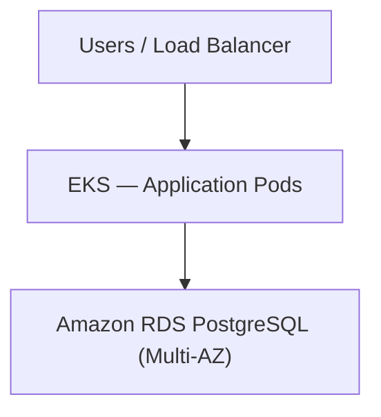
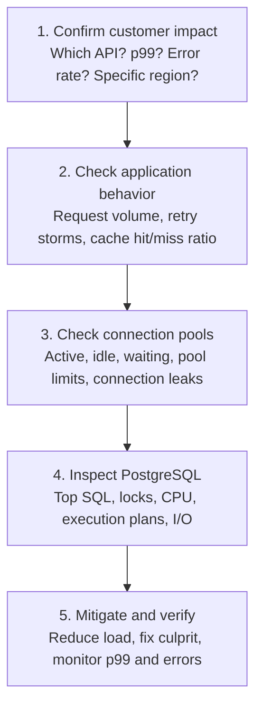
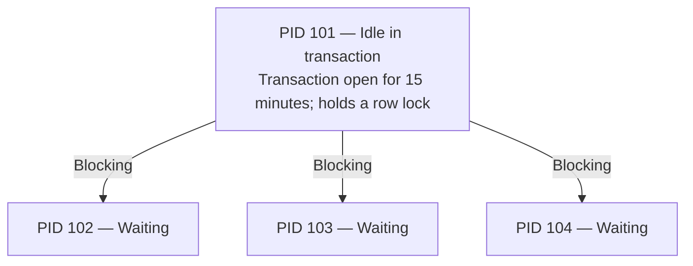
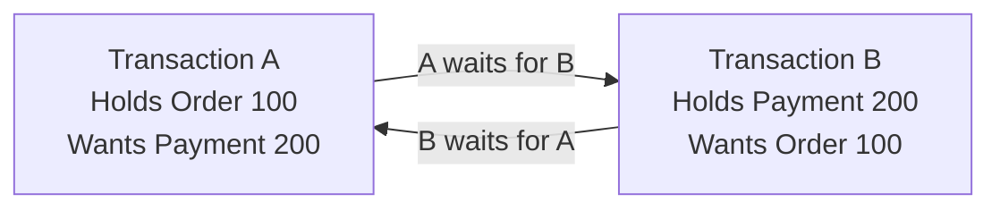
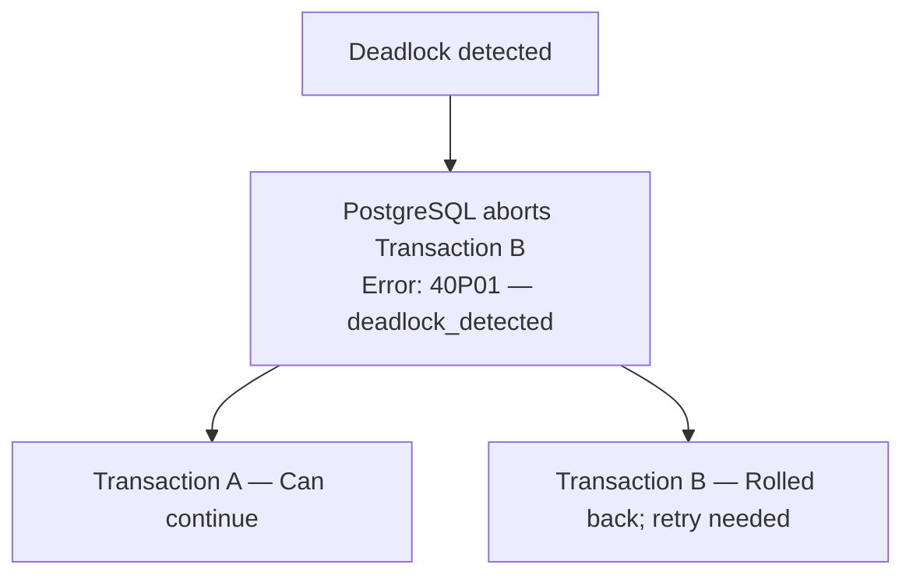
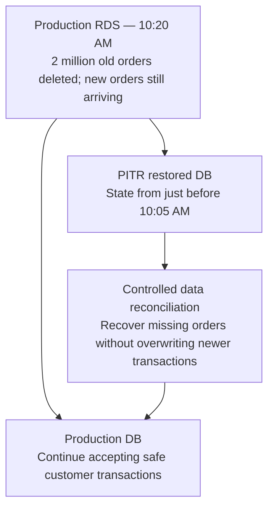
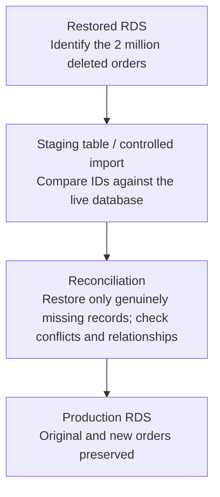

# Database Troubleshooting and Recovery — Apple ASE SRE Mock Interview

## Mock Interview — Scenario 1: Database Slow Queries

Your team runs a customer-facing application on AWS EKS.

**Architecture**



**Production incident:**

- API p99 latency increased from 200 ms to 5 seconds.
- Some API requests are timing out.
- Application pods are healthy.
- No recent deployments.
- Database CPU utilization is at 90%.
- Database connections increased from 100 to 450.

**Question:**

"You're the on-call SRE. How would you troubleshoot this issue?"

Walk me through your investigation, starting from the application layer and moving toward the database. What would you check first?

### What you answered correctly

| Your answer | My assessment |
|---|---|
| Check API-specific, cluster-wide, or region-wide impact | Excellent starting point |
| Check cache hit/miss ratio | Correct |
| Investigate connection pools | Very important |
| Identify slow-running queries | Correct |
| Check read/write routing and replicas | Good, if replicas exist |
| Check disk bottlenecks and database locks | Correct |

### Important corrections

**Correction 1 — A cache miss doesn't necessarily mean a database failure.**

A cache miss means the requested information is not available in the cache. Possible reasons include TTL expiration, eviction, cold cache, or invalidation.

If Redis fails, requests may bypass it and overload the database, depending on the application's fallback behavior.

**Correction 2 — 450 connections doesn't necessarily mean 450 queries are executing.**

Some connections may be idle or waiting on locks. You should check active, idle, and waiting sessions.

**Correction 3 — Don't immediately recycle connection pools.**

Restarting application pods or resetting pools may create a reconnection storm and worsen database CPU utilization.

**Correction 4 — Don't promote a replica simply because the database is slow.**

A Multi-AZ standby is normally for failover, not read scaling. Read replicas are separate resources, and adding them helps only when queries can be safely routed there.

### How I would structure your interview answer



One thing missing from your answer was **immediate mitigation**.

If CPU is already at 90% and customer requests are timing out, consider temporarily restricting expensive requests, controlling concurrency, and ensuring retries use bounded exponential backoff with jitter. Don't wait until every root-cause detail is known.

---

## Mock Interview — Follow-up Question 2: Database slow-query investigation

You have investigated the RDS PostgreSQL database and found these metrics:

| Database CPU | Total connections | Active connections | Idle connections |
|---|---|---|---|
| 90% | 450 | 40 | 350 |

The remaining 60 sessions have other states, including transaction-related or waiting sessions.

Additionally, database monitoring shows that a query which normally completes in 100 ms is now taking 4 seconds:

```sql
SELECT *
FROM orders
WHERE customer_id = 12345;
```

The `orders` table contains approximately 20 million rows.

**Interviewer asks:**

"We've identified a slow SQL query. How will you determine *why* it is slow? What PostgreSQL commands or tools would you use, and what exactly would you look for?"

Assume the database is production-critical and you cannot restart it.

### Four commands you should know for the interview

| Command / tool | What it tells you |
|---|---|
| `pg_stat_activity` | Which queries are running, idle, or waiting |
| `pg_stat_statements` | Which queries consume the most execution time overall |
| `EXPLAIN` | How PostgreSQL plans to execute a query |
| `pg_indexes` | Which indexes already exist on a table |

### Step 1 — Check running queries

```sql
SELECT pid, state, wait_event_type,
       wait_event, query
FROM pg_stat_activity
WHERE state = 'active';
```

This helps identify whether queries are executing or waiting on something such as a lock.

### Step 2 — Check the query execution plan

```sql
EXPLAIN
SELECT *
FROM orders
WHERE customer_id = 12345;
```

Imagine PostgreSQL returns:

```text
Seq Scan on orders
  Filter: (customer_id = 12345)
```

**What does `Seq Scan` mean?**

PostgreSQL is scanning the table sequentially to find matching records.

Think of searching for one customer's orders in a book containing 20 million entries without an index at the back of the book.

| Sequential scan | Index scan |
|---|---|
| Potentially examines millions of rows | Locates matching rows through an index |

### Step 3 — Check whether an index exists

```sql
SELECT indexname, indexdef
FROM pg_indexes
WHERE tablename = 'orders';
```

If `customer_id` is not indexed, and the execution plan confirms it would help, a possible remedy is:

```sql
CREATE INDEX CONCURRENTLY
idx_orders_customer_id
ON orders(customer_id);
```

`CONCURRENTLY` allows normal reads and writes to continue, although index creation still consumes resources and can be expensive on a busy production database.

**Important:** You should not immediately build an index on a database already running at 90% CPU without evaluating the production impact.

Also, `EXPLAIN` shows the estimated plan. `EXPLAIN ANALYZE` actually executes the query and reports actual timing, so use it carefully in production.

### A better 60-second interview answer

> First, I would check `pg_stat_activity` to identify active queries, long-running transactions, and sessions waiting on locks.
>
> Then I would use `pg_stat_statements`, if enabled, to identify SQL statements consuming the most database execution time.
>
> For the problematic query, I would check its execution plan using `EXPLAIN` to see whether PostgreSQL is using a sequential scan or an index scan.
>
> If it's performing a sequential scan on a 20-million-row table, I would check whether the `customer_id` column has a suitable index.
>
> I would also check whether the query is slow because of locks, high disk I/O, or inefficient execution plans.
>
> Based on those findings, I would mitigate the immediate customer impact, coordinate an appropriate database optimization, and verify that API latency and database CPU return to normal.

### Primary key and indexing correction

Yes, if `customer_id` is the **primary key**, PostgreSQL automatically creates a unique B-tree index on it.

However, consider this table:

```sql
CREATE TABLE orders (
    id BIGINT PRIMARY KEY,
    customer_id BIGINT,
    amount DECIMAL
);
```

Here:

- `id` is the primary key and is automatically indexed.
- `customer_id` is not automatically indexed.
- Even if `customer_id` is a foreign key referencing `customers(id)`, PostgreSQL does not automatically create an index on it.

So our scenario is still valid: `customer_id` has no index, and the query is performing a sequential scan.

---

## Mock Interview — Follow-up Question 3: Safe production index creation

You ran `EXPLAIN` and found:

```text
Seq Scan on orders
  Filter: (customer_id = 12345)
```

You also discovered that `customer_id` has no index.

- Database CPU: 90%.
- API latency: 5 sec.

**Question:**

"Now that you've identified the missing index, would you create the index immediately in production?

What would you do to reduce customer impact while fixing the problem?"

### What you got right

- **Don't create the index immediately** when database CPU is already at 90%.
- Use caching to reduce repeated database reads.
- Apply rate limiting to control incoming traffic.
- Review connection pooling to prevent excessive database connections.
- Create an index on `customer_id` once the database has sufficient capacity.

### What I would improve

There are three important points to remember.

| Technique | What you should do |
|---|---|
| Caching | Cache frequently requested, safe-to-cache reads. Watch for cache misses creating more DB pressure. |
| Rate limiting | Limit noncritical or expensive requests first, while protecting important customer traffic. |
| Connection pooling | Bound concurrent DB connections. Don't simply increase pool size, as it could overload PostgreSQL further. |

### Safe index creation in production

Once the database is stable and the change is approved:

```sql
CREATE INDEX CONCURRENTLY
idx_orders_customer_id
ON orders(customer_id);
```

Why `CONCURRENTLY`?

Unlike a standard index build, it allows normal database reads and writes to continue during the operation.

However, it can still consume CPU and I/O, take longer, wait for existing transactions, and fail leaving an invalid index. It also cannot run inside a transaction block.

Afterward, verify that the index is valid, inspect the query execution plan, and check whether database CPU, API p99 latency, and errors improve.

**One additional interview point:** If a single expensive query is overwhelming the database, temporarily controlling that specific endpoint can be more effective than rate limiting the entire application.

---

## Mock Interview — Scenario 2: Database Locks and Deadlocks

Your application uses PostgreSQL on Amazon RDS.

Customers are reporting that payment requests are taking 20–30 seconds.

Your initial investigation shows:

| Database CPU | Database connections | Waiting queries | API p99 latency |
|---|---|---|---|
| 35% | 300 | 80 | 30 sec |

You investigate PostgreSQL using `pg_stat_activity` and find:

```text
pid   state                  wait_event_type
101   idle in transaction    -
102   active                 Lock
103   active                 Lock
104   active                 Lock
```

Process `101` has held an uncommitted transaction open for 15 minutes, and the other three sessions are waiting for locks it holds.

**Interviewer asks:**

"CPU is only 35%, but API latency has reached 30 seconds. Why is the application slow?

How would you troubleshoot and recover from this situation without restarting the database?"

### Understand what's happening



The waiting queries may consume little CPU because they are blocked rather than actively executing.

**Important interview concept:**

`idle in transaction` means a transaction was started but is currently not executing a SQL statement and has not committed or rolled back.

It can continue holding locks. Once its transaction commits or rolls back, its transaction-scoped locks are released.

So low CPU doesn't mean the database is healthy.

### Step 1 — Find the blocking session

```sql
SELECT pid, state, wait_event_type,
       pg_blocking_pids(pid) AS blocked_by,
       now() - xact_start AS transaction_age,
       query
FROM pg_stat_activity
WHERE datname = current_database();
```

Look for:

- `blocked_by` — which PID is preventing progress.
- `transaction_age` — how long the transaction has been open.
- `state` — active or idle in transaction.

You can also inspect `pg_locks` for the requested and granted locks.

### Step 2 — Safely recover

First, identify the owning application and ask whether the transaction can finish or roll back normally.

If PID 101 is confirmed abandoned, and terminating it is approved:

```sql
SELECT pg_terminate_backend(101);
```

This closes that database session. Any uncommitted transaction in that session is rolled back, releasing its locks.

**For payment systems:** Confirm the transaction outcome before retrying, use an idempotency key, and reconcile against the payment provider if needed. Never blindly retry a payment.

### Step 3 — Prevent recurrence

Configure appropriate `idle_in_transaction_session_timeout`, investigate application code that leaves transactions open, and monitor lock-wait duration.

### Interview-ready answer

> A deadlock happens when two or more transactions hold locks that each other needs, so neither can proceed. PostgreSQL detects this automatically and aborts one transaction, allowing the others to continue. As an SRE, I would inspect PostgreSQL logs and blocking relationships, identify the conflicting SQL statements, and coordinate with developers to ensure consistent lock ordering and shorter transactions. The application should retry aborted transactions safely using idempotency and bounded backoff.

---

## Mock Interview — Follow-up Question 5: Deadlock

Two application instances are executing payment transactions simultaneously.

| Transaction A | Transaction B |
|---|---|
| Locks Order 100 | Locks Payment 200 |
| Waits for Payment 200 | Waits for Order 100 |



**Questions:**

1. What is happening here? Is this a normal database lock or a deadlock?
2. Will PostgreSQL resolve this automatically, or do you need to manually terminate a transaction?
3. How would you prevent this from happening repeatedly?

### What is a database deadlock?

Imagine two people:

- **Transaction A** has locked Order 100 and wants Payment 200.
- **Transaction B** has locked Payment 200 and wants Order 100.

Neither can proceed because each is waiting for the other to release a lock.

### Normal lock vs deadlock

| Normal lock | Deadlock |
|---|---|
| Transaction A holds a lock; B waits | A waits for B, and B waits for A |
| A can finish and release the lock | Neither can finish without intervention |
| B can then continue | PostgreSQL automatically breaks the deadlock |

### How PostgreSQL handles a deadlock

**PostgreSQL automatically detects and resolves deadlocks.** It aborts one transaction, rolls back its changes, releases its locks, and allows the other transaction to proceed.

Example:



The application can retry Transaction B from the beginning, using limited retries with backoff and jitter. For payments, retries must be idempotent so they don't trigger duplicate charges.

### How do we prevent deadlocks?

The most important technique is **consistent lock ordering**.

For example, ensure both transactions acquire locks in the same order:

1. Lock the Order row.
2. Lock the Payment row.
3. Perform updates.
4. Commit promptly and release the locks.

Also keep transactions short, monitor deadlock errors in PostgreSQL logs, and investigate repeated deadlocks.

### Interview-ready answer

> A deadlock happens when two or more transactions hold locks that each other needs, so neither can proceed. PostgreSQL detects this automatically and aborts one transaction, allowing the others to continue. As an SRE, I would inspect PostgreSQL logs and blocking relationships, identify the conflicting SQL statements, and coordinate with developers to ensure consistent lock ordering and shorter transactions. The application should retry aborted transactions safely using idempotency and bounded backoff.

### Quick check before moving to PITR

**Interviewer:**

Transaction A and Transaction B enter a deadlock. PostgreSQL automatically aborts Transaction B.

What happens to Transaction B's uncommitted database changes?

- A. They remain saved in the database.
- B. They are rolled back, and the transaction can be retried.
- C. Both transactions are automatically aborted.

**Correct! Answer B.**

When PostgreSQL detects a deadlock, it aborts one transaction and **rolls back its uncommitted changes**. The other transaction can continue.

The application can then retry the aborted transaction from the beginning, using bounded retries with backoff and jitter.

**Remember for the interview:** In payment systems, retries must also be idempotent to prevent duplicate charges.

---

## Mock Interview — Scenario 3: Point-in-Time Recovery (PITR)

You are managing an application running on AWS EKS with Amazon RDS PostgreSQL (Multi-AZ).

At **10:05 AM**, a developer accidentally executes:

```sql
DELETE FROM orders
WHERE created_at < '2026-10-01';
```

The statement is committed, deleting approximately 2 million valid order records.

At **10:20 AM**, the application team discovers the issue and escalates to you.

**Incident timeline**

| Time | Event |
|---|---|
| 10:05 AM | Accidental deletion |
| 10:20 AM | Issue detected — 15 minutes later |

**Additional information:**

- Database is healthy and accepting connections.
- Automated RDS backups are enabled with 7-day retention.
- Customers have continued placing new orders since 10:05 AM.
- The application cannot afford to lose those new orders.

Amazon RDS supports point-in-time recovery using automated backups and transaction logs, restoring into a new database instance.

**Interviewer asks:**

"How would you recover the 2 million accidentally deleted records without losing the new orders created after 10:05 AM?"

Walk me through your recovery approach.

### What you got right and what needs correction

| Your answer | Assessment |
|---|---|
| Don't immediately replace production | Correct |
| Continue accepting new orders | Good, if safe |
| Restoring puts the existing database into lock mode | Incorrect for RDS PITR |
| Restore during non-business hours | Not necessary to start PITR |

**Important correction:** Amazon RDS PITR creates a **new database instance**. It does not lock, overwrite, or stop the existing production database.

Therefore, we can begin restoring immediately while the production database continues receiving new orders.

### How I would approach this scenario



This is a **logical data recovery**, not a database failover.

### The recovery steps

1. **Contain the incident:** Stop the faulty deletion process and prevent further destructive changes. Preserve logs and record the incident timeline.
2. **Start PITR immediately:** Restore to a verified safe time just before the accidental deletion committed, around 10:04:59 AM in our example.
3. **Keep production running safely:** Allow unrelated new orders to continue, subject to consistency checks.
4. **Recover missing records:** Compare the restored database with production and selectively restore the deleted orders, handling conflicts and related tables.
5. **Verify data integrity:** Compare counts and order IDs, validate foreign keys and financial totals, and confirm new orders remain intact.

### 60-second interview answer

> I would not directly replace the production database because new customer orders have been committed after the accidental deletion. Instead, I would immediately initiate Amazon RDS PITR to a separate database instance, targeting a point just before the deletion.
>
> Production would continue handling safe customer transactions while the restore happens.
>
> Once the restored database is available, I would work with the database and application teams to identify the missing records, reconcile them into production in a controlled manner, and validate data integrity.
>
> This approach aims to recover the deleted records without losing newer transactions.

---

## Mock Interview — Follow-up Question 7: Restoring without losing new orders

PITR has completed successfully. You now have two databases:

| Restored RDS | Production RDS |
|---|---|
| 10:04 AM state | 10:20 AM state |
| Contains the 2 million deleted orders. | Missing the 2 million old orders. |
| Does not contain orders placed after the restore point. | Contains 50,000 new orders placed after 10:05 AM. |

**Interviewer asks:**

"Would you simply change the application database endpoint to the restored RDS instance?"

"If not, how would you bring those 2 million missing orders back into production without losing the 50,000 new orders?"

### Understand the problem in simple terms

You have two databases:

| | Restored RDS | Production RDS |
|---|---|---|
| 2 million old orders | Present | Deleted |
| 50,000 new orders | Missing | Present |

**Question: Can we simply switch the application's database endpoint to the restored database?**

**Answer: No.** We would recover the old orders but lose access to the 50,000 new orders, along with other changes made after the restore point.

Instead, we must **selectively copy the missing records from restored RDS into production RDS**, preserving the newer records.

This process is called *data reconciliation*.

### Recovery flow



### How would we practically do this?

Let's assume the `orders` table contains:

```sql
orders (
    order_id,
    customer_id,
    amount,
    created_at
)
```

**Step 1 — Identify the deleted records.** Determine which records existed before the deletion and are missing from production. Export these from restored RDS.

**Step 2 — Import into a staging table.** Use an approved, secured import process to create a temporary reconciliation dataset in production, such as `orders_recovery_stage`.

**Step 3 — Compare before inserting.** For a simplified example where `order_id` is a unique, stable identifier:

```sql
SELECT r.*
FROM orders_recovery_stage r
WHERE NOT EXISTS (
    SELECT 1
    FROM orders p
    WHERE p.order_id = r.order_id
);
```

This identifies candidate missing orders.

**Step 4 — Restore carefully.** After validating the candidate records, insert in controlled batches. An `ON CONFLICT DO NOTHING` safeguard can avoid duplicate primary-key inserts, but conflicts must be investigated rather than silently ignored.

**Step 5 — Verify.** Confirm the deleted orders have been recovered, the newer orders remain intact, and relationships with payments, customers, and other tables are consistent.

In real systems, order IDs alone may not be enough. You must account for records that were legitimately deleted, updated, or recreated after the incident and for related tables and payment state.

### One SQL example to remember

After the missing records have been validated in the staging table:

```sql
INSERT INTO orders (
    order_id, customer_id, amount, created_at
)
SELECT
    r.order_id, r.customer_id,
    r.amount, r.created_at
FROM orders_recovery_stage r
WHERE NOT EXISTS (
    SELECT 1
    FROM orders p
    WHERE p.order_id = r.order_id
)
ON CONFLICT (order_id) DO NOTHING;
```

This inserts missing orders and avoids overwriting orders with existing IDs. PostgreSQL supports `ON CONFLICT` for handling unique-key conflicts.

This is a simplified illustration, not a complete production recovery procedure. Before executing it, we must validate the recovered records, related tables, triggers, business rules, and any primary-key sequence conflicts. We should test and execute the recovery in controlled transactions or batches and reconcile any skipped records.

### Interview-ready answer

> I would not switch the application endpoint directly to the restored database because we would lose access to newer orders.
>
> Instead, I would keep production running, extract the deleted records from the PITR-restored instance, and import them into a staging table.
>
> I would compare those records against production using their unique order IDs and restore only the genuinely missing records in controlled batches.
>
> Finally, I would verify record counts, payments, foreign-key relationships, and all new transactions to ensure no data has been lost or corrupted.

---

## Mock Interview — Follow-up Question 8: Data integrity

You've restored the 2 million orders, and production is functioning normally.

The application team reports that the API is healthy and there are no errors.

But the engineering manager asks:

**"How can you prove that the recovery was successful and that we didn't lose, duplicate, or corrupt any orders?"**

What would you verify at the database and application levels?

### Five important data-integrity checks

| Check | Simple explanation | What we're verifying |
|---|---|---|
| **1. Record count** | Compare expected and actual number of orders | No missing records |
| **2. Duplicate IDs** | Check that the same order ID doesn't appear twice | No duplicate orders |
| **3. Data consistency** | Compare customer IDs, amounts, and order details against the recovery source | No corrupted or incorrect records |
| **4. Foreign keys** | Verify orders still reference valid customers and related payment records | Relationships are intact |
| **5. New transactions** | Confirm that all 50,000 newer orders remain | No recent data lost |

### Let's apply this to our scenario

We started with:

- Old orders recovered: **2,000,000**
- New orders preserved: **50,000**
- Expected total across these two groups: **2,050,000**

Assuming no other legitimate changes affected these records.

But counting alone is insufficient.

For example, suppose there are 2,050,000 records, but 500 old orders are missing and 500 unexpected records exist. The total count still matches!

So we also compare **individual order IDs**, relevant field values, and financial totals.

For payment applications, we'd reconcile payments with the payment provider or financial ledger to ensure we're not missing a transaction or counting it twice.

### Interview-ready answer

> After recovering the deleted records, I would first verify the total record count against our expected recovery dataset.
>
> Then I would check for missing or duplicate order IDs, compare important fields and financial totals, and verify referential integrity between orders, customers, and payments.
>
> I would specifically validate that the 50,000 new orders are still present and unchanged.
>
> Finally, I would run application-level tests, verify payment reconciliation, and monitor error rates and database metrics before declaring the incident resolved.

**Remember these five words:** Count → Duplicates → Consistency → Relationships → New transactions.

---
