# Database Troubleshooting and Recovery — Apple ASE SRE Mock Interview

## Mock Interview — Scenario 1: Database Slow Queries

Your team runs a customer-facing application on AWS EKS.

**Architecture**

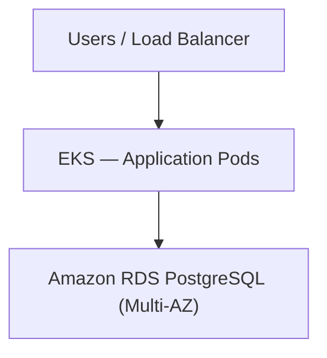

**Production incident:**

- API p99 latency increased from 200 ms to 5 seconds.
- Some API requests are timing out.
- Application pods are healthy.
- No recent deployments.
- Database CPU utilization is at 90%.
- Database connections increased from 100 to 450.

**Question:**

"You're the on-call SRE. How would you troubleshoot this issue?"

Walk me through your investigation, starting from the application layer and moving toward the database. What would you check first?

### What you answered correctly

| Your answer | My assessment |
|---|---|
| Check API-specific, cluster-wide, or region-wide impact | Excellent starting point |
| Check cache hit/miss ratio | Correct |
| Investigate connection pools | Very important |
| Identify slow-running queries | Correct |
| Check read/write routing and replicas | Good, if replicas exist |
| Check disk bottlenecks and database locks | Correct |

### Important corrections

**Correction 1 — A cache miss doesn't necessarily mean a database failure.**

A cache miss means the requested information is not available in the cache. Possible reasons include TTL expiration, eviction, cold cache, or invalidation.

If Redis fails, requests may bypass it and overload the database, depending on the application's fallback behavior.

**Correction 2 — 450 connections doesn't necessarily mean 450 queries are executing.**

Some connections may be idle or waiting on locks. You should check active, idle, and waiting sessions.

**Correction 3 — Don't immediately recycle connection pools.**

Restarting application pods or resetting pools may create a reconnection storm and worsen database CPU utilization.

**Correction 4 — Don't promote a replica simply because the database is slow.**

A Multi-AZ standby is normally for failover, not read scaling. Read replicas are separate resources, and adding them helps only when queries can be safely routed there.

### How I would structure your interview answer

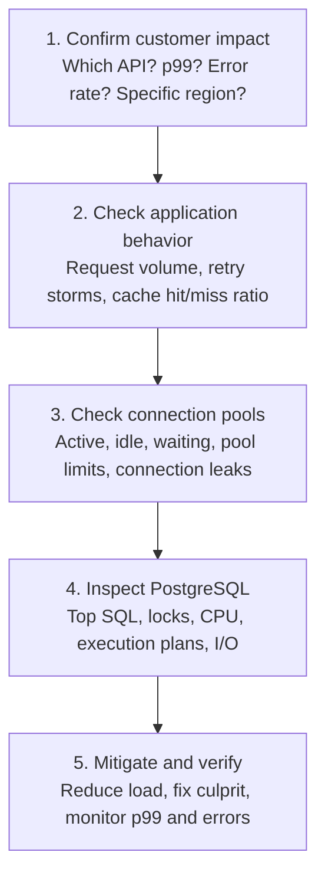

One thing missing from your answer was **immediate mitigation**.

If CPU is already at 90% and customer requests are timing out, consider temporarily restricting expensive requests, controlling concurrency, and ensuring retries use bounded exponential backoff with jitter. Don't wait until every root-cause detail is known.

---

## Mock Interview — Follow-up Question 2: Database slow-query investigation

You have investigated the RDS PostgreSQL database and found these metrics:

| Database CPU | Total connections | Active connections | Idle connections |
|---|---|---|---|
| 90% | 450 | 40 | 350 |

The remaining 60 sessions have other states, including transaction-related or waiting sessions.

Additionally, database monitoring shows that a query which normally completes in 100 ms is now taking 4 seconds:

```sql
SELECT *
FROM orders
WHERE customer_id = 12345;
```

The `orders` table contains approximately 20 million rows.

**Interviewer asks:**

"We've identified a slow SQL query. How will you determine *why* it is slow? What PostgreSQL commands or tools would you use, and what exactly would you look for?"

Assume the database is production-critical and you cannot restart it.

### Four commands you should know for the interview

| Command / tool | What it tells you |
|---|---|
| `pg_stat_activity` | Which queries are running, idle, or waiting |
| `pg_stat_statements` | Which queries consume the most execution time overall |
| `EXPLAIN` | How PostgreSQL plans to execute a query |
| `pg_indexes` | Which indexes already exist on a table |

### Step 1 — Check running queries

```sql
SELECT pid, state, wait_event_type,
       wait_event, query
FROM pg_stat_activity
WHERE state = 'active';
```

This helps identify whether queries are executing or waiting on something such as a lock.

### Step 2 — Check the query execution plan

```sql
EXPLAIN
SELECT *
FROM orders
WHERE customer_id = 12345;
```

Imagine PostgreSQL returns:

```text
Seq Scan on orders
  Filter: (customer_id = 12345)
```

**What does `Seq Scan` mean?**

PostgreSQL is scanning the table sequentially to find matching records.

Think of searching for one customer's orders in a book containing 20 million entries without an index at the back of the book.

| Sequential scan | Index scan |
|---|---|
| Potentially examines millions of rows | Locates matching rows through an index |

### Step 3 — Check whether an index exists

```sql
SELECT indexname, indexdef
FROM pg_indexes
WHERE tablename = 'orders';
```

If `customer_id` is not indexed, and the execution plan confirms it would help, a possible remedy is:

```sql
CREATE INDEX CONCURRENTLY
idx_orders_customer_id
ON orders(customer_id);
```

`CONCURRENTLY` allows normal reads and writes to continue, although index creation still consumes resources and can be expensive on a busy production database.

**Important:** You should not immediately build an index on a database already running at 90% CPU without evaluating the production impact.

Also, `EXPLAIN` shows the estimated plan. `EXPLAIN ANALYZE` actually executes the query and reports actual timing, so use it carefully in production.

### A better 60-second interview answer

> First, I would check `pg_stat_activity` to identify active queries, long-running transactions, and sessions waiting on locks.
>
> Then I would use `pg_stat_statements`, if enabled, to identify SQL statements consuming the most database execution time.
>
> For the problematic query, I would check its execution plan using `EXPLAIN` to see whether PostgreSQL is using a sequential scan or an index scan.
>
> If it's performing a sequential scan on a 20-million-row table, I would check whether the `customer_id` column has a suitable index.
>
> I would also check whether the query is slow because of locks, high disk I/O, or inefficient execution plans.
>
> Based on those findings, I would mitigate the immediate customer impact, coordinate an appropriate database optimization, and verify that API latency and database CPU return to normal.

### Primary key and indexing correction

Yes, if `customer_id` is the **primary key**, PostgreSQL automatically creates a unique B-tree index on it.

However, consider this table:

```sql
CREATE TABLE orders (
    id BIGINT PRIMARY KEY,
    customer_id BIGINT,
    amount DECIMAL
);
```

Here:

- `id` is the primary key and is automatically indexed.
- `customer_id` is not automatically indexed.
- Even if `customer_id` is a foreign key referencing `customers(id)`, PostgreSQL does not automatically create an index on it.

So our scenario is still valid: `customer_id` has no index, and the query is performing a sequential scan.

---

## Mock Interview — Follow-up Question 3: Safe production index creation

You ran `EXPLAIN` and found:

```text
Seq Scan on orders
  Filter: (customer_id = 12345)
```

You also discovered that `customer_id` has no index.

- Database CPU: 90%.
- API latency: 5 sec.

**Question:**

"Now that you've identified the missing index, would you create the index immediately in production?

What would you do to reduce customer impact while fixing the problem?"

### What you got right

- **Don't create the index immediately** when database CPU is already at 90%.
- Use caching to reduce repeated database reads.
- Apply rate limiting to control incoming traffic.
- Review connection pooling to prevent excessive database connections.
- Create an index on `customer_id` once the database has sufficient capacity.

### What I would improve

There are three important points to remember.

| Technique | What you should do |
|---|---|
| Caching | Cache frequently requested, safe-to-cache reads. Watch for cache misses creating more DB pressure. |
| Rate limiting | Limit noncritical or expensive requests first, while protecting important customer traffic. |
| Connection pooling | Bound concurrent DB connections. Don't simply increase pool size, as it could overload PostgreSQL further. |

### Safe index creation in production

Once the database is stable and the change is approved:

```sql
CREATE INDEX CONCURRENTLY
idx_orders_customer_id
ON orders(customer_id);
```

Why `CONCURRENTLY`?

Unlike a standard index build, it allows normal database reads and writes to continue during the operation.

However, it can still consume CPU and I/O, take longer, wait for existing transactions, and fail leaving an invalid index. It also cannot run inside a transaction block.

Afterward, verify that the index is valid, inspect the query execution plan, and check whether database CPU, API p99 latency, and errors improve.

**One additional interview point:** If a single expensive query is overwhelming the database, temporarily controlling that specific endpoint can be more effective than rate limiting the entire application.

---

## Mock Interview — Scenario 2: Database Locks and Deadlocks

Your application uses PostgreSQL on Amazon RDS.

Customers are reporting that payment requests are taking 20–30 seconds.

Your initial investigation shows:

| Database CPU | Database connections | Waiting queries | API p99 latency |
|---|---|---|---|
| 35% | 300 | 80 | 30 sec |

You investigate PostgreSQL using `pg_stat_activity` and find:

```text
pid   state                  wait_event_type
101   idle in transaction    -
102   active                 Lock
103   active                 Lock
104   active                 Lock
```

Process `101` has held an uncommitted transaction open for 15 minutes, and the other three sessions are waiting for locks it holds.

**Interviewer asks:**

"CPU is only 35%, but API latency has reached 30 seconds. Why is the application slow?

How would you troubleshoot and recover from this situation without restarting the database?"

### Understand what's happening

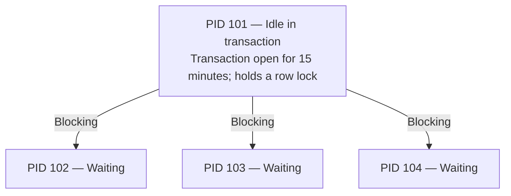

The waiting queries may consume little CPU because they are blocked rather than actively executing.

**Important interview concept:**

`idle in transaction` means a transaction was started but is currently not executing a SQL statement and has not committed or rolled back.

It can continue holding locks. Once its transaction commits or rolls back, its transaction-scoped locks are released.

So low CPU doesn't mean the database is healthy.

### Step 1 — Find the blocking session

```sql
SELECT pid, state, wait_event_type,
       pg_blocking_pids(pid) AS blocked_by,
       now() - xact_start AS transaction_age,
       query
FROM pg_stat_activity
WHERE datname = current_database();
```

Look for:

- `blocked_by` — which PID is preventing progress.
- `transaction_age` — how long the transaction has been open.
- `state` — active or idle in transaction.

You can also inspect `pg_locks` for the requested and granted locks.

### Step 2 — Safely recover

First, identify the owning application and ask whether the transaction can finish or roll back normally.

If PID 101 is confirmed abandoned, and terminating it is approved:

```sql
SELECT pg_terminate_backend(101);
```

This closes that database session. Any uncommitted transaction in that session is rolled back, releasing its locks.

**For payment systems:** Confirm the transaction outcome before retrying, use an idempotency key, and reconcile against the payment provider if needed. Never blindly retry a payment.

### Step 3 — Prevent recurrence

Configure appropriate `idle_in_transaction_session_timeout`, investigate application code that leaves transactions open, and monitor lock-wait duration.

### Interview-ready answer

> A deadlock happens when two or more transactions hold locks that each other needs, so neither can proceed. PostgreSQL detects this automatically and aborts one transaction, allowing the others to continue. As an SRE, I would inspect PostgreSQL logs and blocking relationships, identify the conflicting SQL statements, and coordinate with developers to ensure consistent lock ordering and shorter transactions. The application should retry aborted transactions safely using idempotency and bounded backoff.

---

## Mock Interview — Follow-up Question 5: Deadlock

Two application instances are executing payment transactions simultaneously.

| Transaction A | Transaction B |
|---|---|
| Locks Order 100 | Locks Payment 200 |
| Waits for Payment 200 | Waits for Order 100 |

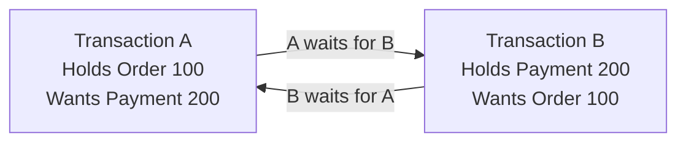

**Questions:**

1. What is happening here? Is this a normal database lock or a deadlock?
2. Will PostgreSQL resolve this automatically, or do you need to manually terminate a transaction?
3. How would you prevent this from happening repeatedly?

### What is a database deadlock?

Imagine two people:

- **Transaction A** has locked Order 100 and wants Payment 200.
- **Transaction B** has locked Payment 200 and wants Order 100.

Neither can proceed because each is waiting for the other to release a lock.

### Normal lock vs deadlock

| Normal lock | Deadlock |
|---|---|
| Transaction A holds a lock; B waits | A waits for B, and B waits for A |
| A can finish and release the lock | Neither can finish without intervention |
| B can then continue | PostgreSQL automatically breaks the deadlock |

### How PostgreSQL handles a deadlock

**PostgreSQL automatically detects and resolves deadlocks.** It aborts one transaction, rolls back its changes, releases its locks, and allows the other transaction to proceed.

Example:

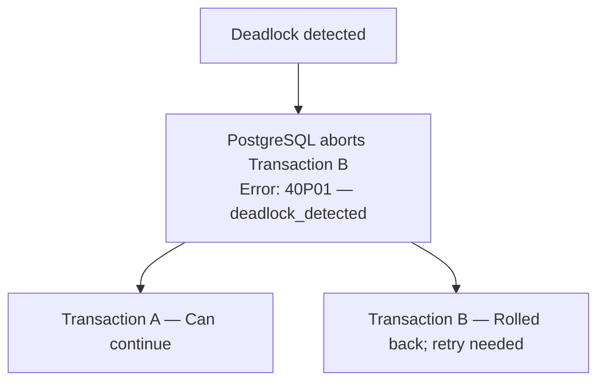

The application can retry Transaction B from the beginning, using limited retries with backoff and jitter. For payments, retries must be idempotent so they don't trigger duplicate charges.

### How do we prevent deadlocks?

The most important technique is **consistent lock ordering**.

For example, ensure both transactions acquire locks in the same order:

1. Lock the Order row.
2. Lock the Payment row.
3. Perform updates.
4. Commit promptly and release the locks.

Also keep transactions short, monitor deadlock errors in PostgreSQL logs, and investigate repeated deadlocks.

### Interview-ready answer

> A deadlock happens when two or more transactions hold locks that each other needs, so neither can proceed. PostgreSQL detects this automatically and aborts one transaction, allowing the others to continue. As an SRE, I would inspect PostgreSQL logs and blocking relationships, identify the conflicting SQL statements, and coordinate with developers to ensure consistent lock ordering and shorter transactions. The application should retry aborted transactions safely using idempotency and bounded backoff.

### Quick check before moving to PITR

**Interviewer:**

Transaction A and Transaction B enter a deadlock. PostgreSQL automatically aborts Transaction B.

What happens to Transaction B's uncommitted database changes?

- A. They remain saved in the database.
- B. They are rolled back, and the transaction can be retried.
- C. Both transactions are automatically aborted.

**Correct! Answer B.**

When PostgreSQL detects a deadlock, it aborts one transaction and **rolls back its uncommitted changes**. The other transaction can continue.

The application can then retry the aborted transaction from the beginning, using bounded retries with backoff and jitter.

**Remember for the interview:** In payment systems, retries must also be idempotent to prevent duplicate charges.

---

## Mock Interview — Scenario 3: Point-in-Time Recovery (PITR)

You are managing an application running on AWS EKS with Amazon RDS PostgreSQL (Multi-AZ).

At **10:05 AM**, a developer accidentally executes:

```sql
DELETE FROM orders
WHERE created_at < '2026-10-01';
```

The statement is committed, deleting approximately 2 million valid order records.

At **10:20 AM**, the application team discovers the issue and escalates to you.

**Incident timeline**

| Time | Event |
|---|---|
| 10:05 AM | Accidental deletion |
| 10:20 AM | Issue detected — 15 minutes later |

**Additional information:**

- Database is healthy and accepting connections.
- Automated RDS backups are enabled with 7-day retention.
- Customers have continued placing new orders since 10:05 AM.
- The application cannot afford to lose those new orders.

Amazon RDS supports point-in-time recovery using automated backups and transaction logs, restoring into a new database instance.

**Interviewer asks:**

"How would you recover the 2 million accidentally deleted records without losing the new orders created after 10:05 AM?"

Walk me through your recovery approach.

### What you got right and what needs correction

| Your answer | Assessment |
|---|---|
| Don't immediately replace production | Correct |
| Continue accepting new orders | Good, if safe |
| Restoring puts the existing database into lock mode | Incorrect for RDS PITR |
| Restore during non-business hours | Not necessary to start PITR |

**Important correction:** Amazon RDS PITR creates a **new database instance**. It does not lock, overwrite, or stop the existing production database.

Therefore, we can begin restoring immediately while the production database continues receiving new orders.

### How I would approach this scenario

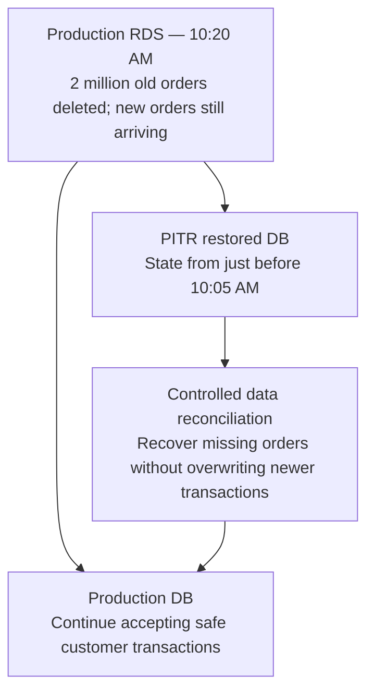

This is a **logical data recovery**, not a database failover.

### The recovery steps

1. **Contain the incident:** Stop the faulty deletion process and prevent further destructive changes. Preserve logs and record the incident timeline.
2. **Start PITR immediately:** Restore to a verified safe time just before the accidental deletion committed, around 10:04:59 AM in our example.
3. **Keep production running safely:** Allow unrelated new orders to continue, subject to consistency checks.
4. **Recover missing records:** Compare the restored database with production and selectively restore the deleted orders, handling conflicts and related tables.
5. **Verify data integrity:** Compare counts and order IDs, validate foreign keys and financial totals, and confirm new orders remain intact.

### 60-second interview answer

> I would not directly replace the production database because new customer orders have been committed after the accidental deletion. Instead, I would immediately initiate Amazon RDS PITR to a separate database instance, targeting a point just before the deletion.
>
> Production would continue handling safe customer transactions while the restore happens.
>
> Once the restored database is available, I would work with the database and application teams to identify the missing records, reconcile them into production in a controlled manner, and validate data integrity.
>
> This approach aims to recover the deleted records without losing newer transactions.

---

## Mock Interview — Follow-up Question 7: Restoring without losing new orders

PITR has completed successfully. You now have two databases:

| Restored RDS | Production RDS |
|---|---|
| 10:04 AM state | 10:20 AM state |
| Contains the 2 million deleted orders. | Missing the 2 million old orders. |
| Does not contain orders placed after the restore point. | Contains 50,000 new orders placed after 10:05 AM. |

**Interviewer asks:**

"Would you simply change the application database endpoint to the restored RDS instance?"

"If not, how would you bring those 2 million missing orders back into production without losing the 50,000 new orders?"

### Understand the problem in simple terms

You have two databases:

| | Restored RDS | Production RDS |
|---|---|---|
| 2 million old orders | Present | Deleted |
| 50,000 new orders | Missing | Present |

**Question: Can we simply switch the application's database endpoint to the restored database?**

**Answer: No.** We would recover the old orders but lose access to the 50,000 new orders, along with other changes made after the restore point.

Instead, we must **selectively copy the missing records from restored RDS into production RDS**, preserving the newer records.

This process is called *data reconciliation*.

### Recovery flow

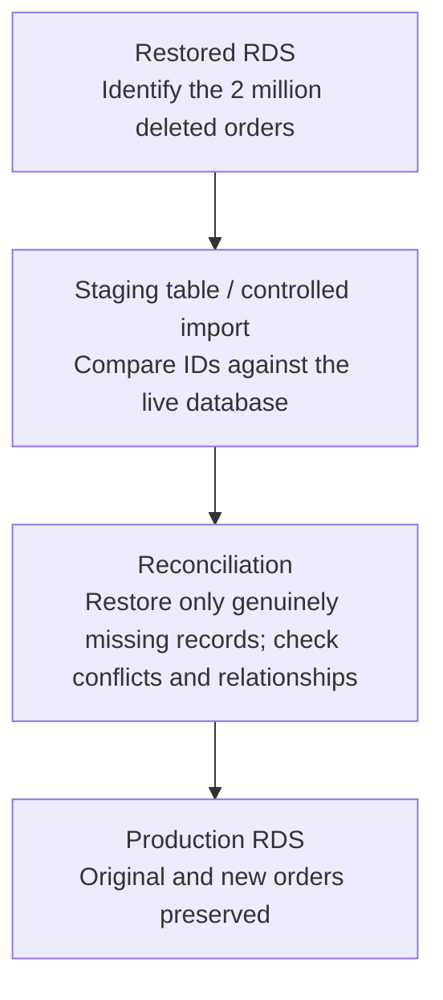

### How would we practically do this?

Let's assume the `orders` table contains:

```sql
orders (
    order_id,
    customer_id,
    amount,
    created_at
)
```

**Step 1 — Identify the deleted records.** Determine which records existed before the deletion and are missing from production. Export these from restored RDS.

**Step 2 — Import into a staging table.** Use an approved, secured import process to create a temporary reconciliation dataset in production, such as `orders_recovery_stage`.

**Step 3 — Compare before inserting.** For a simplified example where `order_id` is a unique, stable identifier:

```sql
SELECT r.*
FROM orders_recovery_stage r
WHERE NOT EXISTS (
    SELECT 1
    FROM orders p
    WHERE p.order_id = r.order_id
);
```

This identifies candidate missing orders.

**Step 4 — Restore carefully.** After validating the candidate records, insert in controlled batches. An `ON CONFLICT DO NOTHING` safeguard can avoid duplicate primary-key inserts, but conflicts must be investigated rather than silently ignored.

**Step 5 — Verify.** Confirm the deleted orders have been recovered, the newer orders remain intact, and relationships with payments, customers, and other tables are consistent.

In real systems, order IDs alone may not be enough. You must account for records that were legitimately deleted, updated, or recreated after the incident and for related tables and payment state.

### One SQL example to remember

After the missing records have been validated in the staging table:

```sql
INSERT INTO orders (
    order_id, customer_id, amount, created_at
)
SELECT
    r.order_id, r.customer_id,
    r.amount, r.created_at
FROM orders_recovery_stage r
WHERE NOT EXISTS (
    SELECT 1
    FROM orders p
    WHERE p.order_id = r.order_id
)
ON CONFLICT (order_id) DO NOTHING;
```

This inserts missing orders and avoids overwriting orders with existing IDs. PostgreSQL supports `ON CONFLICT` for handling unique-key conflicts.

This is a simplified illustration, not a complete production recovery procedure. Before executing it, we must validate the recovered records, related tables, triggers, business rules, and any primary-key sequence conflicts. We should test and execute the recovery in controlled transactions or batches and reconcile any skipped records.

### Interview-ready answer

> I would not switch the application endpoint directly to the restored database because we would lose access to newer orders.
>
> Instead, I would keep production running, extract the deleted records from the PITR-restored instance, and import them into a staging table.
>
> I would compare those records against production using their unique order IDs and restore only the genuinely missing records in controlled batches.
>
> Finally, I would verify record counts, payments, foreign-key relationships, and all new transactions to ensure no data has been lost or corrupted.

---

## Mock Interview — Follow-up Question 8: Data integrity

You've restored the 2 million orders, and production is functioning normally.

The application team reports that the API is healthy and there are no errors.

But the engineering manager asks:

**"How can you prove that the recovery was successful and that we didn't lose, duplicate, or corrupt any orders?"**

What would you verify at the database and application levels?

### Five important data-integrity checks

| Check | Simple explanation | What we're verifying |
|---|---|---|
| **1. Record count** | Compare expected and actual number of orders | No missing records |
| **2. Duplicate IDs** | Check that the same order ID doesn't appear twice | No duplicate orders |
| **3. Data consistency** | Compare customer IDs, amounts, and order details against the recovery source | No corrupted or incorrect records |
| **4. Foreign keys** | Verify orders still reference valid customers and related payment records | Relationships are intact |
| **5. New transactions** | Confirm that all 50,000 newer orders remain | No recent data lost |

### Let's apply this to our scenario

We started with:

- Old orders recovered: **2,000,000**
- New orders preserved: **50,000**
- Expected total across these two groups: **2,050,000**

Assuming no other legitimate changes affected these records.

But counting alone is insufficient.

For example, suppose there are 2,050,000 records, but 500 old orders are missing and 500 unexpected records exist. The total count still matches!

So we also compare **individual order IDs**, relevant field values, and financial totals.

For payment applications, we'd reconcile payments with the payment provider or financial ledger to ensure we're not missing a transaction or counting it twice.

### Interview-ready answer

> After recovering the deleted records, I would first verify the total record count against our expected recovery dataset.
>
> Then I would check for missing or duplicate order IDs, compare important fields and financial totals, and verify referential integrity between orders, customers, and payments.
>
> I would specifically validate that the 50,000 new orders are still present and unchanged.
>
> Finally, I would run application-level tests, verify payment reconciliation, and monitor error rates and database metrics before declaring the incident resolved.

**Remember these five words:** Count → Duplicates → Consistency → Relationships → New transactions.

---

## Mock Interview — Scenario 4: Database failover and in-flight transactions

Your application runs on EKS and uses Amazon RDS PostgreSQL with a Multi-AZ standby.

The primary database suddenly fails while customer orders are being processed.

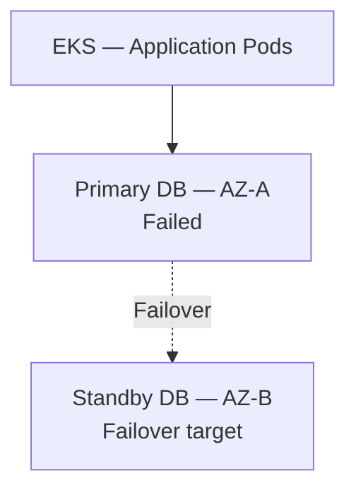

At the time of failure, three transactions were in progress:

| Transaction | Status |
|---|---|
| A | Committed and acknowledged to application |
| B | Executing, not yet committed |
| C | Commit requested, but application did not receive confirmation |

**Interviewer asks:**

1. What happens to these three transactions when the primary fails?
2. Will the standby database automatically take over?
3. How should the application handle interrupted connections and retries?

### What happens to the three transactions?

| Transaction | What happens after failover? | Application action |
|---|---|---|
| **A — Committed and acknowledged** | Changes survive failover under normal RDS Multi-AZ durability guarantees | No retry required |
| **B — Still executing** | The interrupted, uncommitted transaction is rolled back during recovery | Retry the entire transaction safely |
| **C — Commit requested, no acknowledgement** | **Unknown outcome:** It may have committed, or it may have rolled back | Verify whether it committed before deciding how to retry |

Amazon RDS Multi-AZ DB instances use synchronous replication to maintain a standby in another Availability Zone.

### Why Transaction C is particularly important

Suppose a customer places an order.

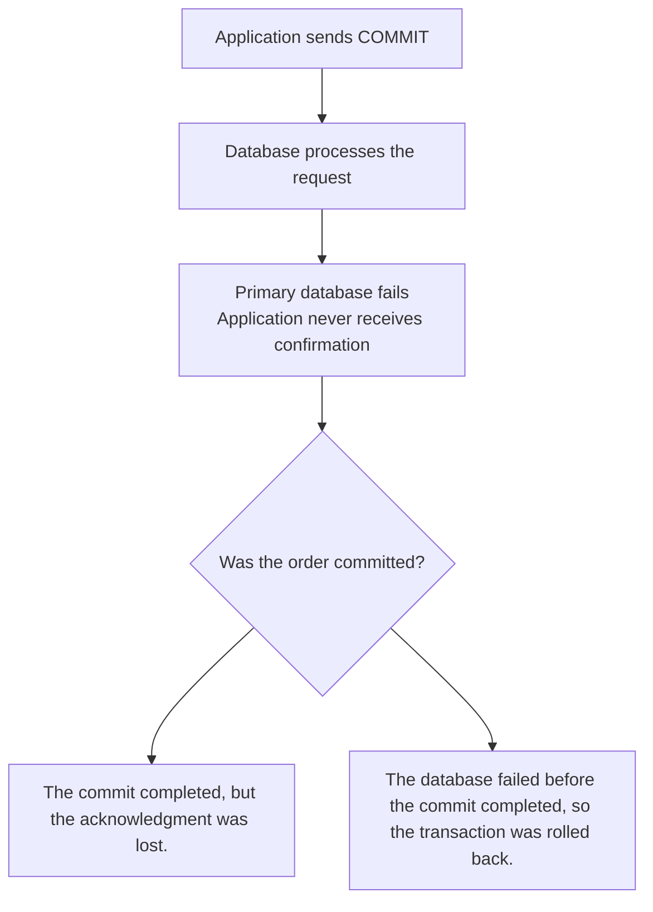

There are two possibilities:

- The commit completed, but the acknowledgment was lost.
- The database failed before the commit completed, so the transaction was rolled back.

This is why **blindly retrying payment transactions is dangerous**.

The application should reconnect, check the transaction using a unique order ID or idempotency key, and then decide whether to return the existing result or retry the operation.

An idempotency key must be enforced by the application and database, such as through a unique constraint. Simply repeating the same message ID is not sufficient by itself.

### Interview-ready answer

> In an RDS Multi-AZ failover, Transaction A has already committed and been acknowledged, so its data should survive.
>
> Transaction B was still executing, so its uncommitted changes will be rolled back during recovery. The application needs to retry the entire transaction safely.
>
> Transaction C is more complicated because the commit was requested but the acknowledgment was lost. We cannot assume whether it committed or rolled back.
>
> After failover, the application should reconnect, verify the transaction status using its unique transaction ID, and retry only when appropriate. For payments, we must enforce idempotency to avoid duplicate charges.

---

## Mock Interview — Follow-up Question 10: Application connectivity after RDS failover

Amazon RDS detects the primary failure and automatically promotes the standby database.

The new primary is healthy and accepting connections.

However, your EKS application pods are still reporting:

```text
SQLSTATE 08006
Connection failure

Connection timeout
```

Your architecture:

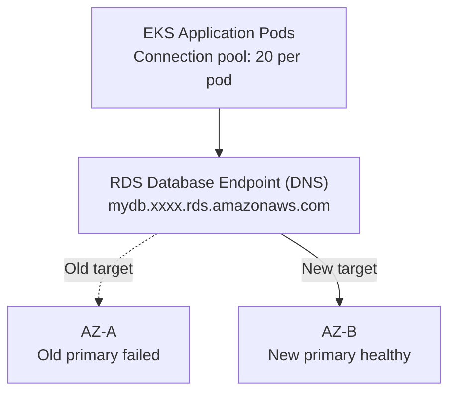

RDS updates the database endpoint's DNS target during failover. Applications must establish working connections to the new primary, and cached DNS information can delay recovery.

**Interviewer asks:**

"If the new database is healthy, why are application pods still failing to connect?"

"What would you investigate and do to restore application connectivity without causing a connection storm?"

### Why NetworkPolicy could be involved

Suppose your NetworkPolicy restricts outgoing traffic from application pods.

After failover, the RDS endpoint resolves to a different IP address. If your egress rules permit only the previous IP, connectivity could fail.

However, if there was no NetworkPolicy change and the application uses the proper RDS endpoint, **stale database connections and DNS caching are more likely causes**.

### What actually happens during failover?

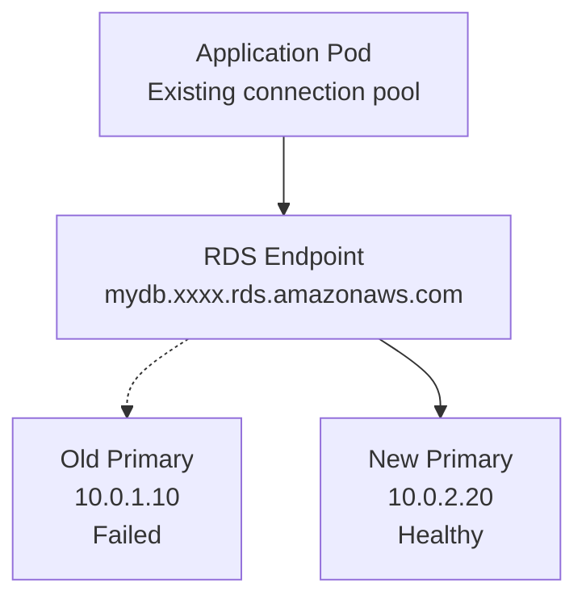

Illustrative IPs. The database endpoint changes its DNS target during failover.

The application may continue failing because:

1. **Stale connections:** The connection pool contains broken TCP connections to the old primary.
2. **DNS caching:** The application continues resolving the endpoint to the old IP.
3. **Retry storm:** Hundreds of pods simultaneously attempt reconnection, overwhelming the new primary.
4. **Network restrictions:** NetworkPolicy, security groups, or routes prevent connections to the new primary.

### How I would troubleshoot

| Check | Action |
|---|---|
| DNS | Run `nslookup` or `dig` from an application pod; compare with the current RDS target |
| Network | Test TCP connectivity to the RDS endpoint on port 5432 |
| Connection pool | Check stale connections, validation failures, pool exhaustion |
| Security | Verify NetworkPolicy, security groups and routes |
| Recovery | Replace broken connections gradually, use bounded retries with jitter and monitor database connections |

For Java-based applications, configuring an appropriate JVM DNS cache TTL is particularly important.

### Interview-ready answer

> First, I would verify that the RDS failover completed and the endpoint is resolving correctly from the application pods.
>
> Next, I would check whether the application connection pool is reusing stale connections established before failover.
>
> I would also verify NetworkPolicy, security groups, and connectivity to port 5432.
>
> To recover, I would ensure broken connections are discarded and new connections are established gradually with bounded exponential backoff and jitter, avoiding a connection storm.
>
> For longer-term improvement, I would evaluate RDS Proxy, which can reduce application disruption during database failover.

RDS Proxy can maintain application-facing connections and automatically connect to the new primary, although in-flight transactions can still fail.

---

## Mock Interview — Follow-up Question 11: Application connection pools

- DNS is resolving to the **new primary database** correctly.
- NetworkPolicy and security groups are allowing traffic.
- TCP connectivity on port 5432 is successful.
- The database is healthy.

But the application is still reporting connection errors.

You discover that **50 application pods each have a connection pool containing 20 connections**, some of which were created before failover.

**Question:**

"What would you do with these connection pools? Would you restart all 50 application pods, increase the pool size, or take another approach?"

Explain why.

### How to recover the connection pools

We have:

| App pods | Pool size / pod | Max pooled connections |
|---|---|---|
| 50 | 20 | 1,000 |

1,000 is the combined pool capacity, not necessarily the number of established database connections.

### Recovery steps

| Step | What I would do | Why |
|---|---|---|
| 1. Check logs | Identify broken connection errors and pool timeouts | Confirm the failure |
| 2. Validate connections | Test connections before returning them to requests | Identify stale connections |
| 3. Evict stale connections | Use the pool's connection eviction/reset mechanism | Remove connections to the old primary |
| 4. Reconnect gradually | Apply capped pool sizes, backoff and jitter | Avoid a connection storm |
| 5. Verify recovery | Check DB connections, API p99 and error rates | Confirm service recovery |

If the application uses a connection pool such as HikariCP, its pool management facilities can help evict stale connections and create replacements.

**Would I ever restart application pods?**

Yes. If the application cannot recover its pool, I would consider a **controlled rolling restart**, keeping sufficient healthy pods available and staggering reconnections.

I would not restart all 50 pods simultaneously.

### Interview-ready answer

> I would first inspect application logs and connection pool metrics to confirm whether the failures are caused by stale connections from the previous primary database.
>
> I would not immediately increase the pool size or restart all application pods, because that could generate a connection storm against the newly promoted primary.
>
> I would invalidate broken connections using the application's connection pool management mechanism and allow new connections to be established gradually, with bounded retries, exponential backoff, and jitter.
>
> If the pools cannot recover, I would consider a controlled rolling restart.
>
> Finally, I would monitor connection counts, database CPU, connection failures, and API latency to verify recovery.

---

## Mock Interview — Follow-up Question 12: Preventing connection storms

The application teams have fixed the stale connection problem.

All 50 application pods now attempt to establish new connections to the healthy database.

Suddenly:

| DB CPU | Connection attempts |
|---|---|
| 95% | 1,000 |

Even though the failover succeeded, the database is becoming overloaded again.

**Question:**

"As the SRE, what mechanisms would you implement so that 50 application pods do not simultaneously overwhelm the database after every failover?"

Consider **connection limits, retries, backoff with jitter, and RDS Proxy**.

### What you got right

| Mechanism | How it helps |
|---|---|
| **Rate limiting** | Reduces incoming application requests that generate database traffic |
| **Backoff with jitter** | Prevents all 50 pods from retrying connections simultaneously |
| **Circuit breaker** | Temporarily stops requests to an unhealthy database and allows limited recovery probes |

These are all valid, but the interviewer is specifically asking about a **database connection storm**.

You should therefore add two more important mechanisms: **connection pool limits and RDS Proxy**.

### Complete architecture-level answer

Imagine we have 50 application pods, each configured for 20 database connections.

That's a potential 1,000 database connections.

Instead of allowing all connections to be recreated immediately, we would:

1. Configure bounded connection pool sizes and gradual connection creation.
2. Use exponential backoff with jitter for failed connection attempts.
3. Apply a circuit breaker so an unhealthy database isn't overwhelmed.
4. Limit or shed noncritical incoming application traffic during recovery.
5. Consider RDS Proxy to manage and reuse database connections more efficiently.

One distinction: rate limiting application requests doesn't automatically limit connection establishment. The connection pool must have its own concurrency and connection-creation controls.

### Where RDS Proxy fits

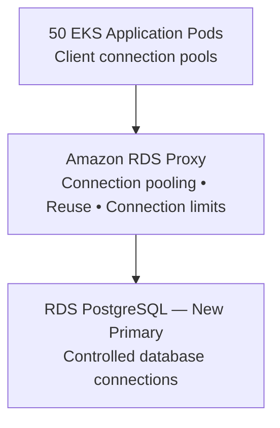

RDS Proxy can reuse backend database connections across application sessions, reducing connection churn. It also supports `MaxConnectionsPercent` to limit backend database connections.

Two important limitations:

- RDS Proxy doesn't eliminate excessive SQL workload or CPU pressure.
- Certain PostgreSQL operations cause *session pinning*, reducing connection sharing.

### Your improved interview answer

> To prevent a connection storm after database failover, I would implement rate limiting, bounded exponential backoff with jitter, and circuit breakers.
>
> I would also limit the maximum connection pool size per application pod and make sure connections are recreated gradually.
>
> For better resilience, I would consider RDS Proxy to pool and reuse database connections and protect the database from excessive connection creation.
>
> Finally, I would monitor database connections, CPU, connection timeouts, and application latency to ensure the recovery is stable.

---

## Mock Interview — Final Recovery Verification Question

We've successfully recovered from the RDS failover.

- The new primary is healthy.
- All EKS application pods have reconnected.
- Database CPU is back to 40%.
- API latency has returned to normal.

Your manager asks:

**"Can we now declare the incident resolved? How do we know that all customer transactions are safe?"**

### Your answer versus the expected answer

| Your answer | Assessment |
|---|---|
| Check application health and API latency | Correct |
| Test sample database queries | Correct |
| Verify database health | Correct |
| Check traffic and request rates | Correct |
| Check outstanding transactions | Good |
| Reconcile failed or uncertain transactions | Missing |
| Verify committed data integrity | Missing |

### What you should add

Remember our previous transaction example:

| Transaction | Before failover | Recovery verification |
|---|---|---|
| A | Committed and acknowledged | Confirm the data is present |
| B | Uncommitted | Confirm rollback; retry safely |
| C | Commit requested, acknowledgment lost | Check whether it committed before retrying |

**Transaction C is the most important.**

If the customer paid ₹5,000 and the application lost the acknowledgment, blindly retrying could cause a duplicate payment unless idempotency is enforced.

You should reconcile uncertain transactions using order IDs, idempotency records, and payment-provider records when applicable.

### Final production recovery checklist

- [ ] RDS failover completed; new primary is healthy
- [ ] Application pods and connection pools have recovered
- [ ] API latency, error rate, and traffic are normal
- [ ] No abnormal lock waits, connection storms, or outstanding transactions
- [ ] Committed and uncertain transactions have been reconciled
- [ ] Data integrity, payment totals, and order counts are verified
- [ ] Recovery remains stable during an observation window

### Your improved interview answer

> Once the RDS failover is complete, I would verify the database is healthy and all application pods have re-established connectivity.
>
> I would check API latency, error rates, database CPU, connection pool health, and outstanding transactions.
>
> Then I would verify committed transactions are present, ensure uncommitted transactions were handled correctly, and reconcile any transactions whose commit status is unknown.
>
> For payment operations, I would check idempotency records and payment-provider reconciliation to ensure there were no duplicate or missing payments.
>
> Finally, I would validate database integrity and monitor the system for a defined observation period before declaring the incident resolved.

---

## RPO vs RTO for RDS Multi-AZ

### RTO and RPO for RDS Multi-AZ

| Metric | Expected behavior | Your answer |
|---|---|---|
| **RTO** | Typically 60–120 seconds for RDS Multi-AZ DB instance failover | Correct estimate |
| **RPO** | Zero for acknowledged, committed transactions during normal Multi-AZ failover | Needs correction |

AWS confirms that Multi-AZ DB instances use synchronous replication and typically complete failover in 60–120 seconds, although complex recovery can take longer.

### The important distinction

**RPO is not dependent on application retry logic.**

For RDS Multi-AZ with synchronous replication:

- A transaction committed and acknowledged before failure should be preserved on the standby.
- An uncommitted transaction can be rolled back.
- A transaction whose commit acknowledgment was lost has an uncertain outcome and needs reconciliation.

Retry logic helps the **application recover failed operations**, but it does not establish the database's RPO.

### Database RTO versus application RTO

| Time | Event | Detail |
|---|---|---|
| 0 sec | Primary database fails | Application database requests begin failing |
| 90 sec | RDS failover completes | Standby promoted and database becomes available |
| 110 sec | Applications reconnect | DNS, connection pools, and retries recover |
| 130 sec | Application recovery verified | API traffic, latency, and errors return to normal |

Illustrative timings, not guaranteed AWS recovery durations.

Even if the database fails over in 90 seconds, the **end-to-end application RTO may be longer** because of DNS caching, connection pool recovery, retries, and health verification.

### Your corrected interview answer

> For Amazon RDS Multi-AZ, I would expect a typical database failover duration of around 60–120 seconds, although it could take longer.
>
> Database RPO is effectively zero for acknowledged, committed transactions because synchronous replication protects those writes during normal failover.
>
> However, in-flight transactions may fail, and transactions without a commit acknowledgment may need reconciliation.
>
> I would implement idempotent retry logic, connection pool recovery, and appropriate DNS caching to minimize application RTO.
>
> Finally, I would measure the actual end-to-end recovery time through failover testing rather than assuming the database failover duration equals application RTO.

---

## Final Apple SRE follow-up: RPO vs application recovery

Assume the primary database fails at 10:00 AM.

- RDS completes failover at 10:02 AM.
- All committed database records are preserved.
- 100 customer requests fail during those two minutes.
- The application has no automatic retry mechanism.

**Question:**

"Can we still say the database has zero RPO even though 100 customer requests failed?"

And what would you implement to ensure those customers can safely complete their operations after recovery?

### Why your RPO answer is correct

Even though 100 customer requests failed during failover, the database can still have **zero RPO for acknowledged, committed transactions** under normal RDS Multi-AZ failover.

Remember:

- **RPO:** How much committed database data we can afford to lose.
- **RTO:** How long it takes to restore service.
- **Failed requests:** Operations that may never have committed and require application-level recovery.

Retry logic doesn't determine database RPO.

### Your SQS suggestion is also valid

You can use Amazon SQS to buffer operations that don't need an immediate synchronous database response.

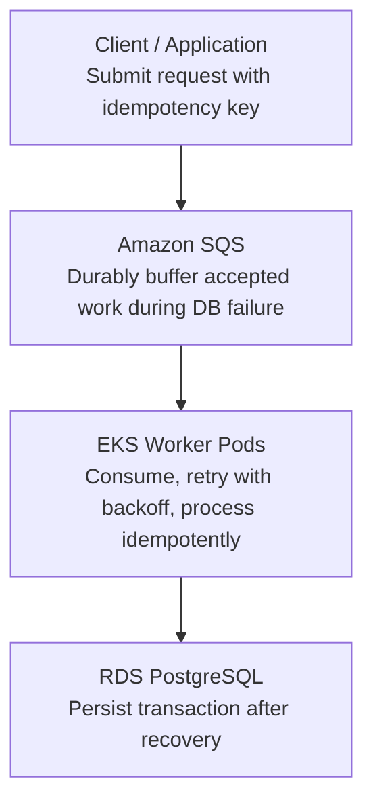

If the database is unavailable, the workers can stop or defer processing while accepted messages remain in SQS, subject to retention limits.

**Two important cautions:**

- SQS is at-least-once delivery for standard queues, so consumers must be idempotent.
- Requests that already failed before being durably queued cannot be recovered from SQS automatically. The client must retry or the application must have persisted them elsewhere.

### Interview-ready answer

> Yes, database RPO can remain zero even when 100 customer requests fail, because no acknowledged, committed database transactions were lost.
>
> To improve application resilience, I would implement idempotent retries with exponential backoff and jitter.
>
> For asynchronous operations, I could introduce SQS to buffer accepted requests while the database is unavailable. Worker pods would process the messages after recovery, and a dead-letter queue would handle repeatedly failing messages.
>
> I would monitor queue depth, message age, processing failures, and end-to-end transaction completion.

---

## Mock Interview — Follow-up Question 14: SQS and duplicate transactions

You've implemented SQS to buffer customer orders during database failover.

After recovery:

1. SQS delivers Order 123 to Worker Pod A.
2. Worker Pod A successfully writes Order 123 to PostgreSQL.
3. Before deleting the message from SQS, Worker Pod A crashes.
4. SQS makes the message available again, and Worker Pod B receives Order 123.

**Question:**

"How would you prevent Worker Pod B from creating a duplicate order in PostgreSQL?"

Would you rely on SQS to prevent duplicates, or implement something at the application/database level?

### What you got right

- **Idempotency:** Prevent the same logical order from being processed twice.
- **Transaction ID:** Use a unique identifier to identify whether an order was already processed.
- **Commit verification:** Check PostgreSQL before deciding whether to perform the operation again.
- **Data reconciliation:** Useful if the system discovers missing, conflicting, or inconsistent records.

One correction: **data reconciliation isn't necessary every time a duplicate SQS message arrives.**

If Order 123 was already committed successfully, Worker B should identify the existing result and avoid inserting it again.

### How duplicate prevention works

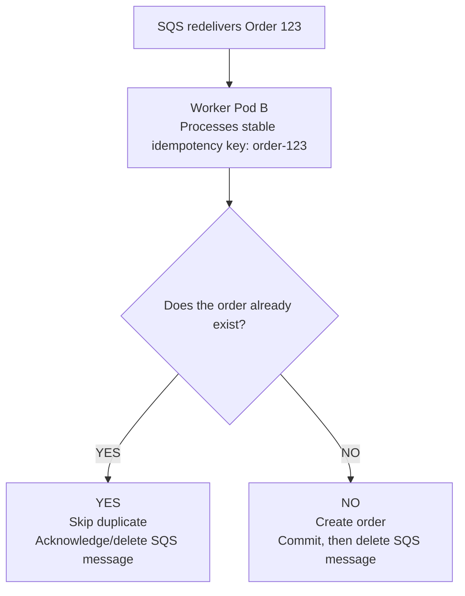

**Important:** A database uniqueness constraint must enforce idempotency atomically. A simple check followed by an insert isn't enough, because two workers might check simultaneously and both attempt insertion.

### SQL implementation — Simple example

Assume `order_id` has a unique constraint or is the primary key.

```sql
INSERT INTO orders (order_id, amount)
VALUES ('order-123', 5000)
ON CONFLICT (order_id) DO NOTHING;
```

If Worker A has already committed `order-123`, Worker B's insert won't create another row. PostgreSQL handles the uniqueness conflict atomically.

Worker B should then verify that the existing order represents the same logical request before acknowledging the SQS message.

**Important:** Prefer the application's stable `order_id` or idempotency key over relying only on the SQS-generated `MessageId`. Two separate SQS messages might represent the same business operation.

Also, preventing duplicate order inserts doesn't automatically prevent duplicate charges at an external payment provider. That operation needs its own idempotency protection.

### Your improved interview answer

> I would implement idempotency using a unique order ID or transaction ID.
>
> When Worker B receives a duplicate message, it should check whether the order was already processed.
>
> I would enforce uniqueness in PostgreSQL so that even concurrent workers cannot insert duplicate orders.
>
> If the original transaction was committed, Worker B should acknowledge the message without repeating the operation.
>
> If the transaction wasn't committed, it can retry safely. If the outcome is uncertain, the application must verify it before retrying.

---

## Mock Interview — Follow-up Question 15: Concurrent workers

Consider a slightly different situation.

Two EKS worker pods receive messages for the same Order 123 almost simultaneously.

| Worker A | Worker B |
|---|---|
| Checks PostgreSQL for Order 123. | Checks PostgreSQL for Order 123. |
| Not found | Not found |

Both workers now attempt to insert Order 123.

**Question:**

"If both workers checked the database and found that the order didn't exist, how would you prevent them from creating duplicate records?"

Would checking the database first be sufficient, or would you need another mechanism?

### What is happening here?

Two workers are processing the same order at almost the same time.

| Time | Worker A | Worker B |
|---|---|---|
| 10:00:01 | Checks Order 123 | Checks Order 123 |
| 10:00:02 | Not found | Not found |
| 10:00:03 | Attempts INSERT | Attempts INSERT |
| 10:00:04 | Successfully inserts | Could also insert if no uniqueness constraint exists |

This problem is called a **race condition**.

Both workers checked before either had committed the order.

**Important:** Checking whether a record exists before inserting is not sufficient to prevent duplicates.

### How do we fix it in PostgreSQL?

**Step 1 — Enforce uniqueness**

```sql
CREATE TABLE orders (
    order_id VARCHAR(50) PRIMARY KEY,
    amount DECIMAL(10,2)
);
```

Since `order_id` is the primary key, PostgreSQL will not allow two rows with the same order ID.

**Step 2 — Use an atomic INSERT**

Both workers execute:

```sql
INSERT INTO orders (order_id, amount)
VALUES ('order-123', 5000)
ON CONFLICT (order_id) DO NOTHING;
```

Now PostgreSQL handles the conflict.

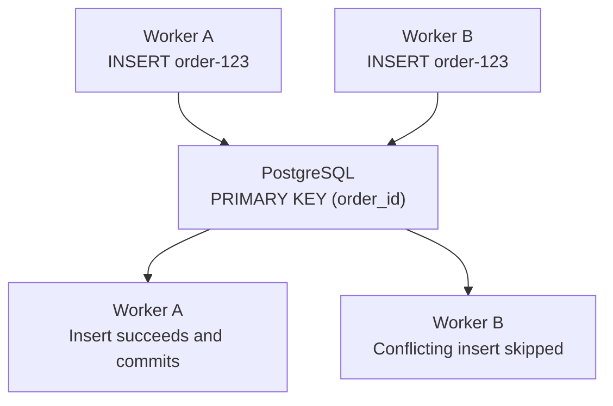

Assuming Worker A commits successfully. Worker B may wait for A's transaction outcome before resolving the conflict.

Now the database contains only one Order 123.

Worker B must verify that the existing order represents the same request before acknowledging its SQS message. If the order details conflict, it should raise an error for investigation.

### What does atomic mean?

Atomic means that an operation has an all-or-nothing outcome, rather than leaving partially applied changes.

Here, PostgreSQL's uniqueness enforcement and `ON CONFLICT` handling safely resolve competing inserts, even when multiple workers execute concurrently.

We don't need to implement a separate application-side distributed lock simply to prevent duplicate order IDs.

### Interview-ready answer

> This is a race condition because both workers check the database before either has inserted the record.
>
> To prevent duplicates, I would enforce a unique constraint on the order ID or idempotency key and use an atomic insert with `ON CONFLICT`.
>
> PostgreSQL will allow only one conflicting record to be inserted. The second worker can identify that the order already exists and avoid repeating the operation.
>
> After confirming the existing order matches the request, the worker can acknowledge the SQS message.

### Quick follow-up

Two worker pods attempt to insert the same Order 123.

PostgreSQL has a `PRIMARY KEY` constraint on `order_id`, and both workers use `ON CONFLICT DO NOTHING`.

**What happens when Worker B tries to insert Order 123 after Worker A has successfully committed it?**

- A. PostgreSQL creates a second copy.
- B. PostgreSQL skips the conflicting insert.
- C. PostgreSQL automatically restarts Worker B.

Your answer **A is incorrect. The correct answer is B.**

### Why does PostgreSQL skip the duplicate?

We have two workers:

- Worker A inserts Order 123 and commits successfully.
- Worker B attempts to insert the same Order 123.
- PostgreSQL has a `PRIMARY KEY` constraint on `order_id`.

Both use:

```sql
INSERT INTO orders (order_id, amount)
VALUES (123, 5000)
ON CONFLICT (order_id) DO NOTHING;
```

Since Order 123 already exists, PostgreSQL **skips Worker B's insert** without creating another row.

| Worker | Result |
|---|---|
| A | Order 123 inserted |
| B | Duplicate insert skipped |
| Database | Exactly one row for Order 123 |

Remember:

- `PRIMARY KEY` prevents duplicate IDs.
- `ON CONFLICT DO NOTHING` handles the conflict without raising a duplicate-key error.
- Together, they make duplicate inserts safe, provided the existing record is checked for consistency.

This does not automatically make external payment processing idempotent.

---

## Mock Interview — Question 16: Transaction atomicity

Your application processes a payment using PostgreSQL.

A transaction contains three operations:

1. **Step 1 — Create Order 123** — INSERT into orders — Successful
2. **Step 2 — Update account balance** — UPDATE accounts — Successful
3. **Step 3 — Record payment** — INSERT into payments — Failed

All three statements are part of **one database transaction**, and no `COMMIT` has happened yet.

**Interviewer asks:**

"The first two SQL statements succeeded, but the third failed. What happens to the order and the account balance?"

"Would PostgreSQL keep the successful changes, or roll everything back?"

### Correct! 10/10

Exactly. **Atomicity means all or nothing.**

If all three operations belong to one database transaction and the third operation fails before `COMMIT`, the transaction cannot be committed normally in PostgreSQL.

| Operation | Execution result | Final result after rollback |
|---|---|---|
| INSERT Order 123 | Successful | Rolled back |
| UPDATE account balance | Successful | Rolled back |
| INSERT payment | Failed | Not applied |

### How PostgreSQL handles this

```sql
BEGIN;

INSERT INTO orders ...;     -- Success
UPDATE accounts ...;       -- Success
INSERT INTO payments ...;   -- Error

ROLLBACK;
```

**Important:** In PostgreSQL, an SQL error normally leaves the transaction in an aborted state. The application must issue `ROLLBACK` (or roll back to a suitable savepoint) before continuing.

This is why applications should handle transaction exceptions and ensure connections are cleaned up before returning them to the pool.

---

## Mock Interview — Question 17: Failed transaction and connection pooling

Your application uses PostgreSQL and a connection pool containing 20 connections.

A payment transaction fails midway.

However, the application developer forgot to execute `ROLLBACK`.

The application then tries to execute another SQL query using the same connection.

PostgreSQL returns:

```text
ERROR: current transaction is aborted,
commands ignored until end of
transaction block

SQLSTATE: 25P02
```

**Question:**

As an SRE, what would you do?

1. Would you restart the PostgreSQL database?
2. Would you restart the application pods?
3. Or would you handle the failed transaction and connection differently?

### What does SQLSTATE 25P02 mean?

Imagine your application has borrowed a database connection from a pool.

It starts a transaction containing three SQL statements:

```sql
BEGIN;

INSERT INTO orders VALUES (123, 5000);

INSERT INTO payments VALUES (123, 5000);
-- This statement fails

SELECT * FROM orders WHERE order_id = 123;
-- ERROR: 25P02
```

**What happened?**

The second statement failed, but the application did not execute `ROLLBACK`.

PostgreSQL marks that transaction as aborted and rejects subsequent ordinary SQL statements until the transaction is rolled back.

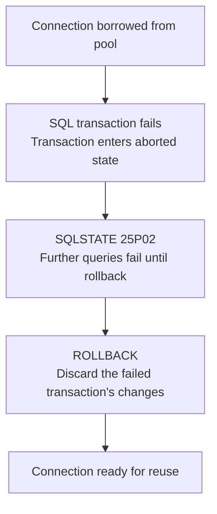

### How would you troubleshoot and recover?

| Step | SRE action |
|---|---|
| 1. Investigate | Find the original SQL error preceding `25P02` in application logs |
| 2. Recover | Ensure the application executes `ROLLBACK` on the failed transaction |
| 3. Connection pool | Return only clean connections; discard connections that cannot be reset safely |
| 4. Prevent | Ensure application exception handling always performs transaction cleanup |
| 5. Verify | Monitor SQL errors, connection pool utilization, and transaction duration |

A properly configured connection pool such as HikariCP includes rollback and connection-cleanup behavior, but the application should still explicitly manage transactions correctly.

### Interview-ready answer

> SQLSTATE 25P02 indicates that a transaction has failed and PostgreSQL is rejecting further statements in that transaction.
>
> I would investigate the original SQL error, ensure the application rolls back the failed transaction, and verify that the connection is clean before returning it to the pool.
>
> I would not immediately restart the database or all application pods.
>
> If the connection cannot be recovered, I would discard it and allow the pool to replace it safely.

**Remember:** Failed transaction → ROLLBACK → Clean connection → Reuse.

---

## Mock Interview — Question 18: PostgreSQL lock troubleshooting

You're the on-call SRE. Customers are reporting that order updates are taking 30 seconds.

You check PostgreSQL and find:

```text
PID  State                  Wait
101  idle in transaction    -
102  active                 Lock
103  active                 Lock
104  active                 Lock
```

Further investigation confirms that PID 101 is blocking the other three transactions.

PID 101 has been idle in an open transaction for 15 minutes.

**Interviewer asks:**

"You've identified PID 101 as the blocking session. How would you safely resolve the issue without restarting PostgreSQL?"

Would you:

- A. Immediately restart PostgreSQL.
- B. Identify the session owner, confirm whether the transaction can be rolled back, and terminate the blocking session if necessary.
- C. Increase the database connection pool size.
- D. Restart all application pods.

### Correct! Answer B — 10/10

That's the safest approach for a production database. We should identify the blocking session, confirm its impact, coordinate with the application owner, and terminate it only if necessary.

You don't need to restart PostgreSQL or all the application pods.

### PostgreSQL commands to remember

For the Apple SRE interview, focus on these four operations.

#### Step 1 — Check transaction state

```sql
SELECT pid, state, wait_event_type,
       now() - xact_start AS transaction_age,
       query
FROM pg_stat_activity
WHERE pid = 101;
```

Example output:

```text
pid:              101
state:            idle in transaction
transaction_age:  00:15:00
query:            UPDATE orders ...
```

This indicates that PID 101 has an open transaction, but is not currently executing SQL. The displayed query is its most recently executed statement, not necessarily the statement responsible for every lock it holds.

#### Step 2 — Find which sessions are blocked

```sql
SELECT pid,
       pg_blocking_pids(pid) AS blocked_by,
       wait_event_type,
       query
FROM pg_stat_activity
WHERE wait_event_type = 'Lock';
```

Illustrative result:

| PID | Blocked by |
|---|---|
| 102 | `{101}` |
| 103 | `{101}` |
| 104 | `{101}` |

We can now see that PID 101 is blocking three other sessions.

#### Step 3 — Check database locks

```sql
SELECT pid, locktype, mode,
       relation::regclass AS relation,
       granted
FROM pg_locks
WHERE pid IN (101, 102, 103, 104);
```

- `granted = true` means the lock has been acquired.
- `granted = false` means the session is waiting to acquire it.

`pg_locks` gives additional details about the locks, while `pg_blocking_pids()` is generally the better tool for identifying blocking sessions.

#### Step 4 — Recover safely

First, identify the owner of PID 101 using its application name, username, and client address. Ask the owning application to commit or roll back the transaction normally.

If the transaction is abandoned and termination is approved:

```sql
SELECT pg_terminate_backend(101);
```

This terminates the session, rolls back its uncommitted transaction, and releases its transaction locks.

**Important distinction:**

| Command | What it does |
|---|---|
| `pg_cancel_backend(101)` | Cancels the currently executing query; doesn't necessarily end the transaction |
| `pg_terminate_backend(101)` | Terminates the database session and rolls back its open transaction |

Because PID 101 is *idle in transaction*, canceling its current query is not useful. The application should issue `ROLLBACK`, or the session can be terminated when justified.

### Interview-ready answer

> I would use `pg_stat_activity` to identify the long-running transaction and `pg_blocking_pids()` to determine which sessions are blocked.
>
> Then I would inspect `pg_locks` and identify the application responsible for the blocking transaction.
>
> If the transaction is abandoned, I would coordinate with the application team to roll it back, or terminate the blocking backend with approval.
>
> Finally, I would verify that blocked queries are progressing, API latency has recovered, and no abnormal lock waits remain.
>
> To prevent recurrence, I would investigate application transaction handling, keep transactions short, and consider an appropriate idle-in-transaction timeout.

---

## Mock Interview — Question 19: Recovery verification

We have successfully performed point-in-time recovery and restored missing customer orders into the production database.

The database is healthy and the application is functioning normally.

However, we now have these numbers:

| Expected recovered orders | Actually recovered |
|---|---|
| 2,000,000 | 1,995,000 |

**5,000 orders are still missing.**

The application team says:

"All APIs are working. Can we close the incident?"

**Interviewer asks:**

"How would you identify exactly which 5,000 orders are missing, and how would you recover them without affecting existing production orders?"

### What you got right

| Your answer | Assessment |
|---|---|
| Compare expected and actual counts | Correct |
| Check duplicate order IDs | Correct |
| Identify exactly which rows are missing | Correct |
| Restore only missing records | Correct approach |
| Restore into the recovered database | Should be production |

### How to identify the 5,000 missing orders

Assume we've imported the expected recovery records into a staging table called `orders_recovery_stage`.

We compare those IDs with the production `orders` table.

```sql
SELECT r.order_id
FROM orders_recovery_stage r
LEFT JOIN orders p
    ON r.order_id = p.order_id
WHERE p.order_id IS NULL;
```

**Simple explanation:**

- `orders_recovery_stage` contains the orders we expect to recover.
- `orders` contains the current production records.
- `LEFT JOIN` compares the two datasets.
- `WHERE p.order_id IS NULL` returns IDs missing from production.

This should identify our 5,000 missing orders, assuming the expected recovery set is accurate.

### How to recover them safely

After validating that these are genuinely missing orders, we can use a controlled insert.

```sql
INSERT INTO orders (
    order_id, customer_id, amount
)
SELECT r.order_id, r.customer_id, r.amount
FROM orders_recovery_stage r
WHERE NOT EXISTS (
    SELECT 1
    FROM orders p
    WHERE p.order_id = r.order_id
)
ON CONFLICT (order_id) DO NOTHING;
```

`ON CONFLICT` prevents a duplicate primary-key insert when a matching record already exists.

For production, I'd first test the recovery, verify related customer/payment records, check for newer changes, and insert in controlled batches. Any conflicts or skipped records must be reconciled, and we must avoid unintended application side effects from triggers or downstream integrations.

### Your improved interview answer

> I would first compare the expected recovery count with the actual recovered records.
>
> Then I would compare the unique order IDs from the PITR recovery dataset against production using a SQL JOIN to identify exactly which records are missing.
>
> Once identified, I would verify those records are valid and restore them into production in controlled batches, without overwriting existing orders.
>
> Finally, I would check record counts, duplicates, foreign-key relationships, financial totals, and newer customer transactions before declaring recovery complete.

---

## Mock Interview — Question 20: PostgreSQL EXPLAIN

Your PostgreSQL database contains 20 million order records.

A customer-facing API is taking 5 seconds to respond.

The application executes:

```sql
SELECT *
FROM orders
WHERE customer_id = 12345;
```

You run `EXPLAIN` and receive:

```text
Seq Scan on orders
  (cost=0.00..450000.00 rows=1000 width=100)
  Filter: (customer_id = 12345)
```

**Database observations**

- CPU utilization: **85%**
- Table rows: **20 million**
- Query execution plan: **Sequential Scan**

**Interviewer asks:**

"What does a Sequential Scan mean, and why might it make this query slow?"

"What would you investigate before deciding to create an index?"

### What is a Sequential Scan?

A **Sequential Scan (Seq Scan)** means PostgreSQL reads through the table to find rows matching the condition.

For example:

```sql
SELECT * FROM orders
WHERE customer_id = 12345;
```

If the table contains 20 million rows, PostgreSQL may need to examine all 20 million rows.

This can cause high CPU, disk I/O, and slow queries.

### Sequential Scan vs Index Scan

| Sequential Scan | Index Scan |
|---|---|
| Scans the table | Uses an index to find matching records |
| Potentially reads millions of rows | Can avoid reading unrelated rows |
| Can be slow for selective queries | Usually faster when few rows match |
| Useful when retrieving a large percentage of the table | Useful when retrieving a small percentage |

**Important:** A Sequential Scan is not always bad. PostgreSQL may deliberately choose it when most rows are needed.

### What should you investigate?

Three commands to remember:

**Check the execution plan:**

```sql
EXPLAIN
SELECT * FROM orders
WHERE customer_id = 12345;
```

**Check whether indexes exist:**

```sql
SELECT indexname, indexdef
FROM pg_indexes
WHERE tablename = 'orders';
```

**Check actual execution time:**

```sql
EXPLAIN (ANALYZE, BUFFERS)
SELECT * FROM orders
WHERE customer_id = 12345;
```

`EXPLAIN ANALYZE` actually executes the query. It reports actual execution time, rows processed, and buffer usage, so use it carefully in production.

### How do we fix it?

If `customer_id` has no suitable index and the query is selective:

```sql
CREATE INDEX CONCURRENTLY idx_customer_id
ON orders(customer_id);
```

Do this only after evaluating production load and the index's write/storage overhead.

### Interview-ready answer

> A Sequential Scan means PostgreSQL reads through the table to find matching rows. On a 20-million-row table, this can be expensive.
>
> I would check the execution plan, verify existing indexes, and compare estimated versus actual rows and execution time.
>
> If the query is selective and a suitable index is missing, I would consider creating one concurrently after stabilizing production.
>
> Finally, I would verify the execution plan and confirm that query latency and database resource usage have improved.

**Remember:**

`Seq Scan → Check indexes → EXPLAIN ANALYZE → Optimize → Verify`

### Quick follow-up: EXPLAIN vs EXPLAIN ANALYZE

**Interviewer:** What is the difference between `EXPLAIN` and `EXPLAIN ANALYZE`?

- A. Both execute the query and show actual execution time.
- B. EXPLAIN shows the estimated execution plan; EXPLAIN ANALYZE executes the query and shows actual statistics.
- C. EXPLAIN creates an index automatically.

**Correct! Answer B — 10/10**

| Command | What it does |
|---|---|
| `EXPLAIN` | Shows the estimated execution plan without executing the query |
| `EXPLAIN ANALYZE` | Executes the query and shows actual execution time, rows processed, and other statistics |

**Interview tip:** Use `EXPLAIN ANALYZE` carefully in production because it actually executes the query.

---

## Final Topic: PITR and WAL — Quick Explanation

### What is WAL?

**WAL = Write-Ahead Log.**

In PostgreSQL, WAL records database changes before the corresponding modified data pages are written to disk.

Think of it as a transaction journal that helps PostgreSQL recover after crashes.

For example:

```text
Customer places Order 123
         ↓
PostgreSQL records changes in WAL
         ↓
Transaction commits
         ↓
Modified database pages are persisted
```

WAL helps PostgreSQL recover committed changes even if a crash occurs before modified data pages are written.

### How PITR uses WAL

PITR = **Point-in-Time Recovery**.

Suppose:

- 10:00 AM — Database backup exists.
- 10:05 AM — Developer accidentally deletes 2 million orders.
- 10:20 AM — SRE discovers the issue.

We want to restore the database to a safe point just before the deletion.

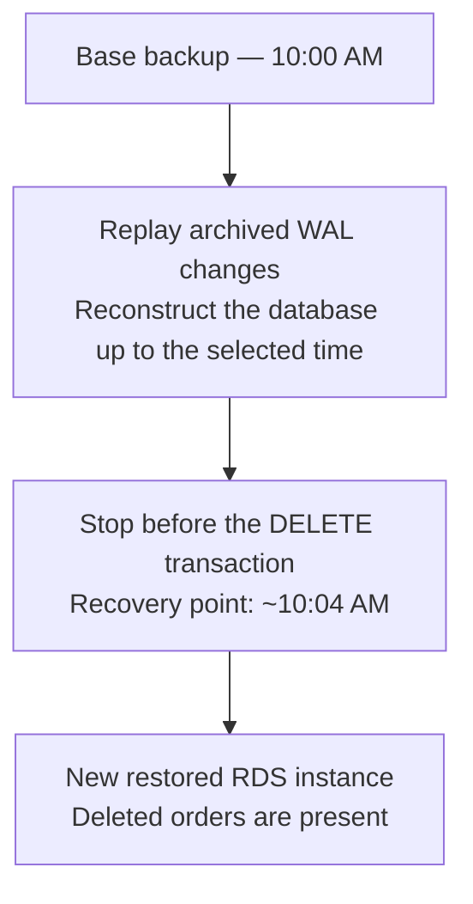

PostgreSQL uses a base backup and WAL replay to reconstruct an earlier database state.

For Amazon RDS, the key points are:

- PITR restores to a **new RDS instance**, not over the existing production database.
- The recovery point must fall within the available restore window.
- RDS uploads transaction logs approximately every five minutes; check `LatestRestorableTime` to determine the latest available recovery point.

### Interview-ready answer

> PostgreSQL uses Write-Ahead Logs to record changes before modified database pages are written.
>
> During PITR, a base backup is restored and WAL records are replayed until the selected recovery point.
>
> On Amazon RDS, this creates a new database instance. We can then extract missing records and reconcile them with production without overwriting newer transactions.

### Final mock interview question — PITR

A developer accidentally deletes 2 million orders at 10:05 AM.

You restore the database using PITR to 10:04 AM.

Meanwhile, production has accepted 50,000 new orders.

**Question:** What happens to the 50,000 new orders if you redirect application traffic directly to the restored database?

- A. WAL automatically merges all 50,000 new orders.
- B. The restored database won't contain those newer orders. We need data reconciliation to preserve both sets.
- C. RDS automatically synchronizes the restored database with production.

**Correct! Answer B — 10/10**

The PITR-restored database contains the 2 million deleted orders, but not the 50,000 newer orders.

**Correct recovery:** Keep production running, extract the missing records from the restored database, reconcile them into production, and verify data integrity.

---

# Final Assessment — Database Troubleshooting & Recovery

## Topic-by-topic status

| Topic | Coverage | Your interview readiness |
|---|---|---|
| Slow queries, indexes, connection pools | Covered | Good |
| Locks and deadlocks | Covered | Good, commands need revision |
| PITR and WAL | Covered | Good conceptual understanding |
| Failover and in-flight transactions | Covered | Stronger area |
| Data integrity and reconciliation | Covered | More practice needed |

## Remaining gaps — Prioritized

| Priority | Gap | What to prepare |
|---|---|---|
| P0 | **Practical PostgreSQL troubleshooting** | Independently interpret `pg_stat_activity`, `pg_locks`, and `EXPLAIN ANALYZE` outputs |
| P0 | **Recovery verification SQL** | Identify missing rows, duplicate IDs, orphaned records, and inconsistent payment totals |
| P1 | **Hands-on PITR operations** | RDS restore process, selecting recovery time, validating the restored instance |
| P1 | **Advanced query optimization** | Execution-plan costs, estimated vs actual rows, indexes, table statistics, CPU vs I/O |

These are refinements, not entirely new topics.

## Key concepts you should remember

| Failure scenario | Correct SRE response |
|---|---|
| Database CPU 90%, slow SQL | Check top queries, execution plan, indexes, locks and I/O |
| Idle transaction holding locks | Find blocker, coordinate rollback or safe termination |
| Deadlock | PostgreSQL aborts one transaction; retry safely |
| Accidental DELETE | PITR to new instance and selective reconciliation |
| RDS primary failure | Multi-AZ failover, reconnect, handle uncertain commits |
| Connection storm | Limit pools, backoff with jitter, circuit breakers, RDS Proxy |
| Duplicate order processing | Stable idempotency key, unique constraint, atomic insert |
| Recovery completed | Verify counts, IDs, relationships, payments and new transactions |

## My assessment for your Apple interview

**You have covered the required database troubleshooting and recovery syllabus.** I would not spend another full preparation session repeating these concepts.

Your strongest area is reasoning about availability, failover, database overload, and application recovery.

Your weaker area is independently explaining the exact PostgreSQL investigation and reconciliation commands without hints.

I recommend one final **15–20-minute practical drill** covering PostgreSQL diagnostics and data integrity, then move to the next item in your Apple preparation plan.

**Final status: Conceptual coverage complete; practical revision pending.**
