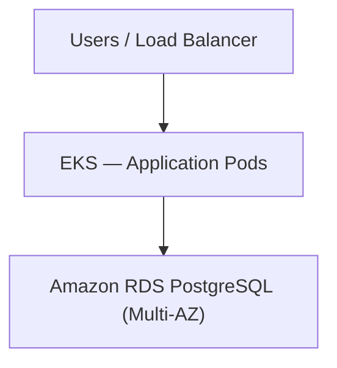
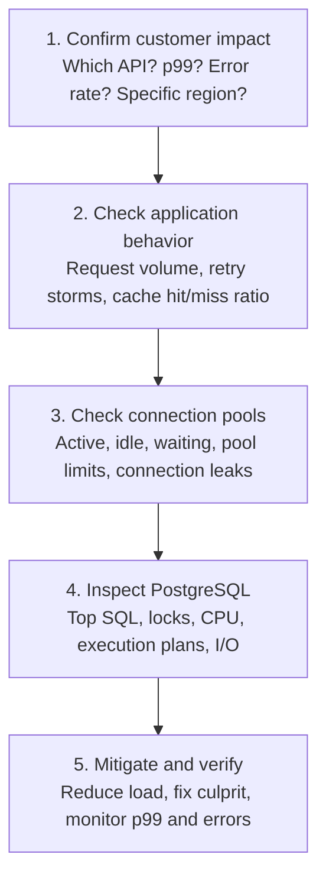
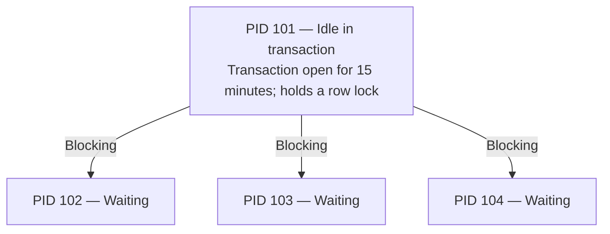

# Database Troubleshooting and Recovery — Apple ASE SRE Mock Interview

## Mock Interview — Scenario 1: Database Slow Queries

Your team runs a customer-facing application on AWS EKS.

**Architecture**



**Production incident:**

- API p99 latency increased from 200 ms to 5 seconds.
- Some API requests are timing out.
- Application pods are healthy.
- No recent deployments.
- Database CPU utilization is at 90%.
- Database connections increased from 100 to 450.

**Question:**

"You're the on-call SRE. How would you troubleshoot this issue?"

Walk me through your investigation, starting from the application layer and moving toward the database. What would you check first?

### What you answered correctly

| Your answer | My assessment |
|---|---|
| Check API-specific, cluster-wide, or region-wide impact | Excellent starting point |
| Check cache hit/miss ratio | Correct |
| Investigate connection pools | Very important |
| Identify slow-running queries | Correct |
| Check read/write routing and replicas | Good, if replicas exist |
| Check disk bottlenecks and database locks | Correct |

### Important corrections

**Correction 1 — A cache miss doesn't necessarily mean a database failure.**

A cache miss means the requested information is not available in the cache. Possible reasons include TTL expiration, eviction, cold cache, or invalidation.

If Redis fails, requests may bypass it and overload the database, depending on the application's fallback behavior.

**Correction 2 — 450 connections doesn't necessarily mean 450 queries are executing.**

Some connections may be idle or waiting on locks. You should check active, idle, and waiting sessions.

**Correction 3 — Don't immediately recycle connection pools.**

Restarting application pods or resetting pools may create a reconnection storm and worsen database CPU utilization.

**Correction 4 — Don't promote a replica simply because the database is slow.**

A Multi-AZ standby is normally for failover, not read scaling. Read replicas are separate resources, and adding them helps only when queries can be safely routed there.

### How I would structure your interview answer



One thing missing from your answer was **immediate mitigation**.

If CPU is already at 90% and customer requests are timing out, consider temporarily restricting expensive requests, controlling concurrency, and ensuring retries use bounded exponential backoff with jitter. Don't wait until every root-cause detail is known.

---

## Mock Interview — Follow-up Question 2: Database slow-query investigation

You have investigated the RDS PostgreSQL database and found these metrics:

| Database CPU | Total connections | Active connections | Idle connections |
|---|---|---|---|
| 90% | 450 | 40 | 350 |

The remaining 60 sessions have other states, including transaction-related or waiting sessions.

Additionally, database monitoring shows that a query which normally completes in 100 ms is now taking 4 seconds:

```sql
SELECT *
FROM orders
WHERE customer_id = 12345;
```

The `orders` table contains approximately 20 million rows.

**Interviewer asks:**

"We've identified a slow SQL query. How will you determine *why* it is slow? What PostgreSQL commands or tools would you use, and what exactly would you look for?"

Assume the database is production-critical and you cannot restart it.

### Four commands you should know for the interview

| Command / tool | What it tells you |
|---|---|
| `pg_stat_activity` | Which queries are running, idle, or waiting |
| `pg_stat_statements` | Which queries consume the most execution time overall |
| `EXPLAIN` | How PostgreSQL plans to execute a query |
| `pg_indexes` | Which indexes already exist on a table |

### Step 1 — Check running queries

```sql
SELECT pid, state, wait_event_type,
       wait_event, query
FROM pg_stat_activity
WHERE state = 'active';
```

This helps identify whether queries are executing or waiting on something such as a lock.

### Step 2 — Check the query execution plan

```sql
EXPLAIN
SELECT *
FROM orders
WHERE customer_id = 12345;
```

Imagine PostgreSQL returns:

```text
Seq Scan on orders
  Filter: (customer_id = 12345)
```

**What does `Seq Scan` mean?**

PostgreSQL is scanning the table sequentially to find matching records.

Think of searching for one customer's orders in a book containing 20 million entries without an index at the back of the book.

| Sequential scan | Index scan |
|---|---|
| Potentially examines millions of rows | Locates matching rows through an index |

### Step 3 — Check whether an index exists

```sql
SELECT indexname, indexdef
FROM pg_indexes
WHERE tablename = 'orders';
```

If `customer_id` is not indexed, and the execution plan confirms it would help, a possible remedy is:

```sql
CREATE INDEX CONCURRENTLY
idx_orders_customer_id
ON orders(customer_id);
```

`CONCURRENTLY` allows normal reads and writes to continue, although index creation still consumes resources and can be expensive on a busy production database.

**Important:** You should not immediately build an index on a database already running at 90% CPU without evaluating the production impact.

Also, `EXPLAIN` shows the estimated plan. `EXPLAIN ANALYZE` actually executes the query and reports actual timing, so use it carefully in production.

### A better 60-second interview answer

> First, I would check `pg_stat_activity` to identify active queries, long-running transactions, and sessions waiting on locks.
>
> Then I would use `pg_stat_statements`, if enabled, to identify SQL statements consuming the most database execution time.
>
> For the problematic query, I would check its execution plan using `EXPLAIN` to see whether PostgreSQL is using a sequential scan or an index scan.
>
> If it's performing a sequential scan on a 20-million-row table, I would check whether the `customer_id` column has a suitable index.
>
> I would also check whether the query is slow because of locks, high disk I/O, or inefficient execution plans.
>
> Based on those findings, I would mitigate the immediate customer impact, coordinate an appropriate database optimization, and verify that API latency and database CPU return to normal.

### Primary key and indexing correction

Yes, if `customer_id` is the **primary key**, PostgreSQL automatically creates a unique B-tree index on it.

However, consider this table:

```sql
CREATE TABLE orders (
    id BIGINT PRIMARY KEY,
    customer_id BIGINT,
    amount DECIMAL
);
```

Here:

- `id` is the primary key and is automatically indexed.
- `customer_id` is not automatically indexed.
- Even if `customer_id` is a foreign key referencing `customers(id)`, PostgreSQL does not automatically create an index on it.

So our scenario is still valid: `customer_id` has no index, and the query is performing a sequential scan.

---

## Mock Interview — Follow-up Question 3: Safe production index creation

You ran `EXPLAIN` and found:

```text
Seq Scan on orders
  Filter: (customer_id = 12345)
```

You also discovered that `customer_id` has no index.

- Database CPU: 90%.
- API latency: 5 sec.

**Question:**

"Now that you've identified the missing index, would you create the index immediately in production?

What would you do to reduce customer impact while fixing the problem?"

### What you got right

- **Don't create the index immediately** when database CPU is already at 90%.
- Use caching to reduce repeated database reads.
- Apply rate limiting to control incoming traffic.
- Review connection pooling to prevent excessive database connections.
- Create an index on `customer_id` once the database has sufficient capacity.

### What I would improve

There are three important points to remember.

| Technique | What you should do |
|---|---|
| Caching | Cache frequently requested, safe-to-cache reads. Watch for cache misses creating more DB pressure. |
| Rate limiting | Limit noncritical or expensive requests first, while protecting important customer traffic. |
| Connection pooling | Bound concurrent DB connections. Don't simply increase pool size, as it could overload PostgreSQL further. |

### Safe index creation in production

Once the database is stable and the change is approved:

```sql
CREATE INDEX CONCURRENTLY
idx_orders_customer_id
ON orders(customer_id);
```

Why `CONCURRENTLY`?

Unlike a standard index build, it allows normal database reads and writes to continue during the operation.

However, it can still consume CPU and I/O, take longer, wait for existing transactions, and fail leaving an invalid index. It also cannot run inside a transaction block.

Afterward, verify that the index is valid, inspect the query execution plan, and check whether database CPU, API p99 latency, and errors improve.

**One additional interview point:** If a single expensive query is overwhelming the database, temporarily controlling that specific endpoint can be more effective than rate limiting the entire application.

---

## Mock Interview — Scenario 2: Database Locks and Deadlocks

Your application uses PostgreSQL on Amazon RDS.

Customers are reporting that payment requests are taking 20–30 seconds.

Your initial investigation shows:

| Database CPU | Database connections | Waiting queries | API p99 latency |
|---|---|---|---|
| 35% | 300 | 80 | 30 sec |

You investigate PostgreSQL using `pg_stat_activity` and find:

```text
pid   state                  wait_event_type
101   idle in transaction    -
102   active                 Lock
103   active                 Lock
104   active                 Lock
```

Process `101` has held an uncommitted transaction open for 15 minutes, and the other three sessions are waiting for locks it holds.

**Interviewer asks:**

"CPU is only 35%, but API latency has reached 30 seconds. Why is the application slow?

How would you troubleshoot and recover from this situation without restarting the database?"

### Understand what's happening



The waiting queries may consume little CPU because they are blocked rather than actively executing.

**Important interview concept:**

`idle in transaction` means a transaction was started but is currently not executing a SQL statement and has not committed or rolled back.

It can continue holding locks. Once its transaction commits or rolls back, its transaction-scoped locks are released.

So low CPU doesn't mean the database is healthy.

### Step 1 — Find the blocking session

```sql
SELECT pid, state, wait_event_type,
       pg_blocking_pids(pid) AS blocked_by,
       now() - xact_start AS transaction_age,
       query
FROM pg_stat_activity
WHERE datname = current_database();
```

Look for:

- `blocked_by` — which PID is preventing progress.
- `transaction_age` — how long the transaction has been open.
- `state` — active or idle in transaction.

You can also inspect `pg_locks` for the requested and granted locks.

### Step 2 — Safely recover

First, identify the owning application and ask whether the transaction can finish or roll back normally.

If PID 101 is confirmed abandoned, and terminating it is approved:

```sql
SELECT pg_terminate_backend(101);
```

This closes that database session. Any uncommitted transaction in that session is rolled back, releasing its locks.

**For payment systems:** Confirm the transaction outcome before retrying, use an idempotency key, and reconcile against the payment provider if needed. Never blindly retry a payment.

### Step 3 — Prevent recurrence

Configure appropriate `idle_in_transaction_session_timeout`, investigate application code that leaves transactions open, and monitor lock-wait duration.

### Interview-ready answer

> A deadlock happens when two or more transactions hold locks that each other needs, so neither can proceed. PostgreSQL detects this automatically and aborts one transaction, allowing the others to continue. As an SRE, I would inspect PostgreSQL logs and blocking relationships, identify the conflicting SQL statements, and coordinate with developers to ensure consistent lock ordering and shorter transactions. The application should retry aborted transactions safely using idempotency and bounded backoff.

---
