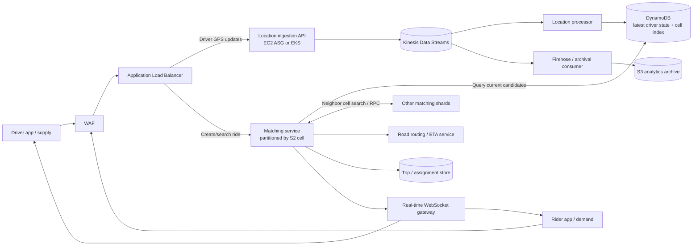
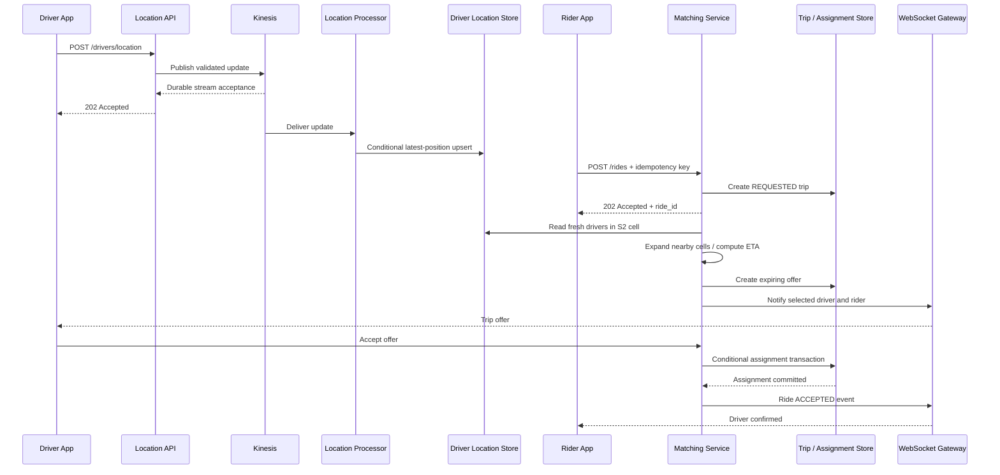

# Ride-Sharing System Design (Uber/Lyft-style)
## Step-by-step AWS architecture tutorial, interview Q&A, and failure/remediation guide

> **Basis and scope.** This tutorial follows the supplied whiteboard and lecture transcript: driver **supply** sends GPS updates; rider **demand** requests a trip; both enter through **WAF → ALB**; the supply side uses **EC2 Auto Scaling → Kinesis → DynamoDB**; and the demand side uses geographically partitioned matching workers, RPC, and WebSockets. The transcript mentions **Google S2**, **Ringpop**, and an analogy with Uber's architecture. Treat this as an **illustrative AWS interview design**, *not* a verified description of Uber's current production implementation. Sections marked **Interview improvement** go beyond or correct simplifications in the supplied lesson.

## 1. Start with requirements (the first two minutes)

**Functional requirements**
1. A driver can come online/offline and periodically update their GPS location.
2. A rider can request a pickup, see nearby eligible drivers, obtain ETA/price estimates, and book a ride.
3. One available driver is assigned to at most one active ride at a time.
4. Rider and driver receive real-time changes (offered, accepted, arriving, completed, cancelled).
5. Historical location/trip events can be used for reporting and analytics.

**Non-functional requirements**
- Low latency for finding nearby drivers and sending an offer.
- Fresh-enough location information, with explicit handling for missing/stale updates.
- High availability across multiple Availability Zones; clear regional-disaster strategy.
- Elastic ingestion for large, geographically uneven driver populations.
- Idempotent commands, no double assignment, and controlled retry/backpressure.
- Driver/rider authentication, privacy protection, rate limiting, observability.

**Clarifying questions for the interviewer:** expected active drivers, GPS ping frequency, cities/regions, target p95 matching latency, acceptable GPS staleness, and availability/RTO/RPO goals. Do **not** invent specific product SLOs if none are provided.

## 2. Architecture at a glance



**Important wiring:** An **ALB does not itself turn requests into Kinesis records**. The location-ingestion application (EC2/containers/Lambda behind an appropriate integration) validates and publishes records. A Kinesis **consumer** updates DynamoDB; Kinesis does not automatically populate the table. The WebSocket gateway is a logical service: ALB can support upgraded WebSocket connections, but a backend must manage connections and push events.

## 3. Ten-step mental model (walk through this out loud)

### Step 1 — Divide the map into geographic cells (Google S2)
**What happens:** Represent each driver's lat/long as an S2 cell ID. A rider's pickup point also maps to one cell. Nearby cells can be searched if the initial cell has no suitable drivers.

**Why:** Searching every driver worldwide would be slow and expensive. Hierarchical cell IDs narrow the candidate set before further distance and ETA checks.

**Example:** A rider in cell `C12` first looks for available drivers in `C12`, then nearby cells `C13`, `C18`, etc.

**Interview improvement:** S2 is a spherical, hierarchical **spatial index**, not a driving-route calculator. Road/traffic-based ETA comes from a routing service. S2 is one option; geohash/H3 may also work.

**Checkpoint Q:** Why not search DynamoDB for all drivers within a 5 km circle?  
**Answer:** DynamoDB does not have native arbitrary-radius geospatial queries like a dedicated spatial index. Use an S2/H3/geohash-based access pattern, query candidate cells, then compute precise distance/ETA.

### Step 2 — Driver app sends a location update (SUPPLY)
**What happens:** The driver app sends a GPS update periodically—**approximately every 4 seconds in the supplied lecture's example**—containing `driver_id` (derived from the authenticated identity), `lat`, `lon`, timestamp, sequence/version, and availability.

**Why:** The platform needs the driver's latest whereabouts to offer suitable rides.

**Optimization:** Reduce redundant updates if movement is negligible **without letting a driver appear offline**. Use a heartbeat or a maximum update interval. Authenticate the device and reject impossible or very old updates.

**Checkpoint Q:** What if a driver has no network for 30 seconds?  
**Answer:** The last location becomes stale. Remove that driver from *eligible matches* based on `last_seen`, even if a database TTL cleanup has not executed.

### Step 3 — WAF and ALB receive location traffic
**Flow:** `Driver mobile → HTTPS → WAF → ALB → location ingestion service`.

**Responsibilities:** WAF blocks selected abusive patterns; ALB terminates/routs HTTP(S) and sends traffic to healthy backends in its target groups; the application authenticates the driver's token and validates the request.

**Interview improvement:** **WAF does not authenticate every driver.** Identity and authorization belong in the auth/application layer. Use TLS, WAF rules, per-user quotas, and backend validation together.

**Checkpoint Q:** Does ALB send GPS data directly into Kinesis?  
**Answer:** No. It forwards the request to compute, which publishes to Kinesis via the AWS SDK/API.

### Step 4 — Location-ingestion workers publish asynchronously to Kinesis
**Flow:** `ALB → EC2 ASG (or EKS pods) → Kinesis Data Streams`.

**Why:** Decouple many incoming driver updates from database writes and downstream processing. The ingress service should acknowledge successful acceptance **only after the chosen durable handoff succeeds**.

**Partitioning:** Key location events by `driver_id` to keep one driver's updates ordered **within the relevant stream ordering guarantees** and spread work across shards. Watch for hot shards, quota throttles, and consumer lag.

**Checkpoint Q:** What if Kinesis is throttling?  
**Answer:** Retry with bounded exponential backoff/jitter, scale stream capacity, reduce update frequency where safe, and shed nonessential traffic. Do not return a misleading success response for data never durably accepted.

### Step 5 — Consumers maintain current driver locations
**Flow:** `Kinesis → location processor → DynamoDB`.

**What to store:** Latest driver state, latest valid sequence/timestamp, availability, S2 cell, and `last_seen`; optionally a separate `cell → drivers` query/index representation.

**Why:** The rider-matching path needs fast lookup of **currently eligible drivers per cell**. Keep location-event history separate from the hot lookup table.

**Interview improvement:** Make writes idempotent and ignore delayed/out-of-order GPS events. If a driver moves to another cell, update/remove the old cell membership safely. DynamoDB TTL removal is asynchronous: **filter stale records in application logic**; do not rely solely on TTL deletion time.

**Checkpoint Q:** If a location event is replayed twice, will it corrupt the database?  
**Answer:** It should not. Use `driver_id + sequence` (or a monotonic version) and conditional updates so an older event cannot overwrite a newer state.

### Step 6 — Rider requests a ride (DEMAND)
**Flow:** `Rider app → WAF → ALB → Matching/Ride API`.

**Example:** Rider submits pickup, destination, ride type, and an idempotency key. The API creates a request and responds with its request ID/status; matching can continue asynchronously.

**Checkpoint Q:** Why not keep the HTTP request open while finding a driver?  
**Answer:** Matching and acceptance can take variable time. A short HTTP acknowledgment plus server-pushed updates avoids long blocking requests and handles app/network reconnects better.

### Step 7 — Route the request to a geographic matching shard
**What happens:** Compute the pickup S2 cell, find the matching worker or shard that currently owns that cell, and forward the request there.

**Source idea:** The lecture illustrates a Ringpop/consistent-hashing ring: worker A owns cells 1–2, B owns 3–4, C owns 5–6, and D owns 7–8. If workers change, ownership is redistributed.

**AWS interview alternative:** Multiple matching-service target groups / EKS deployments for cities or regions, with a **routing layer** that computes cell ownership.

**Interview improvement:** ALB can apply preconfigured header/path/host routing rules, but **does not dynamically compute S2 consistent hashes from an arbitrary JSON body**. Put such logic in an application router/matching service or other suitable service-discovery/partitioning layer.

**Checkpoint Q:** What happens when the owner of cell 3 fails?  
**Answer:** Cluster membership and ownership are updated; healthy workers take over the partition. Requests retry safely, and ownership changes must not produce concurrent conflicting ride assignments.

### Step 8 — Search local and neighboring cells, then compute ETA
**What happens:** The matching worker looks up available drivers in the rider's cell, then expands to nearby cells when necessary. Workers may make **bounded RPC calls** to neighboring partitions, as shown in the lecture.

**Selection:** Filter by availability and freshness, shortlist by approximate distance, use road-routing/traffic ETA, and rank candidates according to business rules.

**Reliability:** Enforce per-RPC deadlines, parallelize a bounded number of neighbor requests, use circuit breakers and concurrency limits. Stop searching once enough candidates are found or the deadline expires.

**Checkpoint Q:** Why is the nearest driver by straight-line distance not always fastest?  
**Answer:** Roads, one-way streets, bridges, traffic, and pickup constraints change real driving ETA.

### Step 9 — Push results through WebSockets and offer a ride
**Flow:** `Matching service → real-time gateway → existing rider/driver WebSocket connections`.

**What happens:** Rider receives searching/ETA/status updates; a selected driver receives an offer. The system records offer expiration and handles acknowledgement, rejection, and timeout. Use reconnect + state resynchronization when the WebSocket drops.

**Interview improvement:** WebSocket is for real-time *push*; ride creation can be a REST request. WebSockets are **not** a substitute for a durable authoritative trip/assignment state.

**Checkpoint Q:** What if the rider disconnects while a driver accepts?  
**Answer:** Persist the trip state first, then deliver or retry the event. When the rider reconnects, fetch authoritative status through an API and resume the live channel.

### Step 10 — Commit the booking, handle races, and analyze events
**What happens:** Driver accepts, and the assignment service atomically checks that the ride is still assignable and the driver is still available; it changes authoritative state once, and publishes state-change events for both apps.

**Example state machine:** `REQUESTED → SEARCHING → OFFERED → ACCEPTED → PICKED_UP → COMPLETED`, with separate `CANCELLED`/`EXPIRED` transitions.

**Why:** Prevent accepting the same offer twice, double-assigning drivers, or losing a confirmed ride after a gateway reconnect.

**Analytics branch:** The lecture sends streamed GPS records via a Firehose/archive path to S3 for reporting or later ML. This is separate from the latency-sensitive matching path.

**Checkpoint Q:** Two riders try to book the same driver. Who wins?  
**Answer:** Only one conditional/transactional assignment succeeds; the other receives a conflict or is rematched. Never rely on an in-memory boolean in a single matching pod.

## 4. Full end-to-end request flows

### A. SUPPLY — live driver location

```text
1. Driver phone GPS → latitude/longitude + timestamp + sequence
2. Driver app → HTTPS → WAF → ALB
3. ALB → healthy location-ingestion EC2/EKS instance
4. Ingestion service → validates identity/payload → publishes event to Kinesis
5. Kinesis → location-consumer workers
6. Workers → conditional latest-location update in DynamoDB
7. Workers → maintain cell-to-available-driver query mapping
8. Records become eligible for nearby rider searches if fresh and AVAILABLE
   ↳ Optionally: Firehose/analytics consumer → S3 historical archive
```

### B. DEMAND — request and match

```text
1. Rider chooses pickup + destination and submits POST /rides
2. Rider app → WAF → ALB → Ride/Matching API
3. API → create durable ride request (idempotency key)
4. Matching router → determine pickup S2 cell → matching shard owner
5. Matching service → find fresh, AVAILABLE driver candidates in DynamoDB
6. If insufficient candidates → bounded RPC/search of nearby cells
7. Routing/ETA service → calculate road ETA for shortlisted drivers
8. Assignment service → create expiring offer for a candidate driver
9. WebSocket gateway → push offer/status to driver and rider
10. Driver accepts → conditional/transactional assignment → push final state
```

### C. Interview sequence diagram



## 5. API design (bridge to the earlier API tutorial)

| Endpoint | Purpose | Expected behavior |
|---|---|---|
| `POST /v1/drivers/location` | Send driver position | Authenticate, validate and durably enqueue; `202 Accepted` after durable handoff, or `429/503` when not accepted |
| `POST /v1/rides` | Create a new ride request | Idempotency key; create `REQUESTED`; return `202` + `ride_id` when matchmaking is asynchronous |
| `GET /v1/rides/{ride_id}` | Recover authoritative ride state | `200` with status/driver or `404` if not accessible |
| `POST /v1/rides/{ride_id}/accept` | Driver accepts an offer | Conditional/transactional update; `200` on success, `409` if expired/taken |
| `POST /v1/rides/{ride_id}/cancel` | Rider or driver cancels | Validate permissions and state transition; idempotent handling |
| `GET /v1/live` (WebSocket upgrade) | Real-time status delivery | Authenticate connection; reconnect and re-fetch authoritative state |

**Example driver location (illustrative only):**

```json
{
  "latitude": 18.5204,
  "longitude": 73.8567,
  "recorded_at": "2026-10-20T13:00:00Z",
  "sequence": 183,
  "availability": "AVAILABLE"
}
```

Derive `driver_id` from the authenticated principal rather than trusting a caller-supplied ID. Keep device timestamps and server receive timestamps distinct to handle clock skew.

**Data model (simplified):**
- `DriverCurrent`: keyed by `driver_id`; `lat`, `lon`, `cell_id`, `availability`, `last_seen`, `sequence`. Use conditional version updates.
- `CellDriverIndex`: keyed by `cell_id` (with optional buckets for hot cells) and `driver_id`; current eligibility and time. Keep it synchronized or tolerate/filter eventual-stale entries.
- `Rides`: keyed by `ride_id`; `rider_id`, candidate/assigned `driver_id`, status, version, timestamps, idempotency key.
- `DriverAssignment`: conditional claim/lease or transactional item governing driver allocation. Ensure correctness across simultaneous offers.
- **Storage separation:** live geo lookup and authoritative trip/financial ledger have different data-consistency and retention requirements; a relational/transactional store is an equally valid choice for the latter.

## 6. Scaling, partitions, and reliability decisions

| Decision | Simple interview answer | Trade-off / caveat |
|---|---|---|
| S2 cell partitioning | Look up near the rider instead of scanning everyone | Cell boundaries and popular-city hot spots require neighbor search and rebalancing |
| Kinesis stream | Absorb high write rates and decouple ingestion from DB processing | Consumers may lag; it is not automatically a current-location index |
| ASG vs EKS | Either is fine for a stateless ingestion service | Scale from request rate/CPU plus stream/consumer backlogs; preserve headroom |
| Partition by `driver_id` | Maintain each driver's ordered update stream | Still verify monotonic event versions due to retries and async processing |
| Matching shard ownership | Divide geographic work and scale per demand | Membership changes and neighbor RPC need careful coordination |
| DynamoDB latest state | Fast key-based reads/writes and managed AZ resilience | Design geographic access patterns; monitor hot keys, write throttling, stale indexes |
| WebSocket push | Deliver offers/ETA updates without polling | Maintain distributed connection routing; reconnect and state resync |
| Ride assignment transaction | Prevent double booking | More coordination than approximate location reads |
| S3 analytics archive | Keep historical events off hot matching path | Asynchronous and not suitable for immediate matching |

**Interview sizing discussion:** Driver update rate is roughly `active_driver_count / update_interval_seconds`. Network overhead, update payload sizes, skew between cities, stream partitions, and read amplification from neighbor queries all matter. State assumptions before calculating capacity.

## 7. Failure, detection, remediation, and prevention — component table

| Component | Failure / impact | Detection | Remediation and prevention |
|---|---|---|---|
| WAF | False-positive rules block valid GPS/ride requests; abuse if too permissive | Sudden WAF blocked-count increase, `403` spike by rule | Review/rollback a bad WAF rule; scoped exceptions; staged rule rollout and rate limits |
| ALB / target group | Requests return `5xx` or route to unhealthy backends | ALB `5xx`, target health, request latency | Multi-AZ ALB with healthy targets; fix listener/health-check settings; scale targets; avoid single-AZ target pools |
| Driver-ingestion EC2/ASG or pods | Incoming GPS updates fail or queue up | `5xx`, CPU/memory, ASG/pod health, queueing | ASG/HPA replacement and scale-out; readiness checks, headroom, timeouts, graceful shutdown |
| Kinesis ingestion | Throttled/unavailable writes; loss risk before durable acceptance | `PutRecords` errors/throttles, incoming bytes/records | Scale stream/shard capacity; bounded retries/jitter and backpressure; reject/ask client to retry when not durably accepted |
| Kinesis hot partition | One driver/key group or skew overloads a shard | Per-shard throttles, uneven capacity, iterator age | Choose high-cardinality keys, balance partitions; review producer key design; scale capacity |
| Location consumer | DynamoDB falls behind live GPS stream | Iterator age / consumer lag, processor errors | Autoscale processing, retry safely, replay retained events, idempotent monotonic writes |
| DynamoDB hot partition or throttling | Missing/slow driver lookups or position updates | Throttled requests, p95/p99 latency, consumed capacity | Better partition key design, bucket hot cells, on-demand/autoscaling, caching with freshness bounds and bounded retries |
| Stale or out-of-order GPS | Wrong driver position / phantom availability | `last_seen` age, version conflicts, impossible jumps | Reject old sequence versions; freshness checks; heartbeat; offline unavailable drivers |
| Cell ownership / matching worker | Requests for cells fail; search misses nearby supply | Match error rate, shard membership instability, high RPC latency | Reassign to healthy owners, use versioned ownership/leases, replay idempotent ride requests |
| Neighbor RPC | Matching stalls while one region's worker is slow | RPC timeout rate, saturation, p99 matching latency | Short deadlines, bounded fanout, circuit breakers, partial-result fallback, parallel search |
| Popular-cell surge | Stadium/airport demand overwhelms one shard | Cell-level RPS and queue time, match p99 | Split/bucket hot cells, scale matching workers, apply admission control and rate limits |
| Routing/ETA provider | No precise driving ETA | Upstream timeouts, error ratio | Cached/approximate ETA clearly labeled, timeouts, circuit breaker, secondary route option |
| WebSocket gateway / connection loss | Riders or drivers miss push notifications | Connection count, reconnect rate, undelivered-event metrics | Multi-AZ gateway, reconnect with jitter, fetch current trip via GET, durable state and event replay/notifications |
| Ride/assignment database | Driver assigned twice or acceptance lost | Conditional conflicts, transaction failures, inconsistent ride statuses | Atomic compare-and-set/transaction, idempotency keys, reconciliation; never commit assignment only in pod memory |
| Driver declines / offer expires | Rider waits indefinitely | Offer timeout/decline rate, time-to-match p95/p99 | Expiring offers, retry with next candidate, notify rider, no open-ended pending state |
| Single Availability Zone loss | Lost worker capacity and active connections | AZ target/node health, `5xx`, reconnect spike | Spread nodes and gateways across AZs, provision capacity headroom, reconnect/retry flows |
| Entire AWS Region loss | Ride matching and trip state unavailable | Regional synthetic checks / multi-region health | Explicit failover plan: another region, replicated **authoritative** data, DNS/traffic shift, client reconnection; test realistic RTO/RPO and conflict resolution |
| S3 analytics/Firehose path | Historical reporting delayed | Delivery errors, archival lag | Retry and replay from retained stream, DLQ/error bucket where supported; isolate analytics from matching critical path |
| Observability / alerting | Failures continue unnoticed or paging is noisy | Missing telemetry, alert volume, SLO burn | User-impact SLIs, multi-window burn-rate alerts, tracing across ride IDs, dashboard drills and runbooks |

## 8. Follow-up interview Q&A

**Q1. Explain SUPPLY versus DEMAND.**  
**A:** Supply is the driver side continuously reporting location and availability. Demand is the rider side asking to find and book an eligible nearby driver. They meet at the current-location index and matching service.

**Q2. Why S2 instead of just latitude/longitude?**  
**A:** Latitude/longitude is the input coordinate; S2 cell indexing groups nearby coordinates so we can query a manageable candidate set rather than scan all drivers.

**Q3. Does S2 calculate driving ETA?**  
**A:** No. It narrows nearby candidates. A road-routing engine with traffic and road topology estimates driving ETA.

**Q4. Why do we need EC2/EKS between ALB and Kinesis?**  
**A:** ALB forwards HTTP requests to a target. The application validates/authenticates and calls Kinesis. In this design ALB does not write stream records itself.

**Q5. Why asynchronous GPS processing but real-time rider responses?**  
**A:** GPS ingestion is high volume and tolerant of a small bounded delay. Rider booking requires responsive APIs, durable state transitions, and live status pushes. Separate their latency/consistency requirements.

**Q6. Is Kinesis a queue or a database?**  
**A:** It is a durable ordered stream within partition boundaries and retention settings. Consumers process events; it is not a ready-made queryable `find nearby drivers` database.

**Q7. Why DynamoDB here rather than PostgreSQL?**  
**A:** DynamoDB suits large key-based latest-location reads/writes when partition keys and geographic indexes are carefully designed. PostgreSQL with spatial features or Redis-backed indexes are viable alternatives. Choose based on actual access patterns and consistency.

**Q8. How do we find drivers in a 5 km radius?**  
**A:** Compute covering cells, read candidate drivers for those cells, filter stale/unavailable records, then calculate exact distance/route ETA. Query neighboring cells at the boundary.

**Q9. What if one area has many more drivers and riders than others?**  
**A:** It is a geographic hot spot. Bucket/split hot cells, distribute ownership, scale independent matching workers, and limit fanout/concurrency.

**Q10. What is Ringpop/consistent hashing doing in the lecture?**  
**A:** It illustrates mapping geographic cells onto a changing set of worker nodes with limited reshuffling on membership changes. It is a design option, not required AWS infrastructure.

**Q11. Can ALB automatically hash GPS coordinates to the right matching worker?**  
**A:** Not from arbitrary request JSON. Route based on supported host/path/header rules or use a service layer that computes cell ownership and forwards appropriately.

**Q12. Why do matching workers talk using RPC?**  
**A:** A rider near a cell border may need drivers owned by neighboring workers. Bounded neighbor RPC expands the search without scanning the full city.

**Q13. What happens when Kinesis is unavailable?**  
**A:** New GPS events cannot be assumed durable. Use limited client retries/backoff, backpressure, optional explicitly designed durable fallback, and honest errors; operate temporarily on previously known locations only within the freshness window.

**Q14. How would you ensure GPS records are not applied out of order?**  
**A:** Include a per-driver monotonic sequence/version and conditionally update the current state only when the incoming version is newer. Replay becomes idempotent.

**Q15. Is DynamoDB TTL enough to remove stale drivers instantly?**  
**A:** No. TTL deletion is asynchronous. Match eligibility must check `now - last_seen` against the agreed freshness threshold.

**Q16. What if a WebSocket breaks during a booking?**  
**A:** The confirmed booking remains in the trip/assignment store. On reconnection, authenticate and fetch `/rides/{id}` before applying later pushed events. Use event IDs to deduplicate.

**Q17. How do you prevent one driver accepting two simultaneous rides?**  
**A:** Atomic state transitions/conditional writes or transactions, with driver availability and offer expiration checked at commit time; idempotent acceptance APIs.

**Q18. What if a driver accepts after the offer has expired?**  
**A:** The atomic precondition fails; return a conflict/expired status and rematch the rider. An old push event must not reassign the driver.

**Q19. Why not use WebSockets for every operation?**  
**A:** REST is convenient for command submission, retries, validation, idempotency, and authoritative GETs; WebSockets are valuable for server-initiated status pushes. Both can coexist.

**Q20. What happens when a matching pod or an AZ fails?**  
**A:** Healthy replicas assume work, clients retry idempotently, shard ownership converges, and persistent trip state survives. Capacity headroom matters while autoscaling catches up.

**Q21. Would you guarantee RPO = 0 across regions?**  
**A:** Not without a specific synchronous, strongly consistent cross-region commit design and its latency/availability costs. Set RPO/RTO as business targets, verify replication behavior, and identify potential in-flight losses/conflicts.

**Q22. What do you monitor as the SRE?**  
**A:** Driver-location freshness, ingestion accepted/error rates, Kinesis throttling and iterator age, eligible drivers per cell, matching success and p95/p99 latency, offer timeout/acceptance rates, ride assignment conflicts, websocket reconnect rate, DB latency/throttling, and user-visible error-budget burn.

**Q23. What if the data analytics pipeline is down?**  
**A:** Keep ride matching running. Alert on archive lag/errors, preserve/replay records within retention where possible, and ensure data warehouse downtime cannot exhaust critical ingestion capacity.

**Q24. What are the biggest architectural trade-offs?**  
**A:** Location freshness vs write cost; partitioning and cell size vs cross-shard queries; asynchronous ingestion vs consistency; real-time sockets vs reconnection complexity; and regional failover availability vs cross-region data consistency.

## 9. Three incident-style scenarios (use in an SRE interview)

**Scenario A: Riders see no nearby drivers despite drivers being online**  
1. Inspect driver-location freshness and ingest `202` vs `429/5xx` rates.  
2. Inspect Kinesis stream throttling and consumer iterator age.  
3. Inspect DynamoDB writes/conditional failures and cell-index synchronization.  
4. Check stale filtering and S2 cell ownership/neighbor RPC.  
5. Mitigate by restoring ingest/consumer capacity or routing; replay valid records where needed, and verify fresh eligible drivers return in real rider queries.

**Scenario B: Time-to-match p99 spikes only near an airport**  
1. Break down time among candidate lookups, neighbor RPC, ETA service, assignment, and WebSocket delivery.  
2. Inspect hot-cell traffic, partition throttles, and one matching shard's CPU/queue.  
3. Split or bucket the hot partition, scale corresponding workers, enforce bounded neighbor RPC fanout and provider deadlines.  
4. Verify p99 and actual matching success recover, not just infrastructure CPU.

**Scenario C: Duplicate driver assignment after retries**  
1. Stop inconsistent new assignments if required; identify impacted rides via authoritative trip records.  
2. Check idempotency key handling, assignment conditional writes, and race windows across matching pods.  
3. Reconcile affected rides and notify participants; restore single atomic driver claim/ride transition.  
4. Add concurrent-acceptance and replay fault-injection tests, conflict metrics, and a safe compensation path.

## 10. One-minute interview answer

> “I would divide the system into driver supply and rider demand. Driver apps periodically send their GPS location through WAF and ALB to a stateless ingestion service on EC2 Auto Scaling or EKS. The ingestion service publishes the events into Kinesis, and stream processors update the current driver location and availability in DynamoDB using S2 cells for geographic lookup. The rider submits a ride request through the API; a matching service resolves the rider’s S2 cell, searches fresh available drivers locally and then in neighboring cells, and uses road routing for ETA. I partition matching workers by geography and use bounded RPC when a neighbor owns a cell. The system sends ride offers and status through WebSockets, but stores confirmed trips in a transactional authoritative database so retries and disconnected clients cannot cause double booking. For resilience I’d spread services across AZs, monitor Kinesis lag and driver freshness, handle stale GPS and partition hot spots, and define a tested multi-region failover strategy.”

## 11. Important simplifications to correct before the interview

| Simplification in the supplied lesson | Better formulation |
|---|---|
| “ALB sends data into Kinesis.” | An ingestion service **behind ALB** calls Kinesis. |
| “WAF only allows verified users/IPs.” | WAF handles traffic filtering; backend/OIDC/JWT/session checks authenticate and authorize drivers/riders. |
| “S2 calculates ETA.” | S2 helps candidate discovery; road routing and traffic data calculate ETA. |
| “ALB uses consistent hashing on rider cell.” | A dedicated router/partition-owner service can compute the cell-to-worker mapping; ALB rules alone are not a generic arbitrary-payload consistent hash engine. |
| “Kinesis stores the location in DynamoDB.” | A Kinesis **consumer** processes and writes current locations; design for lag/replay. |
| “TTL deletes a stale driver immediately.” | Filter by `last_seen`; TTL cleanup is asynchronous. |
| “Nearest location means best driver.” | Consider eligibility, pickup ETA, live road network, state and ranking policies. |
| “A WebSocket notification confirms the booking.” | Only a committed authoritative trip/assignment transition confirms the booking. |
| “Everything auto-scales, therefore HA is solved.” | Multi-AZ placement, headroom, stream partitions, stateful failover, backpressure, observability and regional DR need explicit design. |

---

### Suggested practice order

1. Explain **supply flow** without looking at the diagram.
2. Explain **demand flow** and the exact join between the two paths.
3. Answer **why S2, why Kinesis, why DynamoDB, why WebSocket**, with trade-offs.
4. Walk through **Kinesis down**, **popular-city shard overload**, **WebSocket reconnect**, **AZ outage**, and **double assignment**.
5. Deliver the **one-minute interview answer**, then go deeper when asked.

**Original material used:** supplied whiteboard image and lecture transcript. All added transaction/consistency mechanics, explicit AWS behavior corrections, sample APIs, SLIs, and failure responses are interview-oriented design enhancements rather than claims that the original whiteboard implemented them.