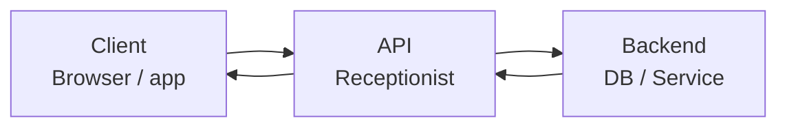
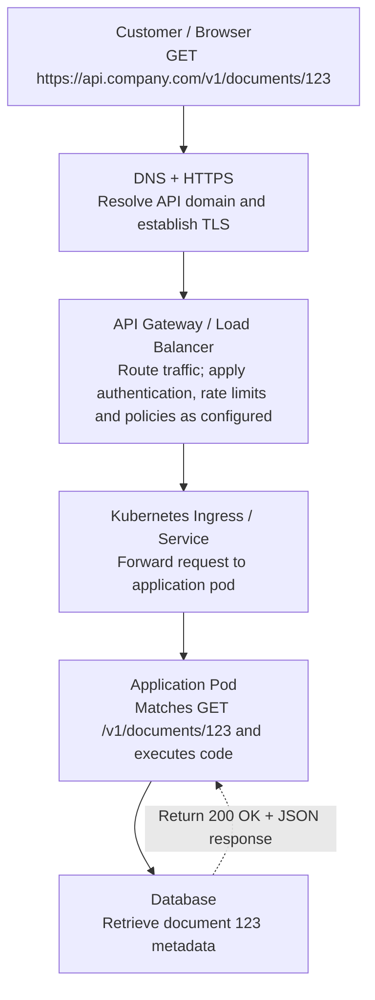

Let's understand this from the basics, using our **Apple SRE system design interview scenario: designing an API to create, retrieve, update, and delete document metadata.**

We will cover what an API is, what endpoints are, how we expose them, and then REST vs GraphQL vs other technologies.

## 1. What is an API?

**API = Application Programming Interface.**

Think of an API as a receptionist who accepts your request, forwards it to the correct department, and returns the response.

For example, you open an application and click **View Document**.



Request → Process → Response

The API allows the frontend to talk to backend systems without needing to know how the database works.

## 2. What is an API endpoint?

An **endpoint is a specific address where a client sends a request to perform an operation.**

Example:

`https://api.company.com/v1/documents/123`

Let's break it down.

| Part | Meaning |
|---|---|
| `https://` | Secure communication |
| `api.company.com` | API domain name |
| `/v1` | API version 1 |
| `/documents` | Resource: documents |
| `/123` | Specific document ID |

Imagine a bank:

- One counter lets you deposit money.
- Another counter lets you withdraw money.
- Another counter tells you your balance.

API endpoints work similarly, except the request goes to a URL.

## 3. How do we expose endpoints?

Your interviewer asks:

"Customers need to create, retrieve, update, and delete document metadata. What API endpoints would you expose?"

First understand **metadata**.

Suppose you upload `report.pdf` to S3. The actual PDF is the file, while its metadata describes it:

```json
{
  "document_id": "123",
  "filename": "report.pdf",
  "owner": "alice",
  "size": 204800,
  "status": "active"
}
```

For this application, I would expose the following REST endpoints:

| Action | HTTP method | Endpoint |
|---|---|---|
| Create metadata | `POST` | `/v1/documents` |
| Retrieve one document | `GET` | `/v1/documents/123` |
| Retrieve document list | `GET` | `/v1/documents` |
| Update all editable metadata | `PUT` | `/v1/documents/123` |
| Update specific metadata fields | `PATCH` | `/v1/documents/123` |
| Delete metadata | `DELETE` | `/v1/documents/123` |

**The important part:** In REST, we generally use the same resource address and change the HTTP method to indicate the operation.

### Your previous PATCH answer was correct

Suppose Alice wants to rename her document without changing the owner or other fields.

```http
PATCH /v1/documents/123
Content-Type: application/json

{
  "filename": "new-report.pdf"
}
```

The backend updates only the filename.

`PUT` generally replaces the resource's editable representation, while `PATCH` changes specific fields.

## 4. How does an architect technically expose these endpoints?

As an SRE, you already know many of these infrastructure components.



"Expose" has two meanings:

1. **Application level:** Developers register the API routes (`GET /documents/{id}`) and implement the associated logic.
2. **Infrastructure level:** We make those routes accessible through a domain, gateway or ingress, TLS, networking and security controls.

For a private enterprise API, we may expose it only internally rather than on the public internet.

---

## 5. What is REST?

**REST = Representational State Transfer.**

Forget the complicated name. REST is a way of designing APIs around resources, such as documents, users, orders or payments.

REST commonly uses HTTP methods:

- `GET` — Read
- `POST` — Create
- `PUT` — Replace
- `PATCH` — Modify part of something
- `DELETE` — Remove

REST APIs commonly return JSON, although REST doesn't require JSON.

### Real example

You ask:

```http
GET /v1/documents/123
```

Server responds:

```json
{
  "document_id": "123",
  "filename": "report.pdf",
  "owner": "alice"
}
```

Simple. You requested one resource and received its details.

One important REST property is **statelessness**: each request should carry enough information for the server to understand and process it without depending on a previous request's session state.

## 6. What is GraphQL?

GraphQL is another way for applications to ask backend systems for data.

Imagine the backend stores 20 fields for a document.

But your mobile application only needs the document ID and filename.

With GraphQL, the client can explicitly ask for those fields.

```graphql
query {
  document(id: "123") {
    document_id
    filename
  }
}
```

Response:

```json
{
  "data": {
    "document": {
      "document_id": "123",
      "filename": "report.pdf"
    }
  }
}
```

Unlike REST's common multiple-resource-endpoint approach, GraphQL commonly uses **one endpoint**, such as:

`POST /graphql`

Inside the request, the client specifies what data or operation it needs.

GraphQL has three main operation types:

| Operation | Purpose |
|---|---|
| Query | Read data |
| Mutation | Create, update, delete |
| Subscription | Receive ongoing updates |

GraphQL is not a database. It is a query language and API execution model.

## 7. REST vs GraphQL — Simple comparison

### REST

"Give me the document resource."

`GET /documents/123`

- ID: 123
- Name: report.pdf
- Owner: Alice
- Size: 204800

Server-defined response, which can be designed to be small or large

### GraphQL

"Give me only these fields."

`POST /graphql`

Fields: id, filename

- ID: 123
- Name: report.pdf

Client selects the fields it needs

| Feature | REST | GraphQL |
|---|---|---|
| Endpoints | Usually multiple paths | Usually single `/graphql` |
| Data returned | Backend defines response | Client requests fields |
| Learning difficulty | Easier | More concepts |
| Caching | HTTP caching often straightforward | More involved |
| Complex related data | May need multiple requests | Can combine into one query |
| Best suited for | Straightforward CRUD APIs | Flexible client data needs |

REST is not inherently slower than GraphQL, nor does GraphQL always require fewer backend queries.

## 8. What other types of APIs are popular?

| Technology | Simple explanation | Common use |
|---|---|---|
| **REST** | Access resources through HTTP methods | Web and mobile applications |
| **GraphQL** | Ask for exactly the data you need | Applications with complex data needs |
| **gRPC** | Call functions on another service, often using efficient binary messages | Microservice-to-microservice communication |
| **SOAP** | Strict XML-based messaging protocol | Legacy enterprise, banking integrations |
| **WebSocket** | Keep a connection open and communicate in both directions | Chat, live notifications |
| **Webhooks** | Another system calls your endpoint when an event occurs | Payment notifications, GitHub events |

You have already worked with WebSockets in our messaging system design. In that case, we kept a persistent connection between the user and WebSocket Gateway pods, rather than asking the server repeatedly for new messages.

## 9. Which API design should we choose for the Apple document metadata system?

I would select **REST**.

Why?

1. We have clear resources: documents and their metadata.
2. The main operations are create, read, update and delete.
3. REST is straightforward for clients to consume, document, secure and monitor.
4. HTTP methods and response codes make troubleshooting easier.

We would also implement OAuth 2.0 for access delegation, OIDC for user authentication where needed, and authorization checks to verify whether the caller may access a specific document. A JWT access token is one common way to convey access information.

### Interview-ready answer (60 seconds)

> For a document metadata service, I would design a RESTful API because our requirements are primarily CRUD operations.
>
> I would expose POST /v1/documents for creating metadata, GET /v1/documents/{id} for retrieval, PATCH for partial updates, PUT for replacement, and DELETE for removal.
>
> The endpoints would be accessible through an API Gateway and Kubernetes ingress, which route requests to the application service. I would secure them using OAuth 2.0 access tokens, enforce document-level authorization, apply rate limiting, and implement proper HTTP status codes.
>
> I would consider GraphQL if multiple clients needed significantly different combinations of metadata fields or complex related data.

---

## 10. Quick knowledge check

**Scenario:** A customer wants to update only the filename of document `123`, without modifying its owner or size.

Which API call would you select?

- GET /documents/123
- POST /documents/123
- PATCH /documents/123
- DELETE /documents/123

---

## Follow-up Q&A

### Q: My answer for updating only the filename is: PATCH. Check my answer and continue with the next API design interview question.

**Correct! PATCH is the right answer.**

You want to update only the filename without modifying any other metadata fields.

```http
PATCH /v1/documents/123
Content-Type: application/json

{
  "filename": "updated-report.pdf"
}
```

**Interview takeaway:**
- `PATCH` → Partial update of a resource.
- `PUT` → Typically replaces the resource's editable representation.
- `GET` → Retrieve data.
- `POST` → Create a resource.
