# iCloud Drive-Like System Design — Upload, Download, List, Search, Sync and Multi-Region DR

> **Apple ASE SRE interview notes (30–45 min).** This is a proposed educational architecture, **not** a description of Apple's private implementation. AWS components are primary; Azure equivalents are shown in parentheses. Keep the diagrams separate and top-to-bottom for legibility on GitHub.

## 1. Requirements and central idea

**Features:** upload files, download/resume, list files and folders, search filenames, propagate changes between Mac/iPhone/web, retry safely, and recover from AZ/region failures.

**Three responsibilities:**
1. **Metadata/control plane** — who owns a file, its path, permissions, object key, version, upload state and change history.
2. **File/data plane** — the bytes in object storage.
3. **Sync plane** — tells other devices what changed; transfers only necessary data where practical.

**Key decision:** normal large file uploads/downloads go **client ↔ S3**, not through Kubernetes application pods. The API checks permissions and issues scoped, short-lived signed URLs.

## 2. Components

| Component | Main logic | AWS (Azure alternative) |
|---|---|---|
| Mac/iPhone/web client + sync agent | Detect changes; retries; local cache, change cursor | Native/browser client |
| Global/API routing | TLS, authentication, throttling, health-based traffic routing | Route 53/Global Accelerator + ALB/API Gateway (Front Door/Application Gateway/APIM) |
| AuthN/AuthZ | Identity and authorization to file/folder | Identity service/OIDC |
| Metadata and upload service | Upload sessions; signed URLs; file versions; permissions | EKS pods (AKS pods) |
| Metadata database | File hierarchy, status, version, outbox, change log | RDS PostgreSQL (Azure Database for PostgreSQL) |
| Object storage | Durable file contents | S3 Standard (Azure Blob Storage) |
| Redis (optional) | Cache hot folder/file metadata; never source of truth | ElastiCache (Azure Managed Redis) |
| Queue + workers | Async notification, indexing, cleanup, reconciliation | SQS (Service Bus) + worker pods |
| Search index (optional) | Fast advanced filename/full-text search | OpenSearch (Azure AI Search) |
| Notification service | Wake devices so they can fetch changes | Push/WebSocket + polling fallback |
| Observability | SLIs, errors, latency, queue lag, replication lag | CloudWatch/Prometheus/Grafana (Azure Monitor) |

### Diagram 1 — High-level architecture

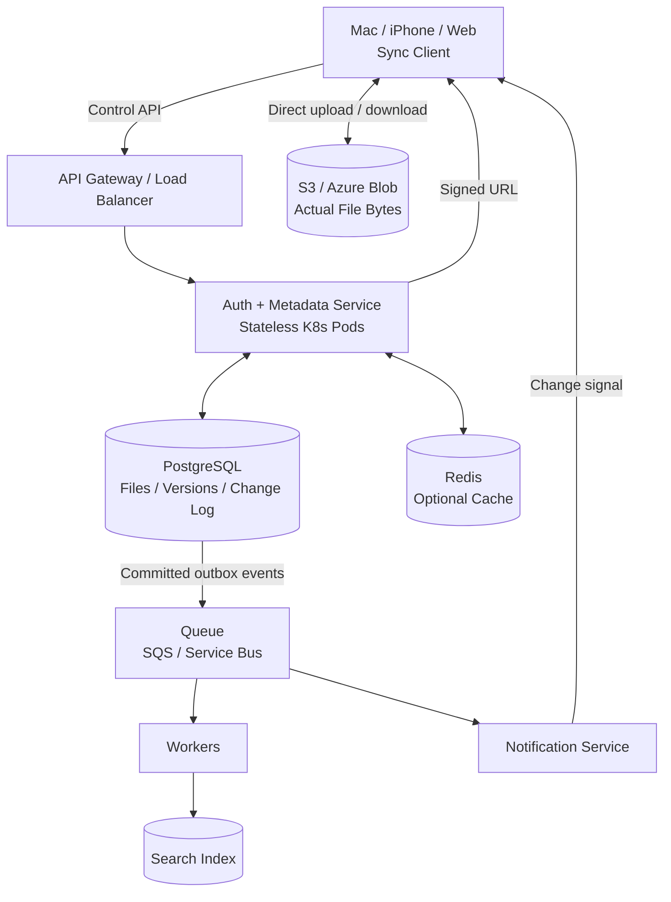

**Why a database if S3 has object names?** Efficient folders, owner checks, pagination, quotas, version conflicts, change feed, and transactional metadata are not provided by S3 object listing alone.

## 3. Upload path

Example: a Mac uploads a **500 MB** video. Illustrative choice: five 100 MB parts; actual part sizes are configurable and constrained by object-storage limits.

### Diagram 2 — Upload path (including retries and commit)

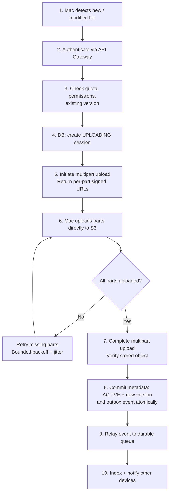

**Step-by-step logic**

1. Client records file ID, base version and a stable request/idempotency ID; optionally calculates a full-file checksum.
2. API checks identity, folder ACLs, quota and concurrent-version preconditions.
3. DB saves upload session (upload ID, owner, target key, status, expiry).
4. Backend creates multipart upload and provides short-lived URLs for permitted parts.
5. Client PUTs parts directly to S3, potentially in bounded parallelism; retains successful part identifiers.
6. Interrupted transfers retry **only incomplete parts**, with timeout/backoff/jitter.
7. Completion process assembles parts, verifies object existence and expected integrity/size. A multipart ETag is **not generally** a whole-file MD5.
8. Metadata transaction changes UPLOADING → ACTIVE, writes immutable new file version, appends a change-feed record and outbox event.
9. Outbox publisher retries delivery to queue; consumers are idempotent.
10. Indexing/notifications are asynchronous. Failed notifications never lose the authoritative change feed.

**If S3 succeeded but DB commit failed:** don't mark upload successful. Reconciliation finds completed-but-uncommitted objects/sessions, retries safely, and garbage-collects abandoned uploads. **If client retries completion:** reuse idempotency key; never create duplicate committed versions.

**Important distinction:** multipart upload makes **one whole-object transfer** resumable; it does not automatically find changes within an earlier version of the object.

## 4. Download path

### Diagram 3 — Download and resume

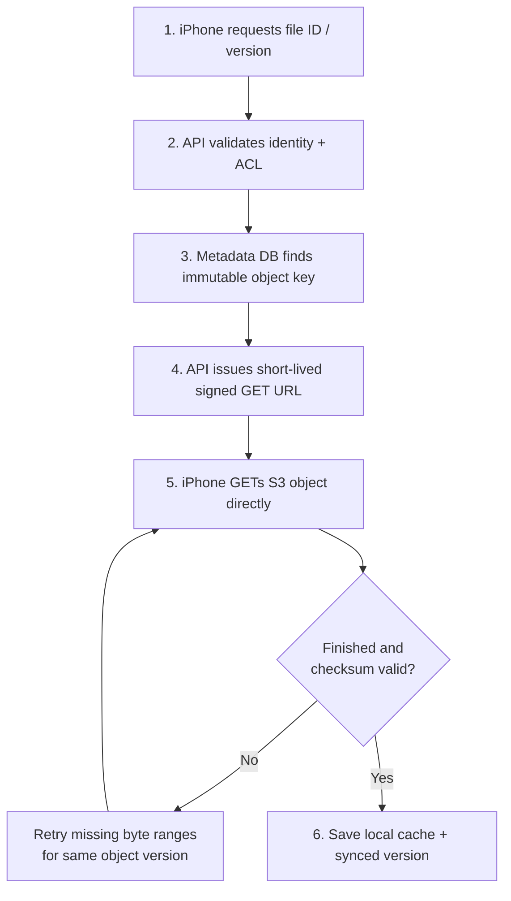

- On disconnect after 300 MiB, an HTTP **Range: bytes=314572800-** request can fetch remaining bytes; use the same immutable object version/ETag precondition.
- A signed GET URL must be short-lived and scoped to one authorized object; keep buckets private, use TLS and encryption at rest.
- A CDN is optional; avoid unauthorized sharing and accidental caching of private files.
- If a regional bucket is unavailable, issue a **new** URL for a confirmed replica only after application failover.

## 5. List files and search files

### Diagram 4 — List versus search

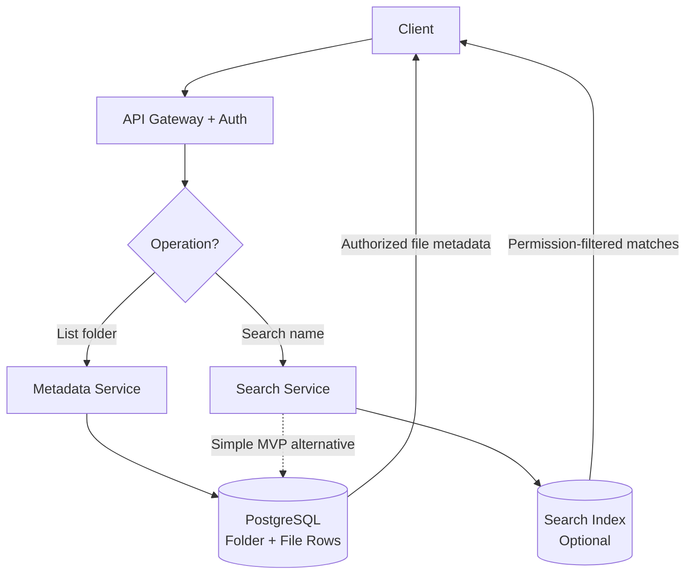

- **List:** GET /folders/{id}/files?limit=50&cursor=... → DB index on owner + parent folder + ordering key; cursor pagination.
- **Search:** GET /files/search?q=report → for MVP, PostgreSQL indexed filename search; later OpenSearch for large scale. Always enforce user/folder permissions.
- Do **not** enumerate S3 bucket contents for every file listing.
- Search can lag a committed upload; source-of-truth folder listing need not wait for indexing.

Example DB schema (simplified):

| file_id | owner_id | parent_id | name | version | status | object_key |
|---|---|---|---|---|---|---|
| F101 | U42 | ROOT | resume.pdf | 3 | ACTIVE | u42/F101/v3 |
| F102 | U42 | ROOT | video.mp4 | 1 | ACTIVE | u42/F102/v1 |

## 6. Synchronization (rsync vs change feed vs multipart)

**Two separate problems:**
- **Device/metadata sync:** what changed since this device last checked?
- **Content/delta sync:** how much file content must be transferred?

### Diagram 5 — Mac to iPhone synchronization

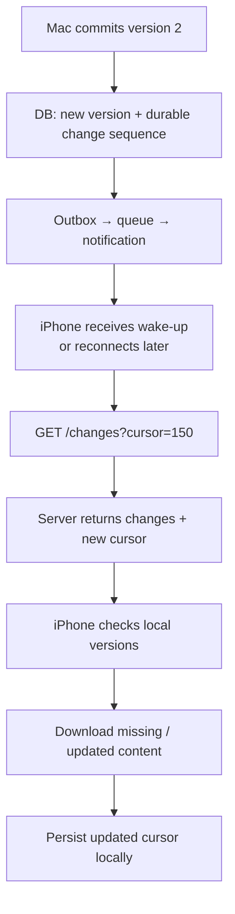

- Notifications are **hints**, not the correctness mechanism: iPhone might be offline.
- Each device keeps an opaque change cursor. On reconnection, fetch every relevant change since last cursor, then persist new cursor only after safely applying changes.
- Maintain file versions and optimistic-concurrency checks. If Mac and iPhone both edit starting from v4, don't overwrite silently; return a conflict and preserve both copies or provide explicit merge semantics.
- Deletes require a durable change/tombstone so offline devices learn about deletions.

### Diagram 6 — File-level delta concept

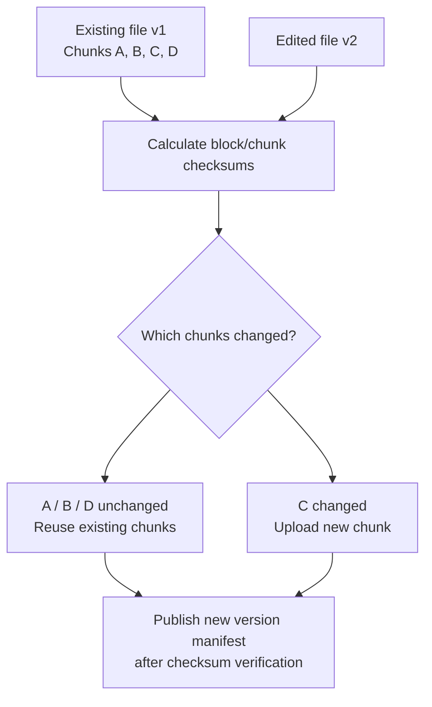

**Whole-file:** simplest; changed file re-uploads as a new object version.  
**Multipart:** splits a transfer; retries parts, no cross-version dedup by itself.  
**rsync-style delta:** uses rolling + strong checksums to recognize unchanged data and transmit differences; requires server reconstruction or suitable chunk storage.  
**Content-defined chunking:** hashes variable chunks; new manifests reference existing + new immutable chunks; introduces garbage collection, chunk ACL/dedup and integrity complexity.

**Recommendation:** MVP = whole-file version uploads + multipart for large objects + durable change feed. Add delta upload only if measured network savings justify complexity.

## 7. Scaling the system

### Diagram 7 — What scales independently

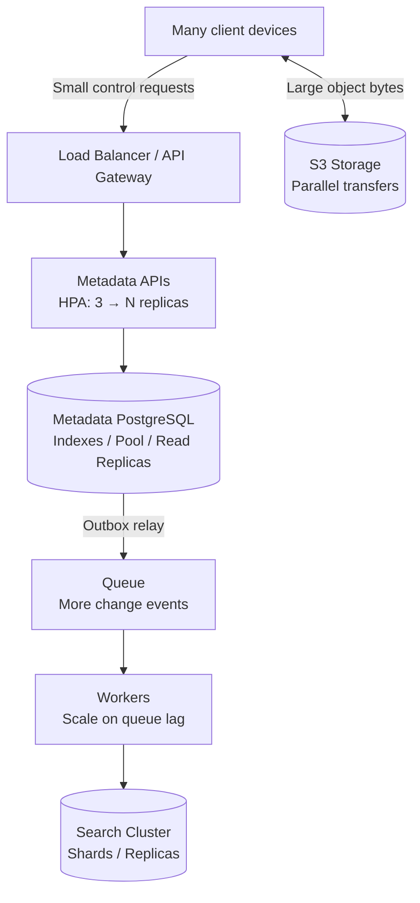

| Bottleneck | First response | Next step |
|---|---|---|
| API CPU / latency | HPA, health checks, stateless sessions | Optimize endpoints / rate limit |
| DB read throughput | Indexes, connection pooling, read replicas | Cache, shard by owner when proven necessary |
| DB write throughput | Reduce write amplification, tune DB | Partition/shard by user/tenant |
| Large file throughput | Client → object storage, bounded parallel multipart | Monitor 503 Slow Down; retry w/backoff |
| Queue lag | Scale workers on age/depth | DLQ, tune consumer cost |
| Search latency | More index/search capacity | Shards, tune queries, enforce ACL filtering |
| Hot folders / abuse | Pagination, rate limits, quotas | Isolate hot tenants |

**Watch-out:** more API pods can exhaust PostgreSQL connection limits; DB is not automatically fixed by HPA.

## 8. Failure handling

### Diagram 8 — Upload failure decision flow

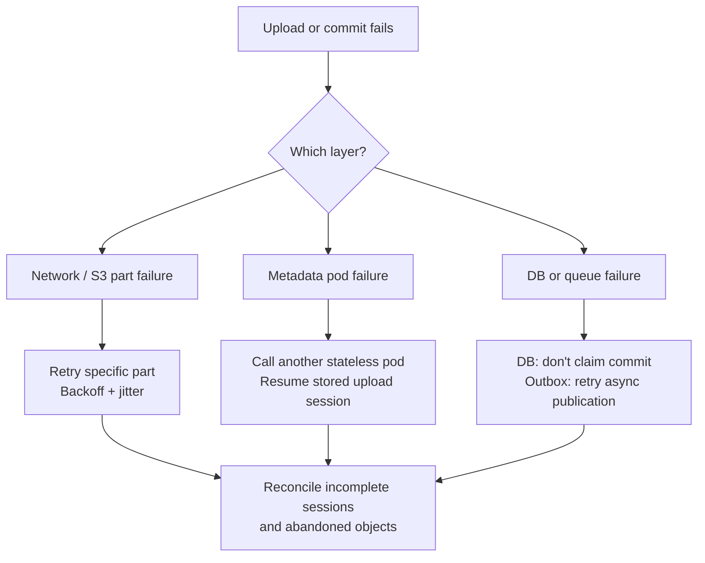

| Failure | Impact | Recovery |
|---|---|---|
| Metadata pod crashes | Control-plane request fails; direct in-flight S3 transfer may continue | Replace pod; client retries against another pod; session in DB |
| DB primary outage | Listing/commits fail | HA failover; backpressure; reconcile pending sessions |
| Redis outage | Cache miss/DB load rises | Bypass cache; circuit breaker; protect DB |
| S3 request fails | Upload/download interruption | Retry part or byte range; do not retry without bound |
| Queue outage | Search/notifications delayed | Durable DB outbox relay resumes later |
| Search index outage | Search unavailable/stale | File list/download still work; replay index events |
| Notification outage | Devices not immediately notified | Poll GET /changes from saved cursor |
| Indexing worker crashes | Index lag | Retry, DLQ, idempotent consumers |
| Two devices modify v4 | Overwrite risk | Compare-and-swap version check; conflict copy |
| DB points to missing object | Broken download | Verify object availability; reconcile; report temporary unavailable |

**SRE signals:** upload success rate; multipart completion age; download errors; p95/p99 metadata latency; DB pool saturation and replication lag; S3 5xx; queue oldest-message age; change-sync lag; search indexing lag; orphaned objects; regional replication lag.

## 9. Is Amazon S3 global or regional?

**Bucket storage is regional.** You can access a bucket over the network from anywhere, but an ordinary S3 bucket is created in a specific AWS Region. S3 Standard stores objects redundantly across **at least three Availability Zones in that Region**. It does **not** automatically copy them into a different AWS Region.

### Diagram 9 — Single-AZ failure inside one Region

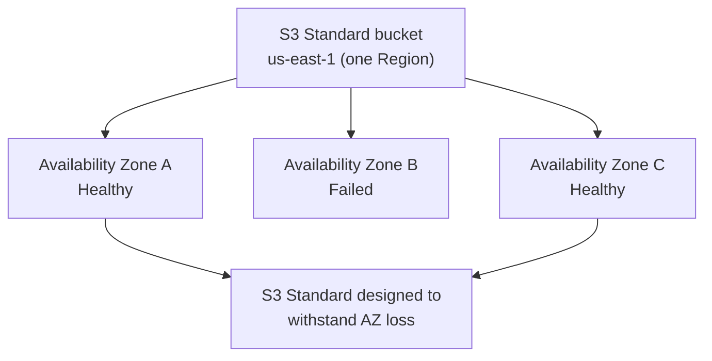

**One AZ down:** redundancy across AZs means normal S3 Standard data access is designed to survive that failure (subject to real operational service health). Note: S3 One Zone storage classes have different resilience.

**Whole Region down:** primary-region access can become unavailable; multi-AZ copies in that same Region are insufficient.

## 10. Multi-region disaster recovery: S3 CRR + database + applications

Use **active/passive** as the initial design. Region 1 serves traffic; Region 2 is warm standby. The two replication channels are **separate**:

1. **S3 Cross-Region Replication (CRR):** bucket → another bucket, asynchronous; requires correct configuration (e.g. versioning, IAM, encryption/key permissions).
2. **PostgreSQL replication:** independent DB replica mechanism, asynchronous in this example.

CRR does not automatically replicate database state, EKS resources, routing, or all application secrets/configuration.

### Diagram 10 — Region failure and failover architecture

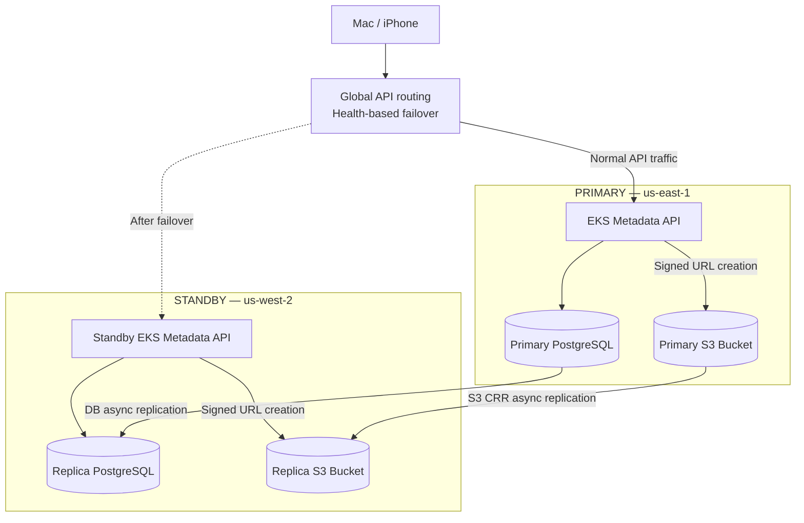

**Important clarification:** application APIs issue signed object URLs; the bytes travel directly **from the client to the bucket**, even though arrows within the region above show where the API gets object target information.

### Diagram 11 — Safe regional failover sequence

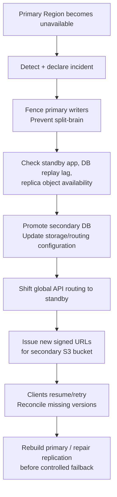

**Why failover both storage and DB?** Even if files are copied, the application needs correct file-version metadata and permissions to safely list or retrieve them.

**What about S3 Multi-Region Access Points (MRAP)?** These provide a global S3 access endpoint with routing/failover controls across regional buckets. They **do not by themselves** make object replication synchronous or fail over PostgreSQL/EKS. MRAP is an optional extension of this design.

### The critical edge case: regional failure before CRR catches up

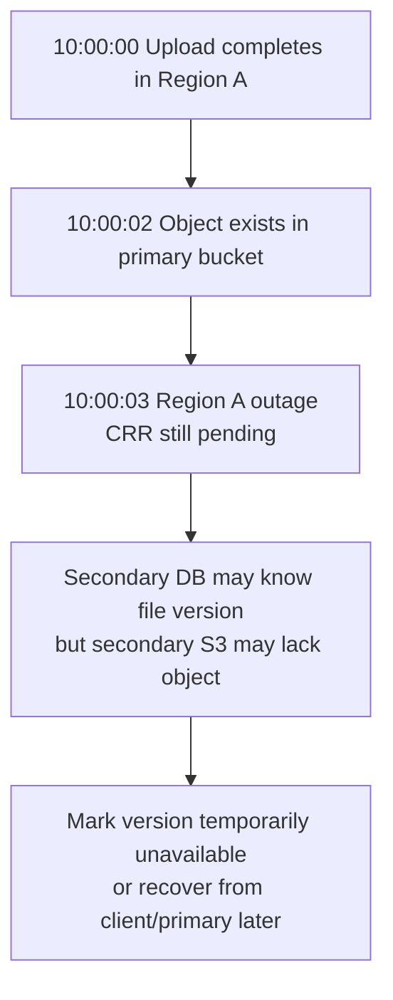

Do **not** promise zero loss with async CRR. Object missing in secondary may be *temporarily* unavailable or irrecoverable if the primary never recovers and the object was not replicated. Reconcile object existence against DB pointers. New uploads after failover go to standby only after writer fencing and consistency checks.

| Term | Meaning | What determines it here? |
|---|---|---|
| **RPO** | Maximum tolerable lost/unreplicated data | S3 and DB replication lag, which may differ |
| **RTO** | Maximum tolerated time to restore usable service | Detection, fencing, DB promotion, routing, client retries and reconciliation |
| **Availability** | Can users list and access valid file versions? | Apps + metadata DB + required object replicas, not bucket health alone |

To target near-zero RPO, an option is to acknowledge a new upload as cross-region-protected **only after both object and metadata are verified durably in both regions**; this trades increased latency and operational complexity for stronger guarantees.

### Region scenarios in one table

| Scenario | Expected behavior |
|---|---|
| One AZ in primary fails | S3 Standard is designed to remain available; EKS/RDS require their own multi-AZ architecture |
| Primary region unavailable, replicas current | Promote secondary DB and app, shift traffic, issue secondary signed URLs |
| Replica bucket missing latest object | Do not return false success; report temporary unavailability and reconcile |
| Secondary DB behind S3 replica | Do not serve an object as an authorized file until metadata reconciled |
| Upload interrupted during region failover | New regional session and safe client retry/idempotency; do not assume old multipart upload moved across regions |
| Primary region returns | Compare divergent metadata/objects, repair, and perform controlled failback |

## 11. Complete mental model — Mac upload to iPhone download

### Diagram 12 — End-to-end combined flow

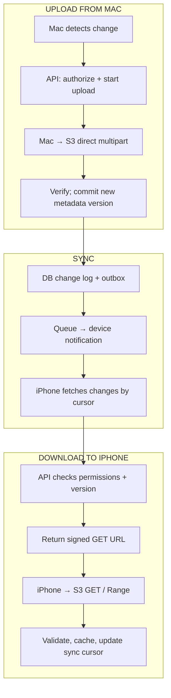

**Memorize:** **Metadata DB → Object Storage → Multipart Transfer → Durable Change Feed → Other Device → Region Failover.**

## 12. Apple ASE SRE follow-up Q&A

**Q1. Why not store bytes in PostgreSQL?**  
The DB handles transactional metadata; object storage is optimized for large durable blobs, direct transfers and high throughput.

**Q2. Can multipart upload resume a changed file without sending unchanged bytes?**  
No. Multipart retries missing parts for the current upload; cross-version delta sync needs additional checksum/diff logic or a chunk store.

**Q3. What if a pod crashes halfway through uploading?**  
Direct S3 transfer may continue. Session state is persisted in DB. Another stateless pod handles follow-up API calls.

**Q4. What if S3 completes but the DB goes down?**  
Keep uncommitted session; reconcile object and DB, use idempotent commit. Never claim metadata is active before the commit.

**Q5. What if the device was offline during notifications?**  
Fetch all changes since persisted sync cursor; notifications are hints only.

**Q6. Why queue/outbox?**  
Metadata commit and event delivery must survive worker/queue outages without losing a file-change notification.

**Q7. What if the search index is down?**  
Degrade search; list/download still rely on authoritative metadata DB and storage.

**Q8. What if 100,000 users upload 500 MB concurrently?**  
Use client-to-S3 transfer; control-plane APIs scale separately; cap client multipart concurrency, throttle, and monitor S3/DB/queue limits.

**Q9. Is S3 global?**  
No: a standard bucket is regional; access is global over the network, but redundancy is multi-AZ within its Region.

**Q10. Is one AZ failure the same as Region failure?**  
No. Multi-AZ S3 Standard protects AZ failure scenarios. Region-wide DR needs another region and a full-stack recovery plan.

**Q11. Does CRR guarantee zero data loss?**  
No, asynchronous CRR has lag. RPO depends on both bucket and metadata replication.

**Q12. Does MRAP replace CRR or DB failover?**  
No; MRAP is S3 routing, not application/DB failover, and it doesn't make replication synchronous.

**Q13. What if two devices edit version 4 at once?**  
Check expected version in DB at commit. Reject stale write and save a conflict version instead of silent overwrite.

**Q14. Which SRE dashboards would you create?**  
API error/latency, upload completion time, abort rate, S3 failures, DB replication/pool saturation, queue age, missed sync cursor backlog, and cross-region replication lag.

---

### Recommended interview explanation (90 seconds)

> I split the design into three parts: a metadata control plane, an object-storage data plane and a device synchronization plane. The client asks stateless API services to authorize an upload and create a session; then it uploads file parts directly to S3 using signed URLs. After verifying the object, the API atomically commits the new metadata version and a change event. Other devices learn about it through push notifications plus a durable change cursor, then obtain their own signed URL to download the correct version, using range requests to resume. For scale I horizontally scale API pods and queue workers, optimize and replicate the metadata DB, and let object storage handle file-byte throughput. A bucket is region-specific, so for disaster recovery I deploy a standby region with separate S3 CRR and DB replication. On a regional outage, I fence writers, verify replica consistency, promote the DB, reroute the API and issue new regional download URLs. Because replication is asynchronous, I define an explicit RPO/RTO and never assume the newest unreplicated files are available.

### Further reading (official)

- AWS S3 multipart: https://docs.aws.amazon.com/AmazonS3/latest/userguide/mpuoverview.html
- AWS S3 replication: https://docs.aws.amazon.com/AmazonS3/latest/userguide/replication.html
- AWS S3 Multi-Region Access Points: https://docs.aws.amazon.com/AmazonS3/latest/userguide/MultiRegionAccessPoints.html
- AWS S3 resilience: https://docs.aws.amazon.com/AmazonS3/latest/userguide/DataDurability.html
